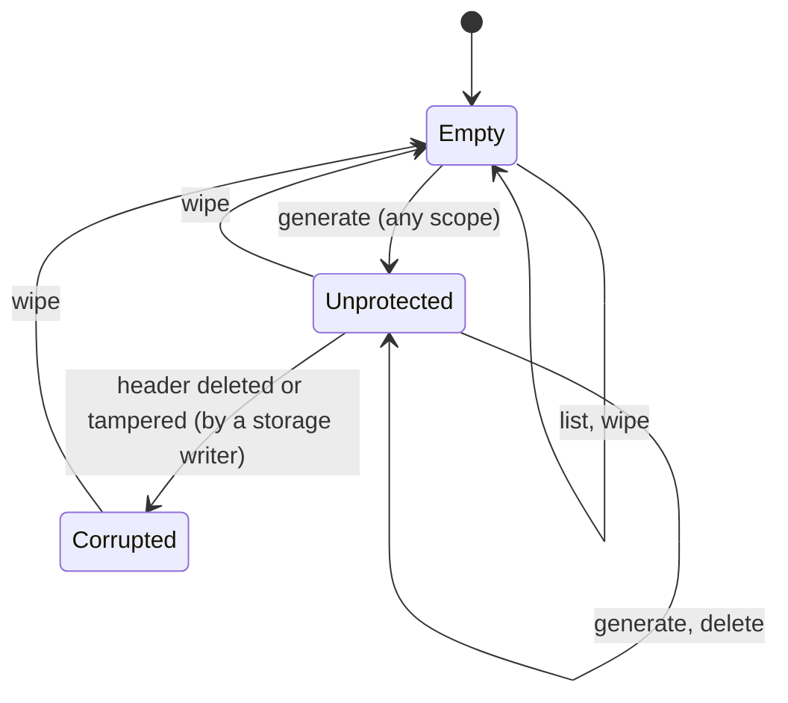

# Vault — Design

<!--
Template. Guidance lives in HTML comments; delete each comment once its section is written.
Rules for filling:
- Short as it can be while complete. Prefer tables and one-line statements over prose.
- Every guarantee names the code or test that enforces it (file:test name). No reference → write "not protected".
- Self-contained: the decision log is not in the repository, so state each decision's outcome and rejected alternatives here, without links or decision IDs.
-->

Test references: `storage ›` = `test/unit/storage.test.ts`, `records ›` = `test/unit/records.test.ts`, `vault ›` = `test/unit/vault.test.ts`, `key-types ›` = `test/unit/key-types.test.ts`, `e2e ›` = `test/e2e/demo.spec.ts`. Every unit test runs in Chromium, Firefox and WebKit; none is skipped.

## 1. Overview

Vault is a browser-native private-key store on IndexedDB. An application calls it to generate keys, list their public information and get signatures; private keys never leave it. Vault does not know or care what its keys sign.

| Goal | Status | Where |
|---|---|---|
| No plaintext keys at rest | Built (unprotected mode), for every key type | §3.1, §4.1 |
| Optional, upgradeable protection | Format ready; upgrade not built yet | §3.1, §5 |
| Cheap to add, gated to use | Adding needs only the public wrapping key, for every key type | §3.1 |
| Many key types, one model | ed25519 and secp256k1 behind one key-type interface; no core file names a type | §7.5 |
| Correct under concurrency and failure | Atomic writes, fail-closed reads; multi-tab not tested yet | §4.2, §6 |
| A small, idiomatic domain API | Scopes, keys, labels, signatures; no records or ciphertext in the API | §7 |

## 2. Threat model

### 2.1 Assets

| Asset | Secret? |
|---|---|
| Private key material (ed25519, secp256k1) | Yes. Never leaves Vault through the API. |
| Wrapping private key: decrypts every private key | Yes. In unprotected mode it is the root secret. |
| Integrity of key records: Vault signs only with the key whose public key it lists | — |
| Protection state (unprotected or passkey-protected) | Not built yet |
| Key metadata: id, scope name, type, public key, createdAt, label | No. Stored in the clear, readable by anyone who can read storage. `list()` returns labels as stored, unchecked (§2.3), so callers should show them as plain text. |

### 2.2 Adversaries and events

| Adversary or event | Capability |
|---|---|
| Profile or disk copy | Reads every IndexedDB file, offline, at any later time |
| Storage writer: same-origin script, or someone editing the profile | Adds, edits, swaps, deletes any record; reads every public field |
| Snapshot restore | Puts back an older, internally consistent copy of the database |
| Same-origin script | Runs in the origin: calls the Vault API on any scope, opens the database itself, and uses the stored CryptoKeys |
| Eviction, crash, closed tab | Storage is removed as a whole; a transaction is cut off midway |

Trusted: the browser, its WebCrypto and IndexedDB implementations, the OS, origin isolation, and the pinned `@noble/curves` and `@noble/hashes` packages (§3.3).

### 2.3 Guarantees per case

| Adversary or event | Mode | Guarantee | Not guaranteed | Enforced by |
|---|---|---|---|---|
| Copy of the browser profile or disk | Unprotected | Private keys are stored only as AES-256-GCM ciphertext. The only stored secret is the wrapping private key, a non-extractable CryptoKey held by the browser, and without it nothing decrypts. | **Not protected against a profile copy.** The browser keeps the root key's bytes in the profile, so the copy, opened in the same browser or parsed, recovers every key. | `storage › no private key bytes are stored, for any key type…`, `› decrypting needs the root key… (ed25519, secp256k1)` |
| | Protected | Not built yet | | |
| Records added or replaced by anyone who can write to storage | Both | `list()`, with no secret, rejects with `corrupted`: a field of the wrong type, length or form; a public key that is not a valid point of its type (ed25519: strict RFC 8032 decoding; secp256k1: a compressed point on the curve); an ill-formed string; a malformed label or scope name; an edited id, type, public key or version; a record moved to another scope with its id kept, because the id binds the scope. A well-formed type name this build doesn't know is `incompatible` (§4.3). `sign()` rejects with `corrupted` an edit to any other field: a changed byte, an edited, removed or added label, swapped ciphertexts, an off-curve ephemeral key. It also rejects a record moved to another scope with its id recomputed, since the associated data binds scope and id; a key the attacker sealed to the public wrapping key, which decrypts cleanly and is caught by the signature check before returning; a secp256k1 plaintext that is not exactly 32 bytes and in [1, n−1]; and an ed25519 key with a degenerate public key, in every engine. Key records without a header are never treated as a new vault. | A complete new key record needs no secret, so an added key can't be told from a real one, **whatever label it carries: label spoofing is not prevented**; callers that need assurance pin key ids. `list()` doesn't detect edits to createdAt, the label or the ciphertext; they surface when the key is used. A moved record with a recomputed id is listed in its new scope until used. Deleting records isn't detected. A replaced header is not detected at list time (§11). A record planted with a made-up but well-formed type name reads as `incompatible`, not `corrupted`. | `storage › editing <field> of a key record fails closed` (9 fields × 2 types, plus a coverage check), `› a label removed…`, `› changing a field type…` (6 cases), `› a planted <type> key whose public key has the wrong length…`, `› a planted ed25519 key whose public key is the identity point / a point with a small y…`, `› ciphertexts swapped…`, `› a key an attacker sealed…`, `› an off-curve ephemeral public key…`, `› a key record moved to another scope with its id recomputed / kept…`, `› a key of a type this build does not know…`, `records › a malformed key record field…` (30 cases), `key-types › a public key is stored as a 33-byte compressed point…`, `› a planted key whose sealed scalar is…` (5 cases), `vault › key records without a vault header…` |
| Older storage snapshot restored | Both | — | **Not detected.** A consistent older copy is a valid state: keys deleted since then reappear, keys added since then vanish. IndexedDB is the only store, so there is nowhere to anchor a counter. | not protected |
| Malicious script in the same origin while unlocked | Unprotected | The API never returns private key bytes. Vault keeps no secret in memory between calls. A `Scope` exposes only its name and key operations, not its `Vault`, so code that is handed only a Scope can't wipe the vault or reach it through that object. | **Not protected.** The script can open any scope (`vault.scope(name)` needs no secret) and sign with every key. It can open the database and use the root key to unwrap every key as extractable, which exfiltrates them. **Scopes are namespaces, not isolation.** | `src/scope.ts` (no export method), `vault › a Scope exposes its name and key operations, and no way to reach its Vault` |
| Lost, deleted or replaced passkey (protection passkey) | Protected | Not built yet | | |
| Lost, deleted or replaced passkey (passkey key) | Both | Not built yet | | |
| Secrets in memory | Both | ed25519 private keys exist only as CryptoKey objects: sealed with `wrapKey`, opened with `unwrapKey` into a non-extractable key, never as JS bytes. secp256k1 private keys are JS bytes only while a key is generated (until it is stored or the call fails) and while it signs. Vault zeroes the buffers it owns: the key-generation seed, the generated scalar and each decrypted scalar, on failure paths too. Per-key AES keys and the ECDH result stay inside `deriveKey`. | JS can't zero memory reliably: noble's bigints and its internal byte copies (the RFC 6979 seed and HMAC-DRBG state) are not zeroed, and the engine may copy buffers. The browser may hold internal copies of CryptoKeys. A CryptoKey lives until garbage collection. | `src/ed25519.ts`, `src/secp256k1.ts`, `src/seal.ts`, `key-types › Vault zeroes the secret buffers it owns…`, `› a generated key is disposed when generate fails…` |
| Storage evicted by the browser | Both | An empty database behaves as a new vault. | Can't be told apart from a vault that was never used or was wiped. Requesting persistent storage: not decided yet. | `vault › opening and listing write nothing; the first generate creates the vault` |
| Crash or closed tab mid-operation | Both | Every multi-record change is one IndexedDB transaction, so a crash leaves the old state or the new one. A transaction that aborts, even after its body has run, fails the call with `unavailable` and writes nothing. | A real process crash is not simulated; aborted transactions are. | `vault › the first generate writes header and key atomically…`, `› a write that aborts at commit…`, `› wipe is one transaction…`, `src/db.ts` `transact` |

### 2.4 Out of scope for the threat model

- A compromised browser or OS, and malicious browser extensions: they see everything the page sees.
- Preventing XSS. Vault limits what injected code gets (§2.3); it doesn't stop the injection.
- Physical and side-channel attacks on the machine or the authenticator.
- Timing side channels in JS. ed25519 secret work runs in WebCrypto. secp256k1 runs in noble, which aims for algorithmic constant time and blinds the scalar multiplication and nonce inversion, but whose README says JIT and garbage collection rule out guarantees.

## 3. Key protection

### 3.1 Key hierarchy

```
vault wrapping key pair — ECDH P-256, one per vault (shared by every scope), in the header record
├─ public half: SPKI, stored in the clear. Sealing a new key needs only this, so adding a key never needs an unlock.
└─ private half
   ├─ unprotected: stored as a non-extractable CryptoKey (usage deriveKey only)
   └─ passkey-protected: not built yet (wrapped under a passkey-derived key; never stored in the clear)

private key (one per key record), sealed by ECIES:
  ephemeral P-256 key pair → ECDH with the wrapping public key → HKDF-SHA-256 (info = both public keys)
  → AES-256-GCM (random 96-bit IV, AAD = every stored field of the record)
  → the key type seals its private key with that cipher:
       ed25519:   wrapKey('pkcs8'), inside WebCrypto
       secp256k1: encrypt() of the raw 32-byte scalar
```

- **Unprotected mode is protected only by the browser.** The root is a CryptoKey that JS can use but not read. That stops a leaked record dump or log from revealing keys, but not a profile copy or same-origin code (§2.3).
- **Enabling protection (not built yet)** will generate a *fresh* wrapping key pair, re-seal every key to it and replace the header, all in one transaction. Rotating rather than rewrapping matters: a profile copy taken while unprotected, or leftover data the storage engine never overwrote, then can't decrypt keys added after protection is on.
- Exactly one passkey can unlock a vault.

### 3.2 Passkey keys

<!--
How a passkey is modelled as a key. User verification requirement.
Fresh device: how the user presents the passkey and Vault identifies which key it is.
What Vault stores about a passkey key and what it can do without that record.
-->

### 3.3 Primitives and dependencies

| Purpose | Primitive | Source | Why this source |
|---|---|---|---|
| Seal private keys | AES-256-GCM, random 96-bit IV, AAD | WebCrypto | Native in all engines |
| Key agreement for sealing | ECDH P-256, ephemeral–static | WebCrypto | Native. X25519 rejected: WebKit silently drops X25519 CryptoKeys stored in IndexedDB (they read back as `null`). |
| Key derivation | HKDF-SHA-256 over the ECDH output | WebCrypto | Native; done with `deriveKey`, so the shared secret never becomes JS bytes |
| Point validation (ephemeral keys) | SPKI import | WebCrypto | WebKit accepts off-curve points in `raw` and `jwk` import, but every engine rejects them in `spki`: `storage › an off-curve ephemeral public key is rejected…` |
| ed25519 key generation and signing | Ed25519 (RFC 8032) | WebCrypto | Native in all three engines; the private key stays a CryptoKey |
| ed25519 verification and public-key decoding | Ed25519, strict RFC 8032 (ZIP-215 off: rejects non-canonical encodings and small-order keys) | `@noble/curves` | WebKit's `crypto.subtle.verify` kills the page's process on some degenerate public keys a storage writer can plant; noble is pure JS and only sees public data: `key-types › signatures are checked with noble, never with crypto.subtle.verify…`, `› strict RFC 8032 verification…`, `storage › a planted ed25519 key whose public key is…` |
| secp256k1 keys and signatures | ECDSA over SHA-256(data), RFC 6979 nonces, low-S, r ‖ s; compressed SEC1 public keys | `@noble/curves` | No engine's WebCrypto has secp256k1. Every option is passed explicitly, and the published RFC 6979 vector pins them: `key-types › signs the published RFC 6979 vector exactly…` |
| secp256k1 prehash and nonce derivation | SHA-256; HMAC-SHA-256 DRBG (RFC 6979) | `@noble/hashes` (through `@noble/curves`) | Required by noble's ECDSA |
| Key ids | SHA-256 | WebCrypto | Native |
| Randomness | `getRandomValues`, `generateKey`; secp256k1 keys from a 48-byte `getRandomValues` seed reduced mod n | WebCrypto | Native |

**Third-party cryptographic dependencies.** `@noble/curves` 2.3.0 and its only dependency, `@noble/hashes` 2.3.0. Both are pure TypeScript and pinned exactly, and `package-lock.json` holds their integrity hashes (`npm audit signatures` verifies them). `@noble/curves` 2.3.0 is the most recent independently audited release (Trail of Bits, Aug 2026, full scope); the newer 2.4.0 has only self-audits, and its changes in the modules Vault uses harden against misuse that Vault's calls don't make. `@noble/hashes` was last independently audited at 1.0.0 (Cure53, 2022); 2.x has only self-audits. Rejected: WASM libsecp256k1 (a build toolchain and a larger third-party surface for the same job), and WebCrypto SHA-256 with noble's prehash off (one more step, and `@noble/hashes` stays for RFC 6979 anyway).

The sealing construction (`src/seal.ts`) composes native primitives in the shape of HPKE base mode: a one-time key per seal, both public keys in the KDF context, and AEAD with associated data. It is not wire-compatible with HPKE. A value sealed by the v1 code is kept as a known-answer test, `storage › a value sealed by format v1 still opens…`. Any change to the derivation fails that test, even when it alters `seal` and `unseal` alike and every round trip still passes.

## 4. Storage layout

### 4.1 Records

One IndexedDB database (default name `vault`); schema version 1.

| Store / record | Key | Contents | Encrypted | Integrity-bound to |
|---|---|---|---|---|
| `meta` / header | `'header'` | `v`, `wrappingPublicKey` (SPKI), `protection: { kind: 'none', privateKey: CryptoKey }` | The private key is a non-extractable CryptoKey held by the browser | Not integrity-protected (§11) |
| `keys` / key | `[scope, id]` | `v`, `scope`, `id`, `type`, `publicKey`, `createdAt`, `label` (only if given), `sealed: { ephemeralPublicKey (SPKI), iv, ciphertext }` | `ciphertext` only (ed25519: PKCS #8; secp256k1: the raw scalar) | `id` = SHA-256(scope, type, public key), checked by `list()`. AAD = every field except `sealed`. HKDF binds the ephemeral key and the wrapping public key. |

**Scopes.** The scope name is the first component of a key record's key, so one scope is one key range, and every scope shares the header, its wrapping key and (later) its protection. A scope name is any well-formed string of 1–1024 UTF-16 code units, so an origin fits; a label is one of 1–256. Both rules hold at the API (`TypeError`) and on every read (`corrupted`).

Every hashed or authenticated value goes through one canonical encoding (`src/bytes.ts` `encode`): each part is a type tag, a 4-byte length and its bytes. Strings are UTF-8, and only well-formed strings are accepted. A lone surrogate would become U+FFFD, so two different scope names would share an id and AAD while IndexedDB keeps them apart: `storage › a string with a lone surrogate is rejected…`. Bytes are only `Uint8Array`; integers are only safe non-negative values, as 8 bytes big-endian. So field boundaries can't shift, and `123` and `"123"` never encode alike: `storage › each value keeps its type…`. The exact bytes are part of format v1 and pinned by a known-answer test, `storage › encodes the exact v1 bytes…`. A label enters the AAD as the two tagged strings `'label'` and the label, after the v1 fields and only when present, so a record without a label keeps its exact v1 AAD: `records › keyAad of fixed labelled fields appends the tagged pair…`.

Code layout:
- `src/db.ts`: opening the database and the transaction helper. `src/connection.ts`: the connection a Vault and its scopes share.
- `src/storage.ts`: record access inside a transaction, store names, scope ranges. No crypto.
- `src/records.ts`: the format, parsing and validation.
- `src/seal.ts`: sealing.
- `src/key-types.ts`: the key-type interface and registry; `src/ed25519.ts`, `src/secp256k1.ts`: the key types.
- `src/vault.ts` (`Vault`) and `src/scope.ts` (`Scope`): the public API.

### 4.2 Validation and fail-closed behaviour

| Check | When | Failure |
|---|---|---|
| `v` is the number 1, never coerced (header and key records) | every read | `corrupted`: `storage › a header with format version 2 / '1' / true / undefined…`, `› editing v…`, `› changing a field type…: v as the string '1'` |
| Header fields have their exact types: wrapping public key bytes, a known protection kind, a CryptoKey root. A header key whose value is `undefined` (or `null`, which WebKit returns for an unreadable value) is malformed, not absent. | `list`, `generate`, `sign` | `corrupted`: `records › a malformed header field…` (6 cases), `vault › a header stored as undefined…`, `storage › a tampered wrapping public key makes generate fail closed…` |
| Key records without a header mean a deleted header, never a new vault: only `wipe()` works | `list`, `generate`, `sign`, in every scope (`src/storage.ts` `readHeader`) | `corrupted`: `vault › key records without a vault header are corrupted everywhere…` |
| The type, checked first: a registered name; a well-formed unknown name (lowercase letters, digits, hyphens, at most 32) means a newer build; anything else is malformed | `list`, `sign`, without any secret | `incompatible`: `records › a key of the unknown type … is incompatible…` (4 cases), `storage › a key of a type this build does not know…`; otherwise `corrupted`: `records › a malformed key record field…: type …` (5 cases) |
| Key record fields have their exact types and forms: scope and label by the rules in §4.1, a well-formed id, the public key a valid point of its type, createdAt a safe non-negative integer, sealed fields `Uint8Array`, a 12-byte IV, no `label: undefined` | `list`, `sign`, without any secret | `corrupted`: `records › a malformed key record field…` (30 cases), `storage › changing a field type…` (6 cases), `› a negative createdAt…`, `› a planted <type> key whose public key has the wrong length…`, `key-types › a public key is stored as a 33-byte compressed point…` |
| Id matches the hash of scope, type and public key | `list`, `sign`, without any secret | `corrupted`: `storage › editing id / type / publicKey…`, `› a key record moved to another scope with its id kept…` |
| Ephemeral key imports as SPKI → AES-GCM decrypt with AAD → the key type opens its plaintext (secp256k1: exactly 32 bytes, in [1, n−1]) → sign → verify against the stored public key | `sign` | `corrupted`: `storage › an off-curve ephemeral public key…`, `› ciphertexts swapped…`, `› a key an attacker sealed…`, `› a key record moved to another scope with its id recomputed…`, `› decrypting needs the root key…`, `key-types › a planted key whose sealed scalar is…` |
| Only the fields Vault writes: any other own field on the header, its protection, a key record or its sealed part is rejected | `list`, `generate`, `sign` | `corrupted` ("`<record>: unexpected field <name>`"): `records › an unexpected extra field on …` (4 cases), `› an extra field fails closed through the API…` |
| A version-1 database has Vault's stores | `open` | `corrupted`: `vault › a database without Vault stores…` |

Each field is read by a typed reader (`src/records.ts`), and the error names the field that failed, e.g. `Corrupted storage: key.sealed.iv`: `records › a malformed header field… / a malformed key record field…`. The parsers return new objects built from the read values, never the stored object. The typed encoding is a backstop, not a second classified check. If a reader check were ever missing, encoding the field for the id or the AAD throws a `TypeError` and the call fails instead of accepting the record; such a failure is not classified as `corrupted`. Vault never repairs: no code path writes back a record it failed to read. A failed check rejects the whole call, so `list()` fails if any key in the scope is bad; other scopes are unaffected.

### 4.3 Versioning and migration

- One number is both the storage format version and the IndexedDB schema version. Every record also carries `v`.
- A database at a higher schema version fails `open()` with `incompatible`: `storage › a database written by a newer format is rejected with incompatible`. An older build never reads or writes a newer format.
- A record with `v ≠ 1` inside a version-1 database is `corrupted`, not `incompatible`: a legitimate newer format bumps the schema version first, so no Vault build writes such a record.
- Open connections close on `versionchange`, so a newer build is never blocked by an old tab. The old tab's next call then fails with `incompatible`: `storage › an open vault never blocks a newer format…`.
- **A new key type needs no version bump.** An older build reads a record of a type it doesn't know as `incompatible` ("reload a newer build"), not `corrupted`. It checks the type before the field list, so a new type with fields of its own reads the same way. Keys of known types in the same scope still sign: `storage › a key of a type this build does not know is incompatible, even with fields this build does not know`. Cost: a record planted with a made-up type name also reads as `incompatible`. It still fails closed.
- Format v1 is pinned by regression tests produced by the v1 code: the id and AAD of fixed inputs, the AAD of a labelled record, and a whole stored key record of each type that must still list and sign. The secp256k1 record also pins its signature, because RFC 6979 makes signing deterministic: `records › format v1 regression`.
- Records are parsed strictly (§4.2), so even an optional new field changes the format. Before release, format v1 stays open: this slice added the secp256k1 type and the optional label, and existing records stayed byte-identical. After release, a new field needs a version bump.
- **Migration (not built):** a v2 build opens with schema version 2 and changes structure in the upgrade callback, which is atomic. Re-encryption can't run there, because the callback can't await crypto. So it happens lazily per record, which per-record `v` allows: read a v1 record, re-seal it, write v2 in a normal transaction.

### 4.4 Eviction and persistent storage

An empty database (no header, no keys) behaves as a new vault: `list()` returns `[]` and the first `generate()` creates the vault. Key records without a header are not empty but `corrupted` (§4.2). Vault can't tell "never used", "wiped" and "evicted" apart. Browsers evict an origin's storage as a whole, and IndexedDB is its only store.

<!-- Position on navigator.storage.persist(): decided with storage integrity. -->

## 5. Lifecycle and state transitions



"Wiped" is the state Empty, and there is no separate state. The state is the vault's, not a scope's: every scope sees the same header. Protected, locked and unlocked arrive with passkey protection. `close()` ends the Vault and every Scope taken from it (every later call throws `InvalidStateError`, and so does `scope()`); the stored state doesn't change.

| From | Operation | To | Prompts | Atomic how | On failure |
|---|---|---|---|---|---|
| Empty | `scope.generate` | Unprotected | none | Header and key added in one transaction; the header is added only if still absent and no key record exists | Nothing written: `vault › the first generate writes header and key atomically…` |
| Corrupted (key records without a header) | `scope.list`, `generate`, `sign` | Corrupted | none | — | `corrupted`; only `wipe` leads out |
| Unprotected | `scope.generate` | Unprotected | none | One transaction re-checks the header and adds the key; a changed header redoes the write with the same key pair (`vault › generate draws the key pair once…`) | Nothing written: `vault › a write that aborts at commit…` |
| Unprotected | `scope.delete` | Unprotected | none | One request | Nothing deleted |
| Any | `vault.wipe` | Empty | none | Both stores, every scope, cleared in one transaction | Nothing cleared: `vault › wipe is one transaction…` |

### 5.1 Enabling protection

<!-- Steps, the single commit point, where the second prompt happens and on which browsers, what is left after a cancel or crash. -->

### 5.2 Unlock and lock

<!-- At most one prompt. What lives in memory after unlock and for how long. What "closed" means. Unlocked state never persisted. -->

### 5.3 No downgrade

<!-- Why a protected vault can never become unprotected: after a failed unlock, a cancelled prompt, a deleted record, a tampered record. Link the tests. -->

### 5.4 Wipe

`wipe()` clears the header and every key of every scope in one transaction: `vault › wipe removes every key in every scope and the vault header…`. The next `generate()` creates a new wrapping key pair, so nothing sealed before the wipe can be opened afterwards. `generate` re-reads the header inside its write transaction, so a key sealed to the wiped vault can't land; it is sealed again to the new header: `vault › generate draws the key pair once…; a write redone after a wipe seals that same pair`. Wipe doesn't erase what the storage engine has not yet overwritten on disk.

## 6. Concurrency and crash safety

A transaction ends once control returns to the event loop with no request pending. Awaiting a request's promise continues in a microtask and keeps it alive. But in Firefox and WebKit, an await that settles in a later task, `crypto.subtle` included, ends it (Chromium happens to keep it). So all crypto runs **before** a transaction, and the transaction only checks and writes (`src/db.ts` `transact`; for a new key, `src/scope.ts` `generate` then `#commitKeyRecord`).

| Requirement | Mechanism | Verified by |
|---|---|---|
| Multi-record changes are atomic | One transaction per change; a throwing body aborts it | `vault › the first generate writes header and key atomically…` |
| No lost updates | Readwrite transactions on overlapping stores run one at a time across tabs. `generate` re-reads the header inside its write transaction and adds only if the header is the one it sealed to; otherwise it re-seals the same key pair and tries again. It tries 3 times in total, then fails with `unavailable`. | `vault › generate draws the key pair once…; a write redone after a wipe seals that same pair` (one context); multi-tab tests not written yet |
| Concurrent first-time setup converges | The header is added only if absent, inside the write transaction; the loser redoes against the winner's header | `src/scope.ts` `#headerForWrite`, `#commitKeyRecord`; multi-tab tests not written yet |
| A call in flight across `close()` | The connection is taken right before each transaction, after re-checking `close()` | `vault › a call in flight when the vault is closed fails with InvalidStateError…` |
| A stale context can't undo a wipe | As above: a write sealed to a wiped header fails its check and is redone against the new header | `vault › generate draws the key pair once…` (wipe queued before the commit); multi-tab tests not written yet |
| Other contexts learn about changes | Not built yet | |

## 7. Public API

### 7.1 Surface

```ts
class Vault {
  static open(options?: { name?: string }): Promise<Vault>;
  scope(name: string): Scope;                          // synchronous, no I/O
  wipe(): Promise<void>;                               // every scope
  close(): void;                                       // ends the vault and all its scopes
}
class Scope {                                          // only from vault.scope(); can't reach its Vault
  readonly name: string;
  generate<T extends KeyTypeName>(type: T, options?: { label?: string }): Promise<KeyInfo<T>>;   // never prompts
  list(): Promise<KeyInfo[]>;                          // oldest first, never prompts
  sign<K extends KeyInfo>(key: K, data: Uint8Array): Promise<Signature<K['type']>>;
  delete(key: KeyInfo): Promise<void>;                 // missing key: no-op
}
type KeyTypeName = 'ed25519' | 'secp256k1';            // derived from the registry
type KeyInfo<T> = { id: string; scope: string; type: T; publicKey: Uint8Array; createdAt: Date; label?: string };  // one member per type
type Signature<T> = { type: T; bytes: Uint8Array };   // one member per type
class VaultError extends Error { code: VaultErrorCode; retryable: boolean }
```

| Type | Public key | Signature over `data` |
|---|---|---|
| `ed25519` | 32 bytes (RFC 8032) | 64 bytes, Ed25519 over the exact bytes |
| `secp256k1` | 33 bytes, compressed SEC1 | 64 bytes r ‖ s (IEEE P1363), ECDSA over SHA-256(data), low-S, RFC 6979. The name means exactly this scheme; another scheme on this curve would be a new type. |

How the types prevent misuse:
- Key operations exist only on a `Scope`, so a key can't be generated or used without choosing a scope.
- `sign` and `delete` take the `KeyInfo` Vault returned, not an id. Its `type` narrows the `Signature` that `sign` returns. A `KeyInfo` of another scope is a `TypeError`, not that scope's key: `vault › a key of another scope is a TypeError…`.
- `generate` accepts only registered type names. `Signature` and `KeyInfo` are unions discriminated by `type`, so a key type with a different shape (a passkey) is another member, not a breaking change.
- No method returns private key material.

### 7.2 Usage examples

```ts
import { Vault, VaultError } from 'vault';

const vault = await Vault.open();
const wallet = vault.scope('https://wallet.example');        // one scope per consumer

const key = await wallet.generate('secp256k1', { label: 'Main' });   // { id, scope, type, publicKey, createdAt, label }
const keys = await wallet.list();

const data = new TextEncoder().encode('hello');
const signature = await wallet.sign(key, data);              // Signature<'secp256k1'>

// Anyone with the public key verifies, without Vault. ed25519 with WebCrypto:
const edKey = await wallet.generate('ed25519');
const edSignature = await wallet.sign(edKey, data);
const publicKey = await crypto.subtle.importKey('raw', edKey.publicKey, 'Ed25519', false, ['verify']);
await crypto.subtle.verify('Ed25519', publicKey, edSignature.bytes, data);   // true
// secp256k1 with any ECDSA verifier: SHA-256, IEEE P1363 (r ‖ s), e.g. Node:
//   crypto.verify('sha256', data, { key, dsaEncoding: 'ieee-p1363' }, signature.bytes)

await wallet.delete(key);
await vault.wipe();                                          // every scope

try {
  await wallet.sign(edKey, data);
} catch (e) {
  if (e instanceof VaultError && e.code === 'not-found') { /* … */ }
}
```

### 7.3 Errors

All failures are `VaultError` with a `code`; `retryable` is true only for `unavailable`, and the underlying error is in `cause` (`src/errors.ts`).

| Situation | Error type | Retryable | Caller should |
|---|---|---|---|
| Infrastructure fault (transient): IndexedDB, or a key generation WebCrypto rejected | `unavailable` | yes | Retry; check quota or storage access if it persists. `vault › an IndexedDB failure is reported as retryable unavailable…`, `› a transient key generation failure is retried; a persistent one is retryable unavailable` |
| Corrupted or tampered storage | `corrupted` | no | Stop using the vault and tell the user; Vault doesn't repair. `wipe()` is the way back (for a database that isn't Vault's, delete it). §4.2 tests |
| Storage written by a newer build: a newer format, or a key type this build doesn't know | `incompatible` | no | Reload with the newer build. `storage › a database written by a newer format…`, `› a key of a type this build does not know…` |
| Prompt declined or cancelled | Not built yet | | |
| Vault locked | Not built yet | | |
| Key not found | `not-found` | no | Refresh the key list. `vault › signing with an unknown key id fails with not-found`, `› delete removes only that key…` |
| Passkey protection unsupported | Not built yet | | |

Programming errors are not `VaultError`:
- **Use after `close()`.** Any call on the vault or its scopes, including one still in flight when it closed, throws a `DOMException` `InvalidStateError`, as IndexedDB does: `vault › a closed vault rejects every call, on the vault and on its scopes`, `› a call in flight when the vault is closed…`.
- **Invalid arguments throw `TypeError`:**
  - an unknown key type: `vault › an unknown key type is a programming error…`;
  - a scope name or label that breaks the rules: `vault › scope names are… / labels are…`;
  - a `KeyInfo` of another scope, a bare id, or a `KeyInfo` whose type was changed: `vault › a key of another scope… / sign and delete take a KeyInfo…`;
  - `data` that is not a `Uint8Array`. Coercing it would be worse, because `new Uint8Array('hello')` is empty and would be signed as the empty message: `vault › sign rejects data that is not a Uint8Array…`.

### 7.4 Prompts and user gestures

<!-- Which operations may prompt. How each can be called directly from a gesture handler without earlier async work consuming the gesture. -->

No operation prompts yet. Already prepared for key types that will:
- `vault.scope()` is synchronous.
- `generate` calls the key type before any IndexedDB access, and only once: `vault › generate draws the key pair once, before any IndexedDB access…`.
- `sign` takes the `KeyInfo`, so a key's type is known without reading storage.

### 7.5 Adding a key type

A key type implements `KeyType` (`src/key-types.ts`) in its own module and is added to the `keyTypes` registry. `KeyTypeName`, `KeyInfo` and `Signature` gain its member automatically. The core calls only these methods and never branches on a type name. A test enforces this: no core file contains a registered type name, comments included (`key-types › no core file mentions a registered key type…`). Older builds report a record of the new type as `incompatible` (§4.3).

```ts
interface KeyType {
  isValidPublicKey(publicKey: Uint8Array): boolean;  // a stored public key that fails is corrupted, checked by list()
  generate(): Promise<GeneratedKey>;                  // called once per generate, before any IndexedDB access
  sign(sealed: Uint8Array, cipher: Cipher, data: Uint8Array): Promise<Uint8Array>;
  verify(publicKey: Uint8Array, signature: Uint8Array, data: Uint8Array): Promise<boolean>;
}
interface GeneratedKey {
  publicKey: Uint8Array;
  seal(cipher: Cipher): Promise<ArrayBuffer>;         // may run again if the write is redone
  dispose(): void;                                    // after the key is stored or the call failed
}
```

The core hands the type an AES-GCM key bound to the record (`Cipher`), and the type decides how its private key is sealed. ed25519 uses `wrapKey`, so the key stays inside WebCrypto (`src/ed25519.ts`). secp256k1 encrypts its raw scalar and zeroes it in `dispose` (`src/secp256k1.ts`).

## 8. Browser support and degradation

Storage and crypto facts this design depends on, measured in the engines Playwright 1.64.1 ships (Chromium 156, Firefox 157, WebKit 27.2):

| Fact | Chromium | Firefox | WebKit | Consequence |
|---|---|---|---|---|
| Ed25519, ECDH P-256, HKDF, AES-GCM `wrapKey`/`unwrapKey`/`encrypt`/`decrypt` | ✓ | ✓ | ✓ | All sealing is WebCrypto |
| secp256k1 in WebCrypto | ✗ | ✗ | ✗ | `@noble/curves`, the same in every engine |
| `Uint8Array.prototype.toBase64` with the `base64url` alphabet (ES2026), `String.prototype.isWellFormed` (ES2024) | ✓ | ✓ | ✓ | Key ids and string checks use them; older engines are not supported |
| X25519 CryptoKey survives IndexedDB | ✓ | ✓ | ✗ (reads back `null`) | P-256 for the wrapping key |
| Off-curve P-256 point rejected by `raw` / `jwk` import | ✓ | ✓ | ✗ | Points are imported only as SPKI |
| Transaction survives an await that settles in a later task (`crypto.subtle`) | yes | no | no | Crypto never runs inside a transaction |
| Transaction survives a microtask await (a request's promise) | yes | yes | yes | Transaction bodies await request promises |
| `generateKey('Ed25519')` always succeeds | ✓ | ✓ | ✗ (about 0.7% `OperationError`; no generated key has a leading zero byte) | Retried up to 5 times: `vault › a transient key generation failure is retried…`; a manual probe (not in the suite) ran 1000 generates in a row in every engine without failure |
| `crypto.subtle.verify('Ed25519')` with a degenerate public key (identity point, small y) returns `false` | ✓ | ✓ | ✗ (the page's process crashes) | Vault verifies Ed25519 with noble instead, so the planted-key tests run in WebKit too (§3.3) |

These WebKit facts come from Playwright's WebKit on Linux. Safari on macOS was not checked.

<!-- Passkey features: where PRF at create vs get, UV and discoverable credentials degrade; what Vault detects up front and what only on failure. -->

## 9. Embedding for other origins (not built)

<!-- Popup or iframe: the choice, why, and what we give up (storage partitioning, gesture/permission policy, messaging protocol). -->

Scopes are how one vault serves several consumers, but they don't isolate them (§2.3). An embedding layer must take each consumer's scope from the requesting origin, which it learns from the browser, and never from a name the consumer supplies. A scope name holds any origin (§4.1).

## 10. Alternatives considered and rejected

| Topic | Chosen | Rejected | Why | Given up |
|---|---|---|---|---|
| Key hierarchy | ECIES (P-256) to a vault wrapping key pair; unprotected root = the non-extractable private half; protection rotates the key pair | X25519 with an AES "device key" wrapping the private half, protection rewraps only the header | A stable key pair means a profile copy taken while unprotected decrypts keys added after protection | A protection upgrade that re-seals every key and must redo on a concurrent add |
| | | RSA-OAEP-3072 with native `wrapKey` (OAEP label as AAD) | Key generation measured at 150–620 ms, 384 B per sealed key, padding-oracle class | A construction composed of several native calls instead of one |
| | | One symmetric vault key | Can't seal a new key while locked | — |
| Key id | SHA-256 of scope, type and public key | Random UUID | A derived id lets `list()` catch an edited public key, type or scope without any secret, and gives a passkey the same id on every device | One hash per key on `list()`; 43-character ids |
| Associated data | Every stored field of the key record, plus verifying each signature before returning it | Identity fields only, labels outside | Any edit fails closed; the verify catches a substituted key that decrypts cleanly | Labels are immutable after generate |
| Scopes | `vault.scope(name)` views; one header, wrapping key and (later) unlock for all scopes | A scope option on every call, defaulting to `'default'`; one scope per `Vault.open()` | One unlock serves every key; a key operation without a scope can't be written; a Scope can't wipe. One scope per instance would need one unlock per scope. | Two classes; wipe and protection are vault-wide |
| How `sign`/`delete` name a key | The `KeyInfo` (union by type, carrying its scope) | An id; ids that embed a passkey's credential id | A passkey key's prompt must start before any I/O, and an opaque id reveals nothing without a read; the result type follows the key; cross-scope mix-ups become `TypeError` | A caller who kept only an id calls `list()` first |
| Labels | `label?: string`, in the AAD when present | Plus JSON metadata; labels outside the AAD | The task asks for "label or metadata"; least code; edits are caught at `sign()`. Labels outside the AAD would never be checked. | Structured metadata; renaming a key. Passkey keys, which have no ciphertext, will have unauthenticated labels. |
| secp256k1 scheme | ECDSA over SHA-256(data), RFC 6979, low-S, r ‖ s | ECDSA over a caller's 32-byte digest with a recovery id; BIP-340 Schnorr | Same shape as ed25519 (it signs the message) and verifiable with OpenSSL. Deterministic nonces allow known-answer tests, and the check before returning withholds any faulted signature, which is what hedged nonces defend against. | Not directly usable where a protocol fixes the digest (Ethereum keccak, Bitcoin sha256d) or needs a recovery id |
| secp256k1 library | `@noble/curves` 2.3.0, pinned | 2.4.0; WASM libsecp256k1 | The audited release; pure TS with one pinned dependency | 2.4.0's misuse hardening |
| Versioning | Schema version = format version, and `v` in every record | Version in the header only | Re-encrypting migrations can't run in the upgrade callback; per-record versions let them run lazily | One field per record |
| A new key type | No version bump: an unknown well-formed type name is `incompatible`, checked before the shape | A schema bump per key type | Adding a key type stays a local change; older builds keep working on vaults without such keys | A record planted with a made-up type reads as `incompatible`, not `corrupted` |
| Concurrency | Crypto first, then one transaction that re-checks the header | Web Locks around read → crypto → write | IndexedDB alone gives atomicity and serialization; no lock is ever held across a passkey prompt | Crypto is wasted on a conflict |
| Key generation in `generate` | Once, before any IndexedDB access; only seal and commit retry | A fresh key pair per attempt | A key type that prompts must prompt first and once | A secp256k1 scalar stays in memory across retries (zeroed after) |
| `sign` result | Union discriminated by `type` | Bare `Uint8Array`; key handles with methods | Passkey assertions need more than signature bytes; handles go stale across tabs | Callers narrow on `type` |
| Errors | One `VaultError` with `code` | A subclass per category | Exhaustive `switch`; one export; `instanceof` fails across realms. A string code is easy to send in a message (structured clone keeps neither `code` nor a subclass, so an embedding layer sends `{ code, message }`). | No `instanceof` per category |
| Lifecycle | The vault is created by its first write; wipe empties it for every instance | Eager creation in `open()`; wipe closes every instance | Reads never write; one rule for wipe | "Wiped" and "never used" are the same state |
| Keys without a header | `corrupted` in `list`, `generate`, `sign`; only `wipe` recovers | Keep listing them; create a fresh header next to them | A fresh header would turn a deleted protected header into an unprotected vault | A writer who deletes only the header makes the vault unusable until `wipe` |
| Field types | Checked on every read, plus a typed canonical encoding that accepts only well-formed strings | Leave type checks for later; numbers as `String()`; any string | A type change with the same encoding (`"123"` for `123`, an `Array` for bytes) passed both the id and the AAD; a lone surrogate encodes like U+FFFD | — |
| Unknown fields | Rejected as `corrupted` (an allow-list per record part) | Ignore them | Vault writes the exact shape, so an extra field is tampering or a foreign format; a newer format already fails on `v`; an ignored field could carry data a later build would trust | No forward-compatible extra fields without a version bump |
| WebKit's failing Ed25519 key generation | Retry up to 5 times, then `unavailable` | Classify at once and let every caller retry | Generation has no side effects; 5 failures in a row ≈ 10⁻¹¹ | An engine workaround in the key type |
| WebKit's crashing Ed25519 verify | Verify with noble, strict RFC 8032 | Keep `crypto.subtle.verify` and document the crash; compare a public key derived via JWK export | noble is already a dependency; verification sees only public data; JWK export would put private key bytes in JS memory on every sign | Native-only Ed25519 |

## 11. Known limitations

- **Unprotected mode doesn't protect against a profile copy or same-origin code** (§2.3). That is what passkey protection is for.
- **Scopes don't isolate consumers.** Any code holding the Vault, or running in the origin, opens every scope; wipe and (later) protection are vault-wide (§2.3, §9).
- **Labels are not authenticated by `list()`.** An edited label surfaces only when the key signs, and anyone who can write storage can add a key with any label. Labels can't be changed after generate.
- **secp256k1 private keys are JS bytes during generate and sign.** Vault zeroes its own buffers; noble's internal copies and the engine's are not (§2.3). secp256k1 signing is JS, with noble's side-channel caveats (§2.4).
- **secp256k1 signs SHA-256(data).** It doesn't sign a caller's digest and returns no recovery id, so it isn't directly usable for Ethereum or Bitcoin transaction signing.
- **A writer who deletes only the header makes the vault `corrupted` until `wipe()`**, by design (§4.2).
- **WebKit's Ed25519 key generation fails about 0.7% of the time**; Vault retries it. Not checked in Safari on macOS.
- **Adding a stored field is a format change** (strict parsing): a build that doesn't know the field reports such records as `corrupted`.
- **An unknown but well-formed key type reads as `incompatible`**, also when a storage writer planted it.
- **The header is not integrity-protected.** A writer who replaces it with their own wrapping key pair makes existing keys fail at `sign()` (`corrupted`), and gets new keys sealed to their key. `list()` doesn't notice.
- **One bad record fails all of `list()`** for its scope (fail closed); other scopes keep working.
- **Concurrency mechanisms (§6) are implemented but not yet tested across tabs**, and other contexts are not notified of changes.
- **`@noble/curves` is pinned at 2.3.0, not the latest 2.4.0** (§3.3).
