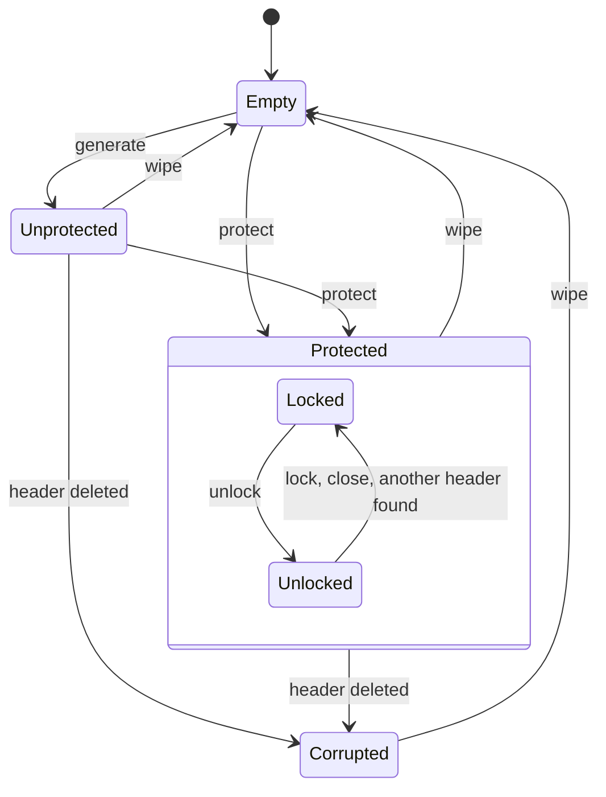

# Vault — Design

<!--
Rules for editing:
- Short as it can be while complete. Prefer tables and one-line statements. State each fact once, in the section that owns it.
- Every guarantee names one code location or links one test that enforces it ([Test](test/<file>#L<line>), the line of the test's title). No reference → write "not protected"; a "not tested" mark names its ticket (#NN) or says "not protected". `npm run check:refs` checks both.
- Self-contained: state each decision's outcome and rejected alternatives here, without links or decision IDs.
-->

Vault is a browser-native private-key store on IndexedDB. An application generates keys, lists their public information and gets signatures; private keys never leave Vault, and Vault does not know what its keys sign.

Each guarantee links the test that enforces it ([Test]) or names its code. Unit tests run in Chromium, Firefox and WebKit, except those needing a virtual authenticator (most passkey and protection tests): Chromium only.

## 1. Threat model

### 1.1 Assets

| Asset | Where it lives |
|---|---|
| Private keys of sealed keys (ed25519, secp256k1) | IndexedDB, sealed to the wrapping public key; no call returns them |
| Private keys of passkey keys and of the unlock passkey | The authenticator only |
| Wrapping private key: opens every sealed key | IndexedDB: a non-extractable CryptoKey (unprotected), or wrapped under a key derived from the unlock passkey's PRF result (protected) |
| The unlock passkey's PRF result | Memory only, during `protect()` or `unlock()`, as a non-extractable HKDF key |
| Public information | IndexedDB, in the clear; not secret |

### 1.2 Adversaries and guarantees

Trusted: the browser, its WebCrypto and IndexedDB, the OS, origin isolation. Out of scope: a compromised browser, OS or extension; preventing XSS (Vault limits what injected code reaches); physical and side-channel attacks (the secp256k1 JS code promises no constant time).

| Adversary or event | Mode | Guarantee | Not guaranteed | Enforced by |
|---|---|---|---|---|
| Profile or disk copy, read offline | Unprotected | Private keys are stored only sealed; the one stored secret, the wrapping private key, is a non-extractable CryptoKey. | **Not protected:** the browser keeps that key's bytes in the profile, so a copy opens every sealed key. | [Test](test/unit/storage.test.ts#L573) |
| | Protected | The wrapping private key is stored only wrapped under a key derived from the unlock passkey's PRF result, which the authenticator computes from a secret it never releases. | **A copy plus the unlock passkey, or the provider account that syncs it, opens every sealed key.** A copy taken before `protect()` still opens the keys sealed before it. | [Test](test/unit/protection.test.ts#L163) |
| Storage writer (same-origin script, profile editor) adds, edits, swaps or deletes records | Both | Every read is validated and fails closed with `corrupted` ([§2.4](#24-validation-and-fail-closed-behaviour)). With no secret, `list()` catches malformed fields and an edited id, type, scope or public key; `sign()` catches any other edit of a sealed key, as the AAD binds every field. | Adding a key needs no secret, so a complete added key can't be told from a real one. Deleted keys are not detected. **Labels can be spoofed**, and a passkey key's label and createdAt are never authenticated. A header replaced as a whole is not detected ([§3.4](#34-no-downgrade)). | [Test](test/unit/storage.test.ts#L718) |
| An older, consistent snapshot put back | Both | — | **Not detected:** deleted keys come back and newer keys vanish. IndexedDB is the only store, so nothing anchors a counter. | not protected |
| Same-origin script: calls the API, opens the database | Unprotected | No call returns private key bytes ([§5.1](#51-surface)), and a `Scope` has no path to its `Vault`. | **Not protected:** it signs with every key and can open every sealed key itself. Scopes don't separate same-origin code; consumers are separated by origin ([§6](#6-alternatives-considered-and-rejected)). | [Test](test/unit/vault.test.ts#L262) |
| | Protected | In a locked context it can't sign with a sealed key. In an unlocked one, the wrapping private key is a non-extractable CryptoKey in a private field, never returned, stored or sent. | **Not protected while unlocked:** it signs with every sealed key until `lock()` or `close()`. It can also call `unlock()` and wait for the user, or replace the header. | `src/unlock.ts` `Unlock` |
| Lost, deleted or replaced unlock passkey | Protected | A failed `unlock()` writes nothing: a deleted unlock passkey ends as `cancelled`, another passkey as `not-found`. Everything but sealed `sign` keeps working. | **Every sealed key is lost for good**, keys sealed later too: no recovery; `wipe()` starts over. | [Test](test/unit/protection.test.ts#L944) |
| Lost, deleted or replaced passkey key | Both | The key stays listed; `sign` fails with `cancelled`. | A loss can't be told from a declined prompt (both are `NotAllowedError`). A replaced passkey: not protected. | [Test](test/unit/passkey.test.ts#L508) |
| Secrets in memory | Both | secp256k1 seeds and scalars are zeroed once used, and the PRF result once imported; ed25519 private keys exist only as CryptoKeys; the unwrapped wrapping private key lives in one context until `lock()` or `close()`. | **Not protected:** JS can't zero memory reliably; secp256k1 scalars are JS bytes during `generate` and `sign`, and the curve library's copies stay; CryptoKeys live until garbage collection. | [Test](test/unit/storage.test.ts#L231), [Test](test/unit/protection.test.ts#L199), `src/unlock.ts` `Unlock` |
| Eviction: storage removed as a whole | Both | An empty database is an empty vault, also when deleted while open ([§2.6](#26-eviction-and-persistent-storage)). | Eviction can't be told from a wipe; an evicted protected vault becomes unprotected at the next `generate()`, and **every sealed key is lost.** | [Test](test/unit/vault.test.ts#L368) |
| Crash or closed tab: a transaction cut midway | Both | Every change that touches several records is one transaction: a cut leaves the old state or the new one ([§4](#4-concurrency)). | A browser or OS crash is not tested: not protected. | [Test](test/e2e/crash.spec.ts#L189) |

## 2. Storage layout and key protection

### 2.1 Records

One IndexedDB database (default `vault`), schema version 1, two object stores.

| Store / record | Key | Contents | Integrity |
|---|---|---|---|
| `meta` / header | `'header'` | `v`, `wrappingPublicKey`, `protection: { kind: 'none', privateKey: CryptoKey }` | None ([§3.4](#34-no-downgrade)) |
| `meta` / protected header | `'header'` | `v`, `wrappingPublicKey`, `protection: { kind: 'passkey', credentialId, salt, iv, wrappedPrivateKey }` | AAD over every other field, checked by `unlock()` |
| `keys` / sealed key | `[scope, id]` | `v`, `scope`, `id`, `type`, `publicKey`, `createdAt`, `label`?, `sealed: { ephemeralPublicKey, iv, ciphertext }` | `id` = SHA-256(scope, type, public key), checked by `list()`; AAD over every other field, checked by `sign()` |
| `keys` / passkey key | `[scope, id]` | `v`, `scope`, `id`, `type`, `publicKey`, `credentialId`, `createdAt`, `label`? | `id` = SHA-256(scope, type, credential id), checked by `list()`; the public key, by `sign()` |

- A scope is the first key component: a key range with no record of its own. Its name is 1–1024 UTF-16 code units ([§6](#6-alternatives-considered-and-rejected)). A label is 1–256, fixed at `generate`.
- Every hashed or authenticated value is a sequence of type tag, 4-byte length and bytes, so field boundaries can't shift and `123` never encodes as `"123"` (`src/bytes.ts` `encode`).

### 2.2 Key hierarchy

```
wrapping key pair — ECDH P-256, one per vault, in the header
├─ public half: SPKI, in the clear; sealing a new key needs only this
└─ private half
   ├─ unprotected: a non-extractable CryptoKey
   └─ protected: wrapKey('pkcs8') under the KEK, AES-256-GCM, AAD = every other header field;
      unwrapped (non-extractable) only in the memory of an unlocked context
      KEK = HKDF-SHA-256(the unlock passkey's PRF result, salt = random 32 bytes, info = 'vault/v1/unlock')

private key of a sealed key, one per record, sealed by ECIES:
  ephemeral P-256 key → ECDH with the wrapping public key → HKDF-SHA-256 (info = both public keys)
  → AES-256-GCM (AAD = every stored field) → ed25519: wrapKey('pkcs8'); secp256k1: the 32-byte scalar
```

- **Generating a sealed key needs only the public half**, so it never needs an unlock or a prompt, in either mode: [Test](test/unit/protection.test.ts#L585).
- **Unprotected mode is protected only by the browser:** the root is a CryptoKey that JS can use but not read.
- **`protect()` rotates the wrapping key pair** and re-seals every sealed key in one transaction, so a copy taken before can't open keys sealed after: [Test](test/unit/protection.test.ts#L216).
- **The wrapping private key never becomes JS bytes:** it is wrapped with `wrapKey` (`src/protection.ts` `protectWrappingKey`).
- The PRF input is fixed, `vault/v1/unlock`, because the unlock prompt starts before any read; the salt is random and stored. The sealing (`src/seal.ts`) has the shape of HPKE base mode, not its wire format.

### 2.3 Passkey keys

- **Model.** A WebAuthn credential whose private key stays in its authenticator: one prompt to `generate`, one per `sign`. Nothing is sealed, so a passkey key is the same in both modes. ES256 only, discoverable.
- **User verification** is required, and Vault checks the UV flag before it returns a signature: [Test](test/unit/passkey.test.ts#L420).
- **Ids.** The key id hashes scope, type and credential id, so it is the same on every device. The user handle is a 16-byte scope mark and 16 fresh random bytes, as an authenticator overwrites a credential with the same handle: [Test](test/unit/passkey.test.ts#L234).
- **Adding a key on a fresh device: `scope.add('passkey')`.** A discoverable `get()`; a passkey of another scope is `not-found`, one the scope holds is returned. Otherwise a second `get()` for that credential: each ECDSA signature yields two candidate public keys, and Vault keeps the one both share, so the record equals the one `generate` wrote: [Test](test/unit/passkey.test.ts#L587).
- **The label leaves Vault:** the passkey picker shows it, and a synced provider copies it.

### 2.4 Validation and fail-closed behaviour

Typed readers (`src/readers.ts`, `src/records.ts`) name the failing field (`Corrupted storage: key.sealed.iv`) and build new objects. Vault never repairs, and one bad record fails the whole call.

| Check | When | Failure |
|---|---|---|
| `v` is the number 1, never coerced | every read | `corrupted`: [Test](test/unit/storage.test.ts#L955) |
| Header fields have exact types and lengths, nothing extra | `list`, `generate`, `sign`, `state` | `corrupted`: [Test](test/unit/records.test.ts#L414) |
| Key records without a header are never a new vault; only `wipe()` works | same | `corrupted`: [Test](test/unit/vault.test.ts#L497) |
| Key fields have exact types; the public key passes its type's check (ed25519: canonical, not small order; secp256k1: on the curve; passkey: a P-256 SPKI) | `list`, `sign` | `corrupted`: [Test](test/unit/records.test.ts#L290) |
| A well-formed key type this build doesn't know | `list`, `sign` | `incompatible`, in its scope only: [Test](test/unit/records.test.ts#L334) |
| The sealed value: a P-256 ephemeral key → AES-GCM with AAD → a valid scalar (secp256k1) → sign → verify under the stored public key | `sign` | `corrupted`: [Test](test/unit/storage.test.ts#L906) |
| No `meta` record and no field that Vault doesn't write | `list`, `generate`, `sign` | `corrupted`: [Test](test/unit/records.test.ts#L481) |
| Object stores that aren't Vault's are never read, so `wipe()` always recovers | — | [Test](test/unit/records.test.ts#L528) |

### 2.5 Versioning and migration

- One number is both the format and the IndexedDB schema version, and every record also carries `v`. A newer schema fails `open()` with `incompatible`: [Test](test/unit/storage.test.ts#L279). Connections close on `versionchange`, so an old tab never blocks a newer build: [Test](test/unit/storage.test.ts#L965).
- A record with `v ≠ 1` in a version-1 database is `corrupted` ([§2.4](#24-validation-and-fail-closed-behaviour)): a real newer format bumps the schema first. A new key type needs no bump (older builds read it as `incompatible`); a new field does, as parsing is strict.
- Format v1 is pinned by known answers from the v1 code: [Test](test/unit/records.test.ts#L51).
- **Migration (not built):** a v2 build opens schema version 2 and changes structure in the atomic upgrade callback. Re-encryption can't await there, so it runs lazily per record: read v1, re-seal, write v2.

### 2.6 Eviction and persistent storage

An empty database is an empty vault: `state()` is `empty` for a vault never used, wiped or evicted alike. A database deleted while open is the same: the connection closes on `versionchange` (`src/db.ts` `onversionchange`), and a `generate` that sealed to the vanished header is redone (`src/scope.ts` `#commitKeyRecord`). An application that expects protection checks `state()` before `generate()` ([§5.2](#52-usage-examples)).

Vault never calls `navigator.storage.persist()`: [Test](test/unit/platform.test.ts#L51). The call guarantees nothing, applies to the whole origin and prompts in Firefox, so the application decides. Safari with tracking prevention also deletes script-created data of a site not visited in 7 days of browser use; whether persistent mode lifts that is unconfirmed. This engine behaviour is not tested: not protected.

### 2.7 Primitives and dependencies

| Purpose | Primitive | Source | Why |
|---|---|---|---|
| Sealing; ed25519 keys and signing | AES-256-GCM, ECDH P-256, HKDF-SHA-256, Ed25519 | WebCrypto | Native. Not X25519: WebKit loses stored X25519 keys. WebKit's Ed25519 key generation fails about 0.7% of the time, so it is tried 5 times: [Test](test/unit/vault.test.ts#L663) |
| Point validation | SPKI import | WebCrypto | WebKit accepts off-curve `raw` points: [Test](test/unit/storage.test.ts#L931) |
| ed25519 verification | Strict RFC 8032 | `@noble/curves` 2.3.0 | WebKit's verify crashes on degenerate keys: [Test](test/unit/vault.test.ts#L684) |
| secp256k1 | ECDSA, RFC 6979, low-S | `@noble/curves` 2.3.0 | In no engine's WebCrypto |
| Passkey assertions, adding a key | ECDSA P-256, DER | `@noble/curves` 2.3.0 | Already a dependency |
| SHA-256 before a prompt | SHA-256 | `@noble/hashes` 2.3.0 | Synchronous, so the prompt starts before any await |

Only these two packages, pinned exactly: [Test](test/unit/platform.test.ts#L39). 2.3.0 is noble's last independently audited release (Trail of Bits, 2026). No primitive is hand-rolled; that is a review claim: not protected.

## 3. Lifecycle and states

### 3.1 States



"Wiped" is Empty. Protected is stored; locked and unlocked belong to one context and are never stored. Everything works in every state but Corrupted, except sealed `sign`, which needs Unprotected or Unlocked: [Test](test/unit/protection.test.ts#L585).

| Operation | Prompts | On failure |
|---|---|---|
| First `generate` | none (passkey key: one) | Nothing written: [Test](test/unit/vault.test.ts#L456) |
| `protect` | one or two ([§3.2](#32-enabling-protection)) | Vault unchanged: [Test](test/unit/protection.test.ts#L319) |
| `unlock` | one | Nothing written ([§3.3](#33-unlock-and-lock)) |
| `wipe` | none, also when locked | Nothing cleared: [Test](test/unit/vault.test.ts#L481) |

### 3.2 Enabling protection

`vault.protect()` (`src/protect.ts` `protectVault`):

1. Before any await, `create()` for the unlock passkey with the PRF extension: [Test](test/unit/protection.test.ts#L130).
2. No PRF result but `prf.enabled: true`: a second prompt at once, a `get()` for the new passkey with UV checked: [Test](test/unit/protection.test.ts#L347). `enabled` false: `unsupported`. If the page has no focus then, it waits for `focus` at most 2 seconds, then `unavailable` (`src/key-types/passkey.ts` `secondPrompt`); `add` does the same.
3. Outside any transaction: a fresh wrapping key pair, every sealed key re-sealed, the private half wrapped under the KEK.
4. **Commit:** one transaction writes only if the header and the key set are unchanged since step 3; a protected header is `protected`; otherwise step 3 runs again with no new prompt, 3 attempts, then `unavailable`: [Test](test/unit/protection.test.ts#L1017).
5. This context is unlocked, and every context's listeners are called.

The unlock passkey a failed `protect()` created stays at its provider ([§7](#7-known-limitations)).

**Where the second prompt happens.** Rows with Runs were checked by hand on one Mac with the Pages demo, following `docs/manual-checks.md` (its Run log has every step): macOS 15.8.3 with Safari 18.6 and Firefox 160, then macOS 27.2.1 with Safari 27.2; "iPhone" is an iPhone 15 Pro whose iCloud Keychain holds the passkeys, over hybrid (QR code); "YubiKey" has firmware 5.4.3 (`hmac-secret`, no `hmac-secret-mc`). The other rows come from engine sources.

| Browser | Authenticator | `protect()` prompts | Runs |
|---|---|---|---|
| Chromium | Google Password Manager; security keys with `prf` or `hmac-secret-mc` | one | — |
| Safari 18.6, Safari 27.2 | iPhone over hybrid | one | 1, 1b, 5 |
| Chromium, Safari 26.4+ (27.2 by hand) | Security keys with `hmac-secret` only (YubiKey) | two | 6, 6b |
| Firefox on Linux, on macOS below 26.4 (160 by hand) | Any security key (YubiKey) | two | 4, 4b |
| Safari before 26.4 (18.6 by hand) | Security key (YubiKey) | one, then `unsupported`, the vault unchanged | 2 |
| Firefox 160 on macOS | iPhone over hybrid | none: Firefox opens only its security-key dialog; `cancelled`, the vault unchanged | 3 |
| Safari 26.4+ | Security keys with `prf` or `hmac-secret-mc` | one; `unlock()` unconfirmed (WebKit bug 311099) | — |
| Windows, Android, iOS, iCloud Keychain on the Mac | — | unconfirmed | — |

In every run, passkey keys generated, signed and were added in a fresh profile (Firefox: a private window), and wherever `protect()` succeeded, `unlock()` took one prompt and `lock()` locked. One Safari 27.2 `add` with the YubiKey first failed with `cancelled` and passed after a reload; the cause was not established. Three faults of Vault these runs found were fixed and the runs repeated (1b, 4b, 6b).

Safari 27.2 with a security key returns no public key for the new unlock passkey, and `protect()` needs only its credential id: [Test](test/unit/protection.test.ts#L396).

### 3.3 Unlock and lock

`vault.unlock()` (`src/unlock.ts` `unlockVault`):

1. Before any await, one `get()` restricted to the unlock passkey this context's last header read named: [Test](test/unit/protection.test.ts#L682). Restricted, because Firefox with a security key without `hmac-secret-mc` returns no PRF result to a discoverable `get()`. No unlock passkey at that read: `not-found`, no prompt.
2. Declined: `cancelled`. No UV or no PRF result: `unsupported`.
3. The header is read again; another passkey, or a vault no longer protected, is `not-found`: [Test](test/unit/protection.test.ts#L826).
4. The KEK is derived and the wrapping private key unwrapped; a failed unwrap is `corrupted`. Nothing is written.

Then every sealed key of every scope signs without a prompt, and a passkey key still prompts for itself: [Test](test/unit/protection.test.ts#L708).

**Per context.** The unwrapped key is never stored or broadcast, so a reload, a new `Vault` and other tabs stay locked: [Test](test/unit/protection.test.ts#L739). Each `state()` and sealed `sign` re-checks the stored wrapping public key and drops the key when another context wiped or re-protected (`src/unlock.ts` `see`).

### 3.4 No downgrade

No call writes an unprotected header over a protected one, and a failed `unlock()` writes nothing: [Test](test/unit/protection.test.ts#L944). An edited protected header fails `unlock()` with `corrupted`: [Test](test/unit/storage.test.ts#L760). **Not detected:** a header replaced as a whole, or a vault reset to empty; an application that expects protection compares `state()` ([§5.2](#52-usage-examples)). In unprotected mode no header check helps: whoever writes the header can use the root key.

### 3.5 Wipe

`wipe()` clears the header and every scope in one transaction: [Test](test/unit/vault.test.ts#L285). The next `generate()` makes a new wrapping key pair, so nothing sealed before opens. Disk blocks the engine hasn't overwritten are not erased.

## 4. Concurrency

In Firefox and WebKit an await that settles in a later task, `crypto.subtle` included, ends an IndexedDB transaction. So all crypto runs first, and then one transaction re-checks what the crypto assumed and writes (`src/db.ts` `transact`; `src/scope.ts` `#prepareKeyRecord`, `#commitKeyRecord`).

| Requirement | Mechanism | Verified by |
|---|---|---|
| Atomic on crash | One transaction per change | [Test](test/e2e/crash.spec.ts#L198) (Chromium) |
| No lost updates | Each key is its own record; `generate` writes only if the header is the one it sealed to, else seals again (3 attempts, then `unavailable`) | [Test](test/e2e/tabs.spec.ts#L37) |
| First-time setup converges | The header is added only if absent; the loser seals again | [Test](test/e2e/tabs.spec.ts#L54) |
| A stale context can't undo a wipe | A write sealed to a wiped header is sealed again; a `sign` in flight may still return | [Test](test/e2e/tabs.spec.ts#L73) |
| | A passkey key write is never redone, as a redo would prompt again: a `generate` answered during a wipe lands in the new vault | [Test](test/unit/passkey.test.ts#L292) |
| `protect()` is atomic | One transaction after all prompts and crypto ([§3.2](#32-enabling-protection)) | [Test](test/e2e/crash.spec.ts#L162) (Chromium) |
| A stale context can't undo protection | A `generate` prepared before is sealed again to the protected header; unlocked contexts re-check the header ([§3.3](#33-unlock-and-lock)) | [Test](test/unit/protection.test.ts#L1133) |
| A call in flight across `close()` | Scopes share one connection, taken after re-checking `close()` | [Test](test/unit/vault.test.ts#L446) |
| Other contexts learn about changes | A change notification, an empty `BroadcastChannel` message, after every committed write; listeners read again | [Test](test/e2e/tabs.spec.ts#L121) |
| A forged notification does no harm | It carries nothing, so it causes only an extra read; other message shapes are ignored | [Test](test/unit/changes.test.ts#L194) |

Frames share the tabs' IndexedDB and `BroadcastChannel`, but no test runs in a frame: not protected.

## 5. Public API

### 5.1 Surface

```ts
class Vault {
  static open(options?: { name?: string }): Promise<Vault>;
  static protectionSupport(): Promise<'unsupported' | 'unknown'>;   // no prompt, no storage
  scope(name: string): Scope;                                 // synchronous, no I/O
  state(): Promise<'empty' | 'unprotected' | 'locked' | 'unlocked'>;
  protect(): Promise<void>;
  unlock(): Promise<void>;                                    // this context only
  lock(): void;
  wipe(): Promise<void>;                                      // every scope
  onChange(listener: () => void): () => void;                 // returns stop
  close(): void;
}
interface Scope {
  readonly name: string;
  generate<T extends KeyTypeName>(type: T, options?: { label?: string }): Promise<KeyInfo<T>>;
  add<T extends AddableKeyTypeName>(type: T, options?: { label?: string }): Promise<KeyInfo<T>>;
  list(): Promise<KeyInfo[]>;
  sign<K extends KeyInfo>(key: K, data: Uint8Array): Promise<Signature<K['type']>>;
  delete(key: KeyInfo): Promise<void>;                        // missing key: no-op
}
type KeyInfo<T> = { id: string; scope: string; type: T; publicKey: Uint8Array; createdAt: Date; label?: string };
//   passkey adds credentialId
type Signature<T> = { type: T; bytes: Uint8Array };   // passkey: { authenticatorData, clientDataJSON, signature }
class VaultError extends Error { code: VaultErrorCode; retryable: boolean }
```

The types rule out a key operation without a scope, a `Scope` reaching vault-wide calls, `add('ed25519')` ([Test](test/unit/vault.test.ts#L606)), a signature of the wrong type ([Test](test/unit/vault.test.ts#L531)), and an unprotected but unlocked state. `sign` and `delete` read only id, scope and type of their argument: [Test](test/unit/vault.test.ts#L109). No call returns private key material or renames a key.

### 5.2 Usage examples

```ts
const vault = await Vault.open();
// An app that protected before: 'empty' now means evicted, wiped or replaced.
if (protectedBefore && (await vault.state()) !== 'locked') warnUser();
const keys = vault.scope('https://app.example');
const key = await keys.generate('ed25519', { label: 'Payments' });
const data = new TextEncoder().encode('hello');
const { bytes } = await keys.sign(key, data);
const pub = await crypto.subtle.importKey('raw', key.publicKey, 'Ed25519', false, ['verify']);
await crypto.subtle.verify('Ed25519', pub, bytes, data);   // true, without Vault

// In click handlers: each prompt starts before any await.
const pk = await keys.generate('passkey', { label: 'Laptop' });
const assertion = await keys.sign(pk, data);   // WebAuthn assertion; challenge = SHA-256(data)
const same = await keys.add('passkey');        // fresh device: the same id and public key
if ((await Vault.protectionSupport()) === 'unknown') await vault.protect();
await vault.unlock();                          // another tab, or after a reload

const stop = vault.onChange(async () => render(await keys.list()));
```

### 5.3 Errors

Every failure is a `VaultError`; only `unavailable` is retryable; the cause is in `cause` (`src/errors.ts`).

| Code | Situation | Test |
|---|---|---|
| `unavailable` | IndexedDB or key-generation fault; a concurrent change after 3 attempts; no focus for a second prompt | [Test](test/unit/vault.test.ts#L640) |
| `corrupted` | Bad storage ([§2.4](#24-validation-and-fail-closed-behaviour)); an edited protected header at `unlock()`. `wipe()` is the way back | [§2.4](#24-validation-and-fail-closed-behaviour) |
| `incompatible` | A newer format or key type: load the newer build | [§2.5](#25-versioning-and-migration) |
| `not-found` | An unknown key, or one of another scope; `unlock()` with no unlock passkey or another passkey | [Test](test/unit/vault.test.ts#L144) |
| `cancelled` | A passkey prompt declined or timed out | [Test](test/unit/passkey.test.ts#L496) |
| `unsupported` | No user verification; no PRF result | [Test](test/unit/passkey.test.ts#L529) |
| `locked` | Sealed `sign` in a locked context | [§3.1](#31-states) |
| `protected` | `protect()` on a protected vault | [Test](test/unit/protection.test.ts#L253) |

Programming errors are not `VaultError`: any call after `close()` throws `InvalidStateError` ([Test](test/unit/vault.test.ts#L415)); a malformed scope name, label or key argument, an unknown type, or `data` that is not a `Uint8Array` throws `TypeError` before anything is written ([Test](test/unit/vault.test.ts#L437)).

### 5.4 Prompts and user gestures

Each call that may prompt (passkey `generate` and `sign`, `add`, `protect`, `unlock`) calls WebAuthn before its first await, so it can run straight from a click: [Test](test/e2e/passkey.spec.ts#L221). So `sign` hashes its challenge, SHA-256(data), synchronously and checks its argument after the prompt: [Test](test/unit/passkey.test.ts#L330). A first signature with a passkey key on a fresh device takes three prompts: two to add it, one to sign.

**Up front**, `Vault.protectionSupport()` is `unsupported` without WebAuthn or with `extension:prf` reported false, else `unknown`: [Test](test/unit/protection.test.ts#L1239). Chromium and Firefox report PRF whatever the authenticator, so only `protect()` tells, and it fails cleanly ([§3.2](#32-enabling-protection)).

### 5.5 Adding a key type

A new key type is one module in `src/key-types/` implementing `KeyType` (record fields and parser, public-key check, `generate`, `sign` verifying before it returns, `prompts`, `canAdd`), and one entry in `keyTypes` (`src/key-types.ts`), from which `KeyTypeName`, `KeyInfo` and `Signature` are derived. The core never names a type: [Test](test/unit/key-types.test.ts#L14). Sealed types implement a smaller `SealedScheme`, wrapped by `sealedKeyType` (`src/key-types/sealed.ts`).

| Key type | Public key | Signature |
|---|---|---|
| `ed25519` | 32 bytes, canonical | 64 bytes, RFC 8032: [Test](test/unit/vault.test.ts#L49) |
| `secp256k1` | 33 bytes, compressed | 64 bytes r ‖ s, ECDSA over SHA-256, low-S: [Test](test/unit/storage.test.ts#L195) |
| `passkey` | SPKI, P-256 | WebAuthn assertion: [Test](test/unit/passkey.test.ts#L347) |

### 5.6 Where passkey features degrade

Vault runs in current Chromium, Firefox and WebKit; `Uint8Array.prototype.toBase64` is required, so Safari before 18.2 is not supported. Passkey keys work wherever WebAuthn with ES256 and user verification does. Protection degrades per browser and authenticator ([§3.2](#32-enabling-protection)):

- **No PRF anywhere** (Safari before 26.4 with a security key): `protect()` fails with `unsupported` after one prompt, the vault unchanged.
- **Firefox on macOS with a phone over hybrid:** passkey keys work, but for `protect()` Firefox opens only its security-key dialog; cancelling it is `cancelled`, the vault unchanged.
- **PRF only at a second prompt** (security keys with `hmac-secret` only; Firefox with any security key): `protect()` takes two prompts; `unlock()` still takes one.
- **Safari 27.2 with a security key** gives the page its focus back about 575 ms after a prompt, so a chained second prompt waits for it ([§3.2](#32-enabling-protection)).

## 6. Alternatives considered and rejected

| Topic | Chosen | Rejected | Why | Given up |
|---|---|---|---|---|
| Unlock passkeys | One per vault | Several, the wrapping private key wrapped once per passkey | Adding and removing unlock passkeys needs API and states the task doesn't require | Losing that passkey loses every sealed key; a synced passkey is the only backup |
| Key hierarchy | ECIES to a per-vault P-256 pair, rotated at `protect()` | Rewrapping only the header; RSA-OAEP; a symmetric vault key | A stable pair lets an old copy open later keys; RSA is slow; a symmetric key can't seal while locked | `protect()` re-seals every key |
| Key id | SHA-256 of scope, type, identity | Random UUID | `list()` detects edits without a secret; a passkey key has the same id on every device | A hash per key |
| AAD | Every stored field, plus verify after sign | Identity fields only | Any edit fails closed | Labels can't be renamed |
| Concurrency | Crypto first, then a re-checking transaction | Web Locks | IndexedDB alone orders writes; no lock is held across a prompt | Crypto wasted on a conflict |
| `sign` argument | The `KeyInfo` | An id | An id can't tell a passkey key without a read, which spends the user gesture | Callers with an id call `list()` |
| Scopes | `vault.scope(name)` | A `scope` option per call; one scope per `open()`; isolated scopes | No call forgets its scope; one unlock serves all; same-origin code reads everything anyway | Two classes |
| Errors | One `VaultError` with a `code` | Subclasses | An exhaustive `switch`; survives `postMessage` | No `instanceof` per kind |
| Keys without a header | `corrupted` | A fresh header | It would downgrade a protected vault whose header was deleted | Blocked until `wipe()` |
| No downgrade | Only what is stored decides | Remembering protection per context | A real `wipe()` in another context would then fail | A header replaced as a whole is not detected |
| `wipe()` when locked | Works, no prompt | Needs an unlock | With a lost unlock passkey it is the only way out; any same-origin script can delete the database anyway | A mistaken wipe is not gated |
| Unknown fields | Rejected | Ignored | A later build could trust a planted field | Every new field bumps the version |
| secp256k1 | ECDSA over SHA-256(data), RFC 6979 | Caller digest and recovery id; Schnorr; hedged nonces | Same shape as ed25519; known answers; verify after sign | Protocols that fix another digest |
| Adding a passkey key | Two prompts, the shared public key | One prompt, no public key; `largeBlob` | The task requires the public key; `largeBlob` needs two prompts too | Three prompts to a first signature |
| Embedding for other origins (not built) | A popup of the vault's origin, over `postMessage`; the scope is the sender's `event.origin` (hence names up to 1024 code units); no `Cross-Origin-Opener-Policy: same-origin`, which would cut the opener link | An iframe | Cross-site IndexedDB is partitioned per top-level site (Chromium unpartitions it only after a Storage Access prompt), so each consumer would get its own vault; Safari keeps it ephemeral and may refuse `create()` in an iframe | A window and a click per interaction; a messaging protocol to own |

## 7. Known limitations

Beyond the "Not guaranteed" column of [§1.2](#12-adversaries-and-guarantees):

- **One unlock passkey and no recovery.** Each tab unlocks on its own; after another tab re-protects, the first `unlock()` may be `not-found`.
- **A failed `protect()`, and `delete` of a passkey key, leave the passkey at its provider** for the user to remove; each takes a security-key slot (25 on a YubiKey 5 before firmware 5.7).
- **A deleted header blocks the vault until `wipe()`; one bad record fails `list()` for its scope** ([§2.4](#24-validation-and-fail-closed-behaviour)).
- **An engine-level damaged database reads as retryable `unavailable`**; no test can produce one: not protected.
- **A change notification can be lost**, and changes made outside Vault aren't notified: [Test](test/unit/changes.test.ts#L159).
- **Scopes can't be listed or cleared one by one; a passkey key serves one scope; labels can't be renamed, and there is no other metadata. secp256k1 signs SHA-256 of the data, with no recovery id.**
- **Two contexts adding the same passkey key at once:** the second fails with `unavailable`, and a retry returns the stored key. Not tested: not protected.
- **Real passkeys in Firefox and Safari were checked by hand on one Mac only** ([§3.2](#32-enabling-protection)); Windows, Linux, Android, iOS and Chromium with real authenticators were not. One Safari 27.2 `add` with a YubiKey failed once with `cancelled` and passed after a reload; the cause was not established.
