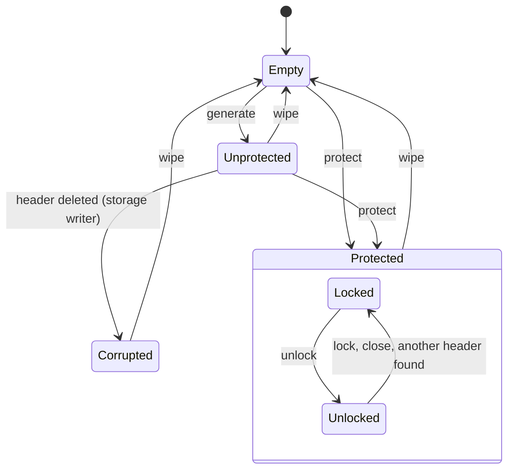

# Vault — Design

<!--
Rules for editing:
- Short as it can be while complete. Prefer tables and one-line statements. State each fact once, in the section that owns it.
- Every guarantee names one code location or test that enforces it (file:test name). No reference → write "not protected". `npm run check:refs` checks the names.
- Self-contained: state each decision's outcome and rejected alternatives here, without links or decision IDs.
-->

Test references: `<name> ›` cites `test/unit/<name>.test.ts`, `e2e ›` cites `test/e2e/`. Unit tests run in Chromium, Firefox and WebKit, except those needing a virtual authenticator (most `passkey ›` and `protection ›` tests): Chromium only. The README's "Property → test" table gives the engines per property.

## 1. Overview

Vault is a browser-native private-key store on IndexedDB. An application generates keys, lists their public information and gets signatures; private keys never leave Vault. Vault does not know what its keys sign.

| Goal | How | Where |
|---|---|---|
| No plaintext keys at rest | Every private key sealed (ECIES, AES-256-GCM) to a per-vault wrapping key pair | §3.1 |
| Optional, upgradeable protection | `protect()` wraps the wrapping private key under a key from a passkey's PRF result, keeping every key | §5.1 |
| Cheap to add, gated to use | Sealing needs only the public wrapping key; only sealed `sign` needs an unlocked context | §3.1, §5 |
| Many key types, one model | ed25519, secp256k1, passkey; a new type is one module and one registry entry | §7.5 |
| Correct under concurrency and failure | Crypto first, then one transaction that re-checks and writes; strict, fail-closed reads | §4.2, §6 |
| A small domain API | `Vault` and `Scope`, keys passed as their public information, one classified error | §7 |

## 2. Threat model

### 2.1 Assets

| Asset | Secret? |
|---|---|
| Private keys (ed25519, secp256k1) | Yes; never leave Vault through the API |
| Passkey private keys | Yes, but never in Vault: they stay in the authenticator |
| Wrapping private key: opens every sealed key | Yes; the root secret in unprotected mode |
| The unlock passkey's PRF result | Yes; in Vault only as a non-extractable HKDF key, during `protect()` or `unlock()` |
| Integrity of records and of the protection state | A protected vault must not turn unprotected unnoticed (§5.3) |
| Public information: id, scope, type, public key, createdAt, label | No; stored in the clear |

### 2.2 Adversaries

| Adversary or event | Capability |
|---|---|
| Profile or disk copy | Reads every IndexedDB file, offline, later |
| Storage writer (same-origin script, profile editor) | Adds, edits, swaps, deletes any record |
| Snapshot restore | Puts back an older, consistent copy |
| Passkey provider account | Uses a synced unlock passkey elsewhere |
| Same-origin script | Calls the API, opens the database, uses stored CryptoKeys |
| Eviction, crash, closed tab | Storage removed as a whole; a transaction cut midway |

Trusted: the browser, its WebCrypto and IndexedDB, the OS, origin isolation.

### 2.3 Guarantees per case

| Case | Mode | Guarantee | Not guaranteed | Enforced by |
|---|---|---|---|---|
| Profile or disk copy | Unprotected | Keys are stored only as ciphertext; the only stored secret is the wrapping private key, a non-extractable CryptoKey. | **Not protected:** the browser keeps the root key's bytes in the profile, so the copy recovers every key. | `storage › no private key bytes are stored: only ciphertext and a non-extractable root key` |
| | Protected | The wrapping private key is stored only wrapped under a KEK from the unlock passkey's PRF result, which the authenticator computes from a secret it never releases. `protect()` re-seals older keys to a fresh wrapping key. | **The copy plus the unlock passkey opens every sealed key.** | `protection › the protected header wraps the wrapping private key under a KEK from the PRF result, bound to every other field` |
| Passkey provider account | Protected | Without a profile copy there is nothing to open: Vault sends nothing anywhere. | **Not protected beyond the provider:** a copy plus the synced unlock passkey unlocks. | not protected |
| Records added or replaced | Both | Every read is validated and a bad record fails closed with `corrupted` (§4.2) at the first operation that can tell: `list()`, with no secret, catches malformed fields and an edited id, type, scope, public key or version, since the id hashes them; `sign()` catches any other edit of a sealed key (the AAD binds every field; the signature is verified under the stored public key, which also catches a key sealed by the attacker); a bad wrapping public key fails `generate()`. Protected: an edited header field fails `unlock()`. | A complete added key needs no secret and can't be told from a real one; deletions are not detected. **Labels can be spoofed:** pin key ids for assurance. A passkey key's label and createdAt are never authenticated. **A header replaced as a whole is not detected** (§5.3). | `storage › tamper table › a bad record is corrupted at the operation the table names: <case>`, `storage › tamper table, protected header › a bad protected header is corrupted at the operation the table names: <case>` |
| Older snapshot restored | Both | — | **Not detected:** deleted keys reappear, newer ones vanish. IndexedDB is the only store, so nothing anchors a counter. | not protected |
| Same-origin script | Unprotected | The API never returns private key bytes; no secret stays in memory between calls; a `Scope` has no path to its `Vault`. | **Not protected:** it signs with every key and can unwrap every key as extractable. **Scopes don't isolate same-origin code** (origins: §9). | `vault › a Scope has no path to its Vault…` |
| | Protected | Locked: it can't sign with a sealed key. Unlocked: the wrapping private key is a non-extractable CryptoKey in a private field, never returned, stored or sent. | **Not protected while unlocked:** it signs with every sealed key until `lock()` or `close()`. | `src/unlock.ts` `Unlock` |
| Script on the change channel | Both | A notification carries nothing; listeners only read again; other message shapes are ignored. | Forged and flooded notifications: extra reads only. | `changes › change notifications › a message of another shape on the channel is ignored` |
| Lost, deleted or replaced unlock passkey | Protected | A failed `unlock()` writes nothing: a deleted passkey ends as `cancelled`, another passkey as `not-found`. All but sealed `sign` keeps working. | **The sealed keys are lost for good:** no recovery; `wipe()` starts over. | `protection › unlock and lock › unlock with %s fails with %s; the vault stays protected and locked` |
| Lost, deleted or replaced passkey key | Both | The key stays listed; `sign` fails with `cancelled`. | A loss can't be told from a cancel (both `NotAllowedError`). A replaced passkey: not protected. | `passkey › a failed prompt › a sign with a passkey removed from its authenticator is cancelled` |
| Secrets in memory | Both | ed25519 private keys exist only as CryptoKeys; ECDH results stay inside `deriveKey`. A new key's secrets are erased once stored or abandoned; secp256k1 zeroes its seed and scalars; the PRF result is zeroed once imported. The unwrapped wrapping key lives in one instance until `lock()` or `close()`. | **secp256k1 scalars are JS bytes during `generate` and `sign`**, and the curve library's copies are not zeroed: not protected. JS can't zero memory; CryptoKeys live until garbage collection. | `storage › a generated key has its secrets erased once, after it is stored` |
| Eviction | Both | An empty database is a new vault, also when deleted while open (§4.4). | Indistinguishable from never used or wiped; an evicted protected vault becomes unprotected at the next `generate()`; **every sealed key is lost.** | `vault › a database deleted while the vault is open is an empty vault: list returns no keys and generate creates a new vault` |
| Crash or closed tab | Both | Every multi-record change is one transaction: a cut leaves the old state or the new one (§6). | A browser or OS crash is not tested: not protected. | `e2e › a tab closed while the first generate writes leaves the old state or the new one, never a mix: <cut>` |

Out of scope: a compromised browser, OS or extension; preventing XSS (Vault limits what injected code gets); physical and side-channel attacks (secp256k1's JS code promises no constant time).

## 3. Key protection

### 3.1 Key hierarchy

```
vault wrapping key pair — ECDH P-256, one per vault, in the header
├─ public half: SPKI, in the clear; sealing a new key needs only this
└─ private half
   ├─ unprotected: a non-extractable CryptoKey
   └─ protected: wrapKey('pkcs8') under the KEK, AES-256-GCM, AAD = every other header field;
      unwrapped (non-extractable) only in the memory of an unlocked context
      KEK = HKDF-SHA-256(the unlock passkey's PRF result, salt = random 32 bytes, info = 'vault/v1/unlock')

private key, one per record, sealed by ECIES:
  ephemeral P-256 key → ECDH with the wrapping public key → HKDF-SHA-256 (info = both public keys)
  → AES-256-GCM (AAD = every stored field) → ed25519: wrapKey('pkcs8'); secp256k1: the 32-byte scalar
```

- **Unprotected mode is protected only by the browser:** the root is a CryptoKey JS can use but not read.
- **`protect()` rotates** the wrapping key pair and re-seals every key in one transaction, so a profile copy taken before can't open later keys: `protection › after protect every key signs and verifies as before, under a new wrapping public key; passkey records are unchanged`.
- **The PRF input is fixed** (`vault/v1/unlock`) because the prompt starts before any read; the salt is random and stored: `records › protectionAad of fixed fields is unchanged`. The wrapping private key is wrapped with `wrapKey`, so it never becomes JS bytes (`src/protection.ts` `protectWrappingKey`). One passkey unlocks a vault.
- **The sealing** (`src/seal.ts`) has the shape of HPKE base mode, not its wire format. A value sealed by the v1 code is a known answer: `storage › a value sealed by format v1 still opens…`.

### 3.2 Passkey keys

- **Model.** A WebAuthn credential whose private key stays in its authenticator; one prompt to `generate`, one per `sign`. Nothing is sealed, so the key is the same in both modes. ES256 only (Apple passkeys support nothing else), discoverable (`src/key-types/passkey.ts` `creationOptions`).
- **User verification** is required, and Vault checks the UV flag before returning a signature: `passkey › sign › Vault checks each assertion before returning it › an assertion without user verification is unsupported`.
- **Ids.** The key id hashes scope, type and credential id, so it is the same on every device. The user handle is a 16-byte scope mark and 16 fresh random bytes, since an authenticator overwrites a credential with the same handle: `passkey › generate › the user handle is the scope mark and 16 fresh random bytes, so a second key never overwrites the first`.
- **Fresh device: `scope.add('passkey')`.** A discoverable `get()`; a user handle without this scope's mark is `not-found`, nothing written. A key the scope holds is returned. Otherwise a second `get()` for that credential: an ECDSA signature yields two candidate public keys, and Vault keeps the one both share (`src/key-types/passkey.ts` `sharedPublicKey`), so the record equals the one generate wrote: `passkey › add › a passkey key added to a fresh vault is the key generate made: same id, public key and credential id, and it signs`.
- **A chained second prompt** (`add`, and `protect()` without a PRF result at creation) that finds the page without focus waits for `focus`, at most 2 seconds; then, or if refused for lack of focus, `unavailable`, nothing written (`src/key-types/passkey.ts` `secondPrompt`; §8).
- **The label leaves Vault:** the passkey picker shows it, and a synced provider copies it: `passkey › generate › a key without a label shows as Vault key in the passkey picker`.
- **`delete` removes only Vault's record**: `passkey › delete › delete removes the passkey key from the scope and leaves the passkey at its authenticator`.
- **Writes are never redone**, as a redo would prompt again: a `generate` answered while another context wipes lands in the wiped vault: `passkey › generate › a generate whose prompt is answered while another context wipes lands in the wiped vault, with one prompt`.

### 3.3 Primitives and dependencies

| Purpose | Primitive | Source | Why |
|---|---|---|---|
| Sealing | AES-256-GCM, ECDH P-256, HKDF-SHA-256 | WebCrypto | Native; X25519 rejected, as WebKit drops stored X25519 keys |
| Point validation | SPKI import | WebCrypto | WebKit accepts off-curve `raw` points: `storage › an off-curve ephemeral public key is rejected…` |
| ed25519 signing | Ed25519 | WebCrypto | The key stays a CryptoKey |
| ed25519 verification | Strict RFC 8032 | `@noble/curves` 2.3.0 | WebKit's verify crashes on degenerate keys: `vault › ed25519 › signing with an ed25519 key never calls WebCrypto verify` |
| secp256k1 | ECDSA, RFC 6979, low-S | `@noble/curves` 2.3.0 | In no engine's WebCrypto |
| Passkey assertions, key recovery | ECDSA P-256, DER | `@noble/curves` 2.3.0 | Already a dependency |
| SHA-256 before a prompt | SHA-256 | `@noble/hashes` 2.3.0 | Synchronous, so the prompt starts before any await |

The only third-party code is these two packages, pinned exactly: `platform › the library imports only its own modules and the pinned @noble packages: no UI framework, no other third-party code`. 2.3.0 is noble's independently audited release (Trail of Bits, 2026); 2.4.0 is not. Every option of every call is passed explicitly. No primitive is hand-rolled (a review claim: not protected).

## 4. Storage layout

### 4.1 Records

One IndexedDB database (default `vault`), schema version 1.

| Store / record | Key | Contents | Integrity |
|---|---|---|---|
| `meta` / header | `'header'` | `v`, `wrappingPublicKey`, `protection: { kind: 'none', privateKey: CryptoKey }` | None (§5.3) |
| `meta` / protected header | `'header'` | `v`, `wrappingPublicKey`, `protection: { kind: 'passkey', credentialId, salt, iv, wrappedPrivateKey }` | AAD over every other field, checked at `unlock()` |
| `keys` / sealed key | `[scope, id]` | `v`, `scope`, `id`, `type`, `publicKey`, `createdAt`, `label`?, `sealed: { ephemeralPublicKey, iv, ciphertext }` | `id` = SHA-256(scope, type, public key), checked by `list()`; AAD over every other field, checked by `sign()` |
| `keys` / passkey key | `[scope, id]` | `v`, `scope`, `id`, `type`, `publicKey`, `credentialId`, `createdAt`, `label`? | `id` = SHA-256(scope, type, credential id), checked by `list()`; public key by `sign()` |

- **Scopes** are the first key component: a key range with no record of its own. A name is a well-formed string of 1–1024 UTF-16 code units: `vault › a malformed scope name is a TypeError…`.
- **Labels** are 1–256 code units, fixed at `generate`. An unlabelled record has no `label` field, keeping its AAD at the v1 bytes: `records › format v1 regression › keyAad of a labelled record…`.
- **Every hashed or authenticated value** is a sequence of type tag, 4-byte length and bytes (`src/bytes.ts` `encode`), so field boundaries can't shift and `123` never encodes as `"123"`: `storage › encodes the exact v1 bytes…`.

### 4.2 Validation and fail-closed behaviour

Typed readers (`src/readers.ts`, `src/records.ts`) name the failing field (`Corrupted storage: key.sealed.iv`) and build new objects. Vault never repairs, and one bad record fails the whole call.

| Check | When | Failure |
|---|---|---|
| `v` is the number 1, never coerced | every read | `corrupted`: `storage › a header with format version 2 / '1' / true / undefined…` |
| Header fields have exact types and lengths, nothing extra | `list`, `generate`, `sign`, `state` | `corrupted`: `records › a malformed protected header is corrupted and named, at list, generate, sign and state(): <case>` |
| Key records without a header: never a new vault; only `wipe()` works | same | `corrupted`: `vault › key records without a vault header are corrupted everywhere…` |
| Key fields have exact types; the public key passes its type's check (ed25519: canonical, not small order; secp256k1: on the curve; passkey: a P-256 SPKI) | `list`, `sign` | `corrupted`: `records › a malformed key record field…`, `storage › a planted ed25519 key whose public key is a small-order point is corrupted at list and sign: <case>` |
| A well-formed key type this build doesn't know, checked right after `v` | `list`, `sign` | `incompatible`, in its scope only: `records › a key of an unknown type is incompatible at list and sign in its scope…` |
| Ephemeral key is a P-256 SPKI of the right curve → AES-GCM with AAD → a valid scalar (secp256k1) → sign → verify under the stored public key | `sign` | `corrupted`: `storage › a key an attacker sealed…` |
| No field and no `meta` record Vault doesn't write | `list`, `generate`, `sign` | `corrupted`: `records › foreign records › a record in meta other than the header makes list, generate and sign fail…` |
| Object stores that aren't Vault's are never read, so `wipe()` always recovers | — | `records › foreign records › an object store that is not Vault’s is ignored…` |

### 4.3 Versioning and migration

- One number is both the format and the IndexedDB schema version; every record also carries `v`. A newer schema fails `open()` with `incompatible`: `storage › a database written by a newer format is rejected with incompatible`. Connections close on `versionchange`, so an old tab never blocks a newer build.
- A record with `v ≠ 1` in a version-1 database is `corrupted`: a real newer format bumps the schema first.
- A new key type needs no version bump: older builds read it as `incompatible` (§4.2). A new field does, as parsing is strict.
- Format v1 is pinned by known answers from the v1 code: `records › format v1 regression`.
- **Migration (not built):** a v2 build opens schema version 2 and changes structure in the atomic upgrade callback. Re-encryption can't await there, so it runs lazily per record: read v1, re-seal, write v2.

### 4.4 Eviction and persistent storage

An empty database is a new vault, and `state()` is `empty` for never used, wiped and evicted alike. A database deleted while open is the same: the connection closes on `versionchange` (`src/db.ts` `onversionchange`), and a `generate` that sealed to the vanished header is redone (`src/scope.ts` `#commitKeyRecord`). An application that expects protection checks `state()` before `generate()` (§7.2).

Vault never calls `navigator.storage.persist()`: `platform › the library never requests persistent storage`. It guarantees nothing in any engine, is origin-wide and prompts in Firefox, so the application decides, ideally from a gesture after the first key. Safari with tracking prevention also deletes data of sites unvisited for 7 days.

## 5. Lifecycle and state transitions



"Wiped" is Empty. Protected is stored; locked and unlocked belong to one `Vault` instance, never stored. `generate`, `add`, `list`, `delete` and passkey `sign` work in every state but Corrupted; sealed `sign` needs Unprotected or Unlocked.

| Operation | Prompts | On failure |
|---|---|---|
| First `generate` | none (passkey: one) | Nothing written: `vault › the first generate writes header and key atomically…` |
| `protect` | one, or two without a PRF result at creation | Vault unchanged: `protection › a declined prompt makes protect fail with cancelled, and the vault is unchanged`; on a protected vault, `protected` |
| sealed `sign`, locked | none | `locked`: `protection › another instance is locked: sealed sign fails with locked; generate, list, add, passkey sign and wipe work` |
| `unlock` | one | Nothing written, the context as it was (§5.2) |
| `wipe` | none | Nothing cleared: `vault › wipe is one transaction…` |

### 5.1 Enabling protection

`vault.protect()` (`src/protect.ts` `protectVault`):

1. Before any await, `create()` for the unlock passkey with the PRF extension: `protection › protect starts the unlock passkey prompt before its first await, with the options Vault fixes`.
2. No PRF result but `prf.enabled: true`: a second prompt at once, a `get()` for the new credential with UV checked: `protection › protect, with no PRF result at creation › protect shows a second prompt for the new passkey only, user verification required, with the fixed PRF input; then every key signs`. `enabled` false: `unsupported`. Always asking twice was rejected.
3. Read the header and keys; a protected header is `protected`.
4. Crypto outside any transaction: a fresh wrapping key pair, every sealed key re-sealed (ed25519 by `unwrapKey`/`wrapKey`), the private half wrapped under the KEK.
5. **Commit:** one transaction writes only if the header and key set are unchanged; else steps 3–5 rerun with no new prompt, 3 attempts, then `unavailable`: `protection › protection across instances › protect held after its prompt while another instance generates: it commits with no new prompt, and the new key is protected`.
6. This instance is unlocked; every context's listeners are called.

A failure leaves the vault unchanged; the created unlock passkey stays at its provider (§11).

### 5.2 Unlock and lock

`vault.unlock()` (`src/unlock.ts` `unlockVault`):

1. Before any await, one `get()` restricted to the unlock passkey named by this instance's last header read, kept in memory: `protection › unlock and lock › unlock starts a prompt for the stored unlock passkey only before its first await…`. Restricted because Firefox with a security key returns no PRF result to a discoverable `get()`. No unlock passkey at that read: `not-found`, no prompt.
2. Declined: `cancelled`, or `not-found` if the header no longer names that passkey: `protection › unlock and lock › a declined prompt for an unlock passkey the vault no longer names…`. No UV or no PRF result: `unsupported`.
3. The header is read again; another credential, or a vault no longer protected, is `not-found`: `protection › unlock and lock › unlock answered by %s fails with not-found and changes nothing, locked or unlocked`.
4. The KEK is derived and the wrapping key unwrapped; a failed unwrap is `corrupted`. Nothing is written.

Then every sealed key of every scope signs without a prompt: `protection › unlock and lock › after one unlock prompt, sealed keys of every scope sign without a prompt; a passkey key still prompts for itself`.

**Per context.** The key is never stored or broadcast, so reloads, new instances and other tabs are locked: `protection › unlock and lock › lock() and close() lock this instance only: sealed sign fails with locked, after close() InvalidStateError; a new instance is locked`. Sharing it was rejected: any same-origin script reads the channel. Each `state()` and sealed `sign` compares the stored wrapping public key with the instance's, and drops the key when another context wiped or re-protected (`src/unlock.ts` `see`).

### 5.3 No downgrade

No Vault call writes an unprotected header over a protected one: `protect()` refuses, `unlock()` and `lock()` write nothing: `protection › unlock and lock › unlock with %s fails with %s; the vault stays protected and locked`. An edited protected header field fails `unlock()` with `corrupted`. Not detected: a header replaced as a whole, or a vault reset to empty; old sealed keys then fail with `corrupted`, and an application that expects protection compares `state()`. Rejected: remembering protection per context (a real `wipe()` elsewhere would then fail). In unprotected mode no header check helps: whoever writes the header can use the root key.

### 5.4 Wipe

`wipe()` clears the header and every scope in one transaction: `vault › wipe removes the keys of every scope…`. The next `generate()` makes a new wrapping key pair, so nothing sealed before opens: `vault › wipe removes every key and the vault header; the next generate starts a new vault`. Disk blocks the engine hasn't overwritten are not erased.

## 6. Concurrency and crash safety

In Firefox and WebKit an await that settles in a later task, `crypto.subtle` included, ends an IndexedDB transaction. So all crypto runs first, and one transaction re-checks and writes (`src/db.ts` `transact`; `src/scope.ts` `#prepareKeyRecord`, `#commitKeyRecord`).

| Requirement | Mechanism | Verified by |
|---|---|---|
| Atomic on crash | One transaction per change | `e2e › a renderer crash while the first generate writes… <cut>` (Chromium) |
| No lost updates | Transactions serialize across tabs; each key is its own record; `generate` writes only if the header is the one it sealed to, else redoes (3 attempts, then `unavailable`) | `e2e › concurrent generates from two tabs each store their key, which lists and signs in both tabs` |
| First-time setup converges | The header is added only if absent; the loser redoes | `e2e › concurrent first generates from two tabs converge on one vault…` |
| A stale context can't undo a wipe | A write sealed to a wiped header is redone. A `sign` in flight may still return, ordered before the wipe | `e2e › a generate held in one tab while another tab wipes…` |
| `protect()` is atomic | One transaction after all prompts and crypto (§5.1) | `e2e › <how> while protect writes leaves the unprotected vault or the whole protected one, never a mix: <cut>` (Chromium) |
| A stale context can't undo protection | A `generate` prepared before is redone against the protected header; unlocked contexts re-check the header (§5.2) | `protection › protection across instances › a generate held while another instance protects is redone against the protected header, and its key signs after unlock` |
| A call in flight across `close()` | Scopes share one connection, taken after re-checking `close()` | `vault › a call in flight when the vault is closed fails with InvalidStateError…` |
| Other contexts learn about changes | After every committed write, an empty message on a `BroadcastChannel` named after the database; listeners read again, so a forged or lost message changes nothing | `e2e › a listener in one tab is called after generate, delete and wipe in another tab` |

## 7. Public API

### 7.1 Surface

```ts
class Vault {
  static open(options?: { name?: string }): Promise<Vault>;   // reads, never writes
  static protectionSupport(): Promise<'unsupported' | 'unknown'>;   // no prompt, no storage
  scope(name: string): Scope;                                 // no I/O
  state(): Promise<'empty' | 'unprotected' | 'locked' | 'unlocked'>;
  protect(): Promise<void>;
  unlock(): Promise<void>;                                    // this context only
  lock(): void;
  wipe(): Promise<void>;                                      // every scope
  onChange(listener: () => void): () => void;                 // any context; returns stop
  close(): void;
}
interface Scope {
  readonly name: string;
  generate<T extends KeyTypeName>(type: T, options?: { label?: string }): Promise<KeyInfo<T>>;
  add<T extends AddableKeyTypeName>(type: T, options?: { label?: string }): Promise<KeyInfo<T>>;
  list(): Promise<KeyInfo[]>;
  sign<K extends KeyInfo>(key: K, data: Uint8Array): Promise<Signature<K['type']>>;
  delete(key: KeyInfo): Promise<void>;                       // missing key: no-op
}
type KeyInfo<T> = { id: string; scope: string; type: T; publicKey: Uint8Array; createdAt: Date; label?: string };
//   passkey adds credentialId
type Signature<T> = { type: T; bytes: Uint8Array };   // passkey: { authenticatorData, clientDataJSON, signature }
class VaultError extends Error { code: VaultErrorCode; retryable: boolean }
```

Misuse the types prevent: a key operation without a scope; a `Scope` reaching vault-wide calls; `add('ed25519')` (a `TypeError` from JavaScript too): `vault › add accepts only key types that can add an existing key, and returns that type’s KeyInfo`; a signature of the wrong type: `vault › the type of a signature follows the type of the key passed to sign`; an "unprotected but unlocked" state. `sign` and `delete` read only id, scope and type of their argument, then the key from storage: `vault › keys › only the id, scope and type of the argument count…`. No method returns private key material or renames a key.

### 7.2 Usage examples

```ts
const vault = await Vault.open();
// An app that protected before: 'empty' now means evicted, wiped or replaced.
if (protectedBefore && (await vault.state()) !== 'locked') warnUser();
const keys = vault.scope('https://app.example');
const key = await keys.generate('ed25519', { label: 'Payments' });
const data = new TextEncoder().encode('hello');
const { bytes } = await keys.sign(key, data);
const pub = await crypto.subtle.importKey('raw', key.publicKey, 'Ed25519', false, ['verify']);
await crypto.subtle.verify('Ed25519', pub, bytes, data);   // true, without Vault

// In click handlers: each prompt starts before any await.
const pk = await keys.generate('passkey', { label: 'Laptop' });
const assertion = await keys.sign(pk, data);   // WebAuthn assertion; challenge = SHA-256(data)
const same = await keys.add('passkey');        // fresh device: the same id and public key
if ((await Vault.protectionSupport()) === 'unknown') await vault.protect();
await vault.unlock();                          // another tab, or after a reload

const stop = vault.onChange(async () => render(await keys.list()));   // also re-read on focus
try { await keys.sign(key, data); } catch (e) {
  if (e instanceof VaultError && e.code === 'locked') await vault.unlock();
}
```

### 7.3 Errors

Every failure is a `VaultError`; only `unavailable` is retryable; the cause is in `cause` (`src/errors.ts`).

| Code | Situation | Test |
|---|---|---|
| `unavailable` | IndexedDB or key-generation fault; a concurrent change after 3 attempts; no focus for a second prompt | `vault › an IndexedDB failure is reported as retryable unavailable…` |
| `corrupted` | Bad storage (§4.2); an edited protected header at `unlock()`. `wipe()` is the way back | §4.2 |
| `incompatible` | A newer format or key type: reload the newer build | §4.3 |
| `not-found` | An unknown key, or one of another scope; `unlock()` with no or another unlock passkey | `vault › signing with an unknown key id fails with not-found` |
| `cancelled` | A passkey prompt declined or timed out | `passkey › a failed prompt › a sign whose prompt is declined or times out is cancelled…` |
| `unsupported` | No user verification; no PRF result | `passkey › an authenticator without user verification › a sign answered without user verification is unsupported…` |
| `locked` | Sealed `sign` in a locked context | §5 |
| `protected` | `protect()` on a protected vault | `protection › protect on a protected vault fails with protected, not retryable, and changes nothing, unlocked or locked` |

Programming errors are not `VaultError`: any call after `close()` throws `InvalidStateError`: `vault › a closed vault rejects every call`. A malformed scope name, label or key argument, an unknown type, or `data` that is not a `Uint8Array` throws `TypeError` before anything is written: `vault › sign rejects data that is not a Uint8Array…`.

### 7.4 Prompts and user gestures

Each call that may prompt (`generate` and `sign` of a passkey key, `add`, `protect`, `unlock`) calls WebAuthn before its first await, so it can run straight from a click: `e2e › a passkey call started from a click handler calls WebAuthn before its first await: <call>`. `sign` therefore checks its argument against storage after the prompt, and computes its challenge, SHA-256(data), synchronously: `passkey › sign › sign starts one prompt before its first await, for that key only, over SHA-256 of the data`. The first signature on a fresh device takes three prompts: two for `add`, one for `sign`.

### 7.5 Adding a key type

A new key type is one module in `src/key-types/` implementing `KeyType`, and one entry in `keyTypes` (`src/key-types.ts`); `KeyTypeName`, `KeyInfo` and `Signature` gain its member from the registry. The core reaches type-specific behaviour only through the interface: `key-types › no core file names a registered key type`. A type owns its record fields and parser, public-key check, `KeyInfo` additions, `generate`, `sign` (verifying before returning), whether it prompts, and whether keys can be added (`canAdd`, `add`). Sealed types implement a smaller `SealedScheme`, wrapped by `sealedKeyType` (`src/key-types/sealed.ts`).

| Key type | Public key | Signature |
|---|---|---|
| `ed25519` | 32 bytes, canonical | 64 bytes, RFC 8032: `vault › keys › a signature verifies under the public key without Vault` |
| `secp256k1` | 33 bytes, compressed | 64 bytes r ‖ s, ECDSA over SHA-256, low-S: `storage › secp256k1 › a published deterministic-ECDSA vector is reproduced exactly` |
| `passkey` | SPKI, P-256 | WebAuthn assertion: `passkey › sign › a passkey signature is a WebAuthn assertion that a verifier checks with the public key alone` |

## 8. Browser support and degradation

Measured in Playwright 1.64.1's Chromium 156, Firefox 157 and WebKit 27.2 (on Linux):

| Fact | Chromium | Firefox | WebKit | Consequence |
|---|---|---|---|---|
| X25519 CryptoKey survives IndexedDB | ✓ | ✓ | ✗ | P-256 |
| `raw` import rejects off-curve points | ✓ | ✓ | ✗ | SPKI only |
| Transaction survives a `crypto.subtle` await | ✓ | ✗ | ✗ | Crypto before transactions |
| `generateKey('Ed25519')` always succeeds | ✓ | ✓ | ✗ (~0.7%) | 5 tries: `vault › a transient key generation failure is retried…` |
| Ed25519 `verify` survives a degenerate key | ✓ | ✓ | ✗ (crash) | noble verify |
| A test authenticator for the engine's WebAuthn | ✓ | ✗ | ✗ | Playwright's stand-in in Firefox and WebKit can't decline, drop UV or return PRF; real passkeys checked by hand (`docs/manual-checks.md`) |

`Uint8Array.prototype.toBase64` is required, so Safari before 18.2 is not supported.

**Up front**, `Vault.protectionSupport()` is `unsupported` without WebAuthn or with `extension:prf` reported false, else `unknown`: `protection › protection support › protectionSupport() with $name is $expected, with no prompt and no database opened`. Chromium and Firefox report PRF whatever the authenticator, so only `protect()` tells, failing cleanly: `e2e › with an authenticator that returns no PRF result, protectionSupport is unknown, protect fails with unsupported…`.

**`protect()` prompts** per browser and authenticator, from engine sources and, marked "by hand", `docs/manual-checks.md` (one Mac; an iPhone's iCloud Keychain over hybrid; a YubiKey 5.4.3 with `hmac-secret` only):

| Browser | Authenticator | Prompts |
|---|---|---|
| Chromium | Google Password Manager; keys with `prf` or `hmac-secret-mc` | one |
| Chromium, Safari 26.4+, Firefox (security keys below macOS 26.4, Linux) | Keys with `hmac-secret` only | two (by hand: Firefox 160, Safari 27.2); `unlock()` one |
| Safari 18 and 27 | iPhone over hybrid | one (by hand) |
| Safari before 26.4 | Security key | one, then `unsupported` (by hand) |
| Firefox 160 on macOS | iPhone over hybrid | none: Firefox opens only its security-key dialog; `cancelled` (by hand) |
| Safari 26.4+ | Keys with `prf` or `hmac-secret-mc` | one; unlock unconfirmed (WebKit bug 311099) |
| Windows, Android, iOS, iCloud Keychain on the Mac | — | unconfirmed |

**Safari 27.2 with a security key** (by hand) returns no public key for a creation with an extension, which `protect()` doesn't need: `protection › protect, with no PRF result at creation › where the browser returns no public key for the new unlock passkey…`. It also returns focus ~575 ms after a prompt and refuses a `get()` before then, hence the focus wait (§3.2): `protection › protect, with no PRF result at creation › where the page gets its focus back only after the creation…`.

## 9. Embedding for other origins (not built)

- **A popup:** a click on the consumer's site opens a top-level window of the vault's origin; they talk over `postMessage`. It sees the one unpartitioned database, and WebAuthn runs same-origin.
- **The scope comes from `event.origin`**, never from the consumer; hence names of up to 1024 code units.
- **The vault's origin sends no `Cross-Origin-Opener-Policy: same-origin`**, which would cut the opener link.
- **Given up:** a window per interaction, popup blockers without a click, a messaging protocol to own (errors as `{ code, message }`).
- **Rejected: an iframe.** Cross-site IndexedDB is partitioned per top-level site in all three engines, so each consumer would see its own vault; only Chromium unpartitions it, through a Storage Access prompt. Safari also keeps third-party storage ephemeral and is not known to allow `create()` in a cross-origin iframe. An iframe plus a popup would mean two databases.
- **Unconfirmed:** whether Chromium ships "Opener Storage Partitioning", which would partition the popup too.

## 10. Alternatives considered and rejected

| Topic | Chosen | Rejected | Why | Given up |
|---|---|---|---|---|
| Key hierarchy | ECIES to a per-vault P-256 pair, rotated at `protect()` | Rewrapping only the header; RSA-OAEP; a symmetric vault key | A stable pair lets an old copy open later keys; RSA is slow; a symmetric key can't seal while locked | `protect()` re-seals every key |
| Key id | SHA-256 of scope, type, identity | Random UUID | `list()` detects edits without a secret; passkey ids match across devices | A hash per key |
| AAD | Every stored field, plus verify after sign | Identity fields only | Any edit fails closed | Labels can't be renamed |
| Concurrency | Crypto first, then a re-checking transaction | Web Locks | IndexedDB alone orders writes; no lock across a prompt | Crypto wasted on a conflict |
| `sign` argument | The `KeyInfo` | An id | An id can't tell a passkey key without a read, which spends the gesture | Callers with an id call `list()` |
| Scopes | `vault.scope(name)` | A `scope` option per call; one scope per `open()`; isolated scopes | No call forgets its scope; one unlock serves all; same-origin code reads everything anyway | Two classes |
| Errors | One `VaultError` with a `code` | Subclasses | Exhaustive `switch`; survives `postMessage` | No `instanceof` per kind |
| Keys without a header | `corrupted` | A fresh header | It would downgrade a protected vault whose header was deleted | Blocked until `wipe()` |
| Unknown fields | Rejected | Ignored | A later build could trust a planted field | Every new field bumps the version |
| secp256k1 | ECDSA over SHA-256(data), RFC 6979 | Caller digest and recovery id; Schnorr; hedged nonces | Same shape as ed25519; known answers; verify-after-sign | Protocols fixing another digest |
| Adding a passkey key | Two prompts, the shared public key | One prompt, no public key; `largeBlob` | The task requires the public key; `largeBlob` needs two prompts too | Three prompts to a first signature |
| Unlock prompt | Restricted to the remembered passkey | Discoverable; a second prompt | Firefox gives PRF only to a restricted one; one prompt allowed | One `not-found` after a re-protect elsewhere |
| Persistent storage | The application asks | Vault asks | Origin-wide, a prompt in Firefox | Best-effort unless asked |

## 11. Known limitations

- **Unprotected mode, and any unlocked context, don't protect against a profile copy or same-origin code** (§2.3).
- **Losing the unlock passkey loses every sealed key**: one unlock passkey, no recovery.
- **Each tab unlocks on its own**; after another tab re-protects, the first `unlock()` may be `not-found`.
- **A failed `protect()`, and `delete` of a passkey key, leave the passkey at its provider**; each takes a security-key slot (25 on a YubiKey 5 before firmware 5.7).
- **Not detected:** a header replaced as a whole, an older snapshot, deleted records, an added complete key, a spoofed label (§2.3).
- **A deleted header blocks the vault until `wipe()`; one bad record fails `list()` for its scope** (§4.2).
- **Eviction is silent and loses every sealed key** (§4.4).
- **An engine-level damaged database reads as retryable `unavailable`**; no test can produce one: not protected.
- **A change notification can be lost**, and changes outside Vault aren't notified: `changes › change notifications › a write that commits while its vault is closed resolves…`.
- **Scopes can't be listed or cleared one by one; a passkey key serves one scope.**
- **Labels can't be renamed; there is no other metadata;** a passkey key's label leaves Vault.
- **secp256k1 scalars are JS bytes during `generate` and `sign`.**
- **Two contexts adding the same passkey key at once:** the second fails with `unavailable`. Not tested: not protected.
- **Real passkeys in Firefox and Safari were checked by hand on one Mac only** (§8); Windows, Linux, Android, iOS and Chromium with real authenticators were not. One Safari 27.2 `add` with a YubiKey failed once with `cancelled` and passed after a reload; the cause was not established.
