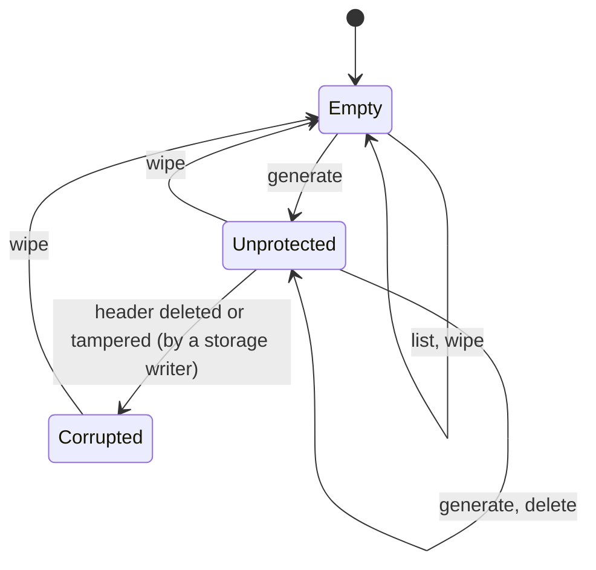

# Vault — Design

<!--
Template. Guidance lives in HTML comments; delete each comment once its section is written.
Rules for filling:
- Short as it can be while complete. Prefer tables and one-line statements over prose.
- Every guarantee names the code or test that enforces it (file:test name). No reference → write "not protected".
- Self-contained: state each decision's outcome and rejected alternatives here, without links or decision IDs, so the document reads on its own.
-->

Test references: `storage ›` = `test/unit/storage.test.ts`, `records ›` = `test/unit/records.test.ts`, `vault ›` = `test/unit/vault.test.ts`, `e2e ›` = `test/e2e/demo.spec.ts`. Unit tests run in Chromium, Firefox and WebKit.

## 1. Overview

Vault is a browser-native private-key store on IndexedDB. An application calls it to generate keys, list their public information and get signatures; private keys never leave it. Vault does not know or care what its keys sign.

| Goal | Status | Where |
|---|---|---|
| No plaintext keys at rest | Built (unprotected mode) | §3.1, §4.1 |
| Optional, upgradeable protection | Format ready; upgrade not built yet | §3.1, §5 |
| Cheap to add, gated to use | Adding needs only the public wrapping key | §3.1 |
| Many key types, one model | ed25519; key-type interface in place | §7.5 |
| Correct under concurrency and failure | Atomic writes, fail-closed reads; multi-tab not tested yet | §4.2, §6 |
| A small, idiomatic domain API | Built for unprotected ed25519 keys in named scopes | §7 |

## 2. Threat model

### 2.1 Assets

| Asset | Secret? |
|---|---|
| Private key material (ed25519 now; secp256k1 later) | Yes. Never leaves Vault through the API. |
| Wrapping private key: decrypts every private key | Yes. In unprotected mode it is the root secret. |
| Integrity of key records: Vault signs only with the key whose public key it lists | — |
| Protection state (unprotected or passkey-protected) | Not built yet |
| Public information: id, scope, type, public key, createdAt | No. Stored in the clear, readable by anyone who can read storage. |

### 2.2 Adversaries and events

| Adversary or event | Capability |
|---|---|
| Profile or disk copy | Reads every IndexedDB file, offline, at any later time |
| Storage writer: same-origin script, or someone editing the profile | Adds, edits, swaps, deletes any record; reads every public field |
| Snapshot restore | Puts back an older, internally consistent copy of the database |
| Same-origin script | Runs in the origin: calls the Vault API, opens the database itself, and uses the stored CryptoKeys |
| Eviction, crash, closed tab | Storage is removed as a whole; a transaction is cut off midway |

Trusted: the browser, its WebCrypto and IndexedDB implementations, the OS, and origin isolation.

### 2.3 Guarantees per case

| Adversary or event | Mode | Guarantee | Not guaranteed | Enforced by |
|---|---|---|---|---|
| Copy of the browser profile or disk | Unprotected | Private keys are stored only as AES-256-GCM ciphertext. The only stored secret is the wrapping private key, a non-extractable CryptoKey held by the browser, and without it nothing decrypts. | **Not protected against a profile copy.** The browser keeps the root key's bytes in the profile, so the copy, opened in the same browser or parsed, recovers every key. | `storage › no private key bytes are stored: only ciphertext and a non-extractable root key`, `› decrypting needs the root key…` |
| | Protected | Not built yet | | |
| Records added or replaced by anyone who can write to storage | Both | `list()`, with no secret, rejects a field of the wrong type or length, and an edited id, type, public key or version. A record moved to another scope fails closed: `list()` rejects it there if its id was kept, because the id binds the scope; if the id was recomputed for the new scope, `sign()` rejects it, because the AAD binds scope and id. `sign()` rejects an edit to any other field: a changed byte, swapped ciphertexts, an off-curve ephemeral key. It also rejects a key the attacker sealed to the public wrapping key: that ciphertext decrypts cleanly, so the signature check before returning catches it. Key records without a header are never treated as a new vault. All of these fail with `corrupted`. | A complete new key record needs no secret, so an added key can't be told from a real one. Deleting records isn't detected. Edits to createdAt and to the ciphertext surface only when the key is used. A replaced header is not detected at list time (§11). **In WebKit, signing with a planted key whose public key is degenerate (e.g. the identity point) crashes the tab instead of failing with `corrupted`: not protected** (§8). | `storage › editing <field> of a key record fails closed`, `› the edit cases cover every stored field…`, `› changing a field type without changing its value…`, `› a planted key whose public key has the wrong length…`, `› a planted key with a degenerate public key…` (Chromium, Firefox), `› ciphertexts swapped…`, `› a key an attacker sealed…`, `› an off-curve ephemeral public key…`, `› a key record moved to another scope fails closed…`, `vault › key records without a vault header are corrupted everywhere…` |
| Older storage snapshot restored | Both | — | **Not detected.** A consistent older copy is a valid state: keys deleted since then reappear, keys added since then vanish. IndexedDB is the only store, so there is nowhere to anchor a counter. | not protected |
| Malicious script in the same origin while unlocked | Unprotected | The API never returns private key bytes. Vault keeps no secret in memory between calls. A `Scope` has no path to its `Vault`, so code handed only a `Scope` can't wipe the vault or open another scope. | **Not protected.** The script can sign with every key, and can open the database and use the root key to unwrap every key as extractable, which exfiltrates them. **Scopes group keys; they do not isolate same-origin code:** any same-origin code can call `vault.scope(name)` with any name, or read IndexedDB directly. Keeping other-origin consumers apart is the embedding layer's job (§9). | `src/scope.ts` (no export method), `vault › a Scope has no path to its Vault…` |
| Lost, deleted or replaced passkey (protection passkey) | Protected | Not built yet | | |
| Lost, deleted or replaced passkey (passkey key) | Both | Not built yet | | |
| Secrets in memory | Both | Ed25519 private keys exist only as CryptoKey objects: sealed with `wrapKey`, opened with `unwrapKey` into a non-extractable key, never as JS bytes. Per-key AES keys and the ECDH result stay inside `deriveKey`. | JS can't zero memory, and the browser may hold internal copies. A CryptoKey lives until garbage collection. | `src/ed25519.ts`, `src/seal.ts` |
| Storage evicted by the browser | Both | An empty database behaves as a new vault. | Can't be told apart from a vault that was never used or was wiped. Requesting persistent storage: not decided yet. | `vault › opening and listing write nothing; the first generate creates the vault` |
| Crash or closed tab mid-operation | Both | Every multi-record change is one IndexedDB transaction, so a crash leaves the old state or the new one. A transaction that aborts, even after its body has run, fails the call with `unavailable` and writes nothing. | A real process crash is not simulated; aborted transactions are. | `vault › the first generate writes header and key atomically…`, `› a write that aborts at commit…`, `› wipe is one transaction…`, `src/db.ts` `transact` |

### 2.4 Out of scope for the threat model

- A compromised browser or OS, and malicious browser extensions: they see everything the page sees.
- Preventing XSS. Vault limits what injected code gets (§2.3); it doesn't stop the injection.
- Physical and side-channel attacks on the machine or the authenticator.
- Timing side channels in JS. WebCrypto does the secret-dependent work.

## 3. Key protection

### 3.1 Key hierarchy

```
vault wrapping key pair — ECDH P-256, one per vault, in the header record
├─ public half: SPKI, stored in the clear. Sealing a new key needs only this, so adding a key never needs an unlock.
└─ private half
   ├─ unprotected: stored as a non-extractable CryptoKey (usage deriveKey only)
   └─ passkey-protected: not built yet (wrapped under a passkey-derived key; never stored in the clear)

private key (one per key record), sealed by ECIES:
  ephemeral P-256 key pair → ECDH with the wrapping public key → HKDF-SHA-256 (info = both public keys)
  → AES-256-GCM (random 96-bit IV, AAD = every stored field of the record) → wrapKey('pkcs8')
```

- **Unprotected mode is protected only by the browser.** The root is a CryptoKey that JS can use but not read. That stops a leaked record dump or log from revealing keys, but not a profile copy or same-origin code (§2.3).
- **Enabling protection (not built yet)** will generate a *fresh* wrapping key pair, re-seal every key to it and replace the header, all in one transaction. Rotating rather than rewrapping matters: a profile copy taken while unprotected, or leftover data the storage engine never overwrote, then can't decrypt keys added after protection is on.
- Exactly one passkey can unlock a vault.

### 3.2 Passkey keys

<!--
How a passkey is modelled as a key. User verification requirement.
Fresh device: how the user presents the passkey and Vault identifies which key it is.
What Vault stores about a passkey key and what it can do without that record.
-->

### 3.3 Primitives and dependencies

| Purpose | Primitive | Source | Why this source |
|---|---|---|---|
| Seal private keys | AES-256-GCM, random 96-bit IV, AAD | WebCrypto | Native in all engines |
| Key agreement for sealing | ECDH P-256, ephemeral–static | WebCrypto | Native. X25519 rejected: WebKit silently drops X25519 CryptoKeys stored in IndexedDB (they read back as `null`). |
| Key derivation | HKDF-SHA-256 over the ECDH output | WebCrypto | Native; done with `deriveKey`, so the shared secret never becomes JS bytes |
| Point validation | SPKI import | WebCrypto | WebKit accepts off-curve points in `raw` and `jwk` import, but every engine rejects them in `spki`: `storage › an off-curve ephemeral public key is rejected…` |
| ed25519 signatures | Ed25519 (RFC 8032) | WebCrypto | Native in all three engines |
| Key ids | SHA-256 | WebCrypto | Native |
| Randomness | `getRandomValues`, `generateKey` | WebCrypto | Native |

There are no third-party cryptographic dependencies yet. The sealing construction (`src/seal.ts`) composes native primitives in the shape of HPKE base mode: a one-time key per seal, both public keys in the KDF context, and AEAD with associated data. It is not wire-compatible with HPKE. A value sealed by the v1 code is kept as a known-answer test, `storage › a value sealed by format v1 still opens…`. Any change to the derivation fails that test, even when it alters `seal` and `unseal` alike and every round trip still passes.

## 4. Storage layout

### 4.1 Records

One IndexedDB database (default name `vault`); schema version 1.

| Store / record | Key | Contents | Encrypted | Integrity-bound to |
|---|---|---|---|---|
| `meta` / header | `'header'` | `v`, `wrappingPublicKey` (SPKI), `protection: { kind: 'none', privateKey: CryptoKey }` | The private key is a non-extractable CryptoKey held by the browser | Not integrity-protected (§11) |
| `keys` / key | `[scope, id]` | `v`, `scope`, `id`, `type`, `publicKey`, `createdAt`, `sealed: { ephemeralPublicKey (SPKI), iv, ciphertext }` | `ciphertext` only | `id` = SHA-256(scope, type, public key), checked by `list()`. AAD = every field except `sealed`. HKDF binds the ephemeral key and the wrapping public key. |

Scopes are the first component of the key, so one scope is one key range, and a scope has no record of its own: it is there while it holds keys. A scope name is a well-formed string of 1 to 1024 UTF-16 code units, long enough for any origin, compared exactly, without normalisation: `vault › a malformed scope name is a TypeError…`. Records written before scopes existed are in the scope `default`, now an ordinary scope, and list and sign there unchanged: `records › a key record written by the v1 code still lists and signs`. Every hashed or authenticated value goes through one canonical encoding (`src/bytes.ts` `encode`): each part is a type tag, a 4-byte length and its bytes. Strings are UTF-8, bytes only `Uint8Array`, integers only safe non-negative values as 8 bytes big-endian. So field boundaries can't shift, and `123` and `"123"` never encode alike: `storage › each value keeps its type…`. The exact bytes are part of format v1 and pinned by a known-answer test, `storage › encodes the exact v1 bytes…`.

Code layout:
- `src/db.ts`: opening the database, and the transaction helper.
- `src/connection.ts`: the one connection a vault and its scopes share; closing it ends them all.
- `src/storage.ts`: record access inside a transaction, store names, scope ranges. No crypto.
- `src/records.ts`: the format, parsing and validation.
- `src/seal.ts`: sealing.
- `src/scope.ts`: the key operations of one scope (`generate`, `list`, `sign`, `delete`).
- `src/vault.ts`: the vault-wide operations (`open`, `scope`, `wipe`, `close`).

### 4.2 Validation and fail-closed behaviour

| Check | When | Failure |
|---|---|---|
| `v` is the number 1, never coerced (header and key records) | every read | `corrupted`: `storage › a header with format version 2 / '1' / true / undefined…`, `› editing v…`, `› changing a field type…: v as the string '1'` |
| Header fields have their exact types: wrapping public key bytes, a known protection kind, a CryptoKey root. A header key whose value is `undefined` (or `null`, which WebKit returns for an unreadable value) is malformed, not absent. | `list`, `generate`, `sign` | `corrupted`: `records › a malformed header field…`, `vault › a header stored as undefined…`, `storage › a tampered wrapping public key makes generate fail closed…` |
| Key records without a header mean a deleted header, never a new vault: only `wipe()` works | `list`, `generate`, `sign` (`src/storage.ts` `readHeader`) | `corrupted`: `vault › key records without a vault header are corrupted everywhere…` |
| Key record fields have their exact types: a well-formed scope name of 1 to 1024 code units, an id string, a registered type, the public key a `Uint8Array` of the type's length, createdAt a safe non-negative integer, sealed fields `Uint8Array`, a 12-byte IV | `list`, `sign`, without any secret | `corrupted`: `records › a malformed key record field…`, `storage › changing a field type…`, `› a negative createdAt…`, `› a planted key whose public key has the wrong length…` |
| Id matches the hash of scope, type and public key | `list`, `sign`, without any secret | `corrupted`: `storage › editing id / type / publicKey…` |
| Ephemeral key imports as SPKI → AES-GCM decrypt with AAD → sign → verify against the stored public key | `sign` | `corrupted`: `storage › an off-curve ephemeral public key…`, `› ciphertexts swapped…`, `› a key an attacker sealed…`, `› decrypting needs the root key…` |
| Only the fields Vault writes: any other own field on the header, its protection, a key record or its sealed part is rejected | `list`, `generate`, `sign` | `corrupted` ("`<record>: unexpected field <name>`"): `records › an unexpected extra field on …`, `› an extra field fails closed through the API…` |
| A version-1 database has Vault's stores | `open` | `corrupted`: `vault › a database without Vault stores…` |

Each field is read by a typed reader (`src/records.ts`), and the error names the field that failed, e.g. `Corrupted storage: key.sealed.iv`: `records › a malformed header field… / a malformed key record field…`. The parsers return new objects built from the read values, never the stored object. The typed encoding is a backstop, not a second classified check. If a reader check were ever missing, encoding the field for the id or the AAD throws a `TypeError` and the call fails instead of accepting the record; such a failure is not classified as `corrupted`. Vault never repairs: no code path writes back a record it failed to read. A failed check rejects the whole call, so `list()` fails if any key in the scope is bad. A stored scope name that `vault.scope()` would refuse lies outside every scope's key range, so no call reads it; the parser rejects it anyway (`key.scope`).

### 4.3 Versioning and migration

- One number is both the storage format version and the IndexedDB schema version. Every record also carries `v`.
- A database at a higher schema version fails `open()` with `incompatible`: `storage › a database written by a newer format is rejected with incompatible`. An older build never reads or writes a newer format.
- A record with `v ≠ 1` inside a version-1 database is `corrupted`, not `incompatible`: a legitimate newer format bumps the schema version first, so no Vault build writes such a record.
- Open connections close on `versionchange`, so a newer build is never blocked by an old tab. The old tab's next call then fails with `incompatible`: `storage › an open vault never blocks a newer format…`.
- Format v1 is pinned by regression tests produced by the v1 code: the id and AAD of fixed inputs, and a whole stored key record that must still list and sign (`records › format v1 regression`).
- Records are parsed strictly (§4.2), so even an optional new field changes the format. It needs a version bump, or, before release, a change to the allow-list.
- **Migration (not built):** a v2 build opens with schema version 2 and changes structure in the upgrade callback, which is atomic. Re-encryption can't run there, because the callback can't await crypto. So it happens lazily per record, which per-record `v` allows: read a v1 record, re-seal it, write v2 in a normal transaction.

### 4.4 Eviction and persistent storage

An empty database (no header, no keys) behaves as a new vault: `list()` returns `[]` and the first `generate()` creates the vault. Key records without a header are not empty but `corrupted` (§4.2). Vault can't tell "never used", "wiped" and "evicted" apart. Browsers evict an origin's storage as a whole, and IndexedDB is its only store.

<!-- Position on navigator.storage.persist(): decided with storage integrity. -->

## 5. Lifecycle and state transitions



"Wiped" is the state Empty, and there is no separate state. Protected, locked and unlocked arrive with passkey protection. States belong to the vault as a whole, never to one scope. `close()` ends one instance and every scope taken from it (every later call throws `InvalidStateError`); the stored state doesn't change.

| From | Operation | To | Prompts | Atomic how | On failure |
|---|---|---|---|---|---|
| Empty | `generate` | Unprotected | none | Header and key added in one transaction; the header is added only if still absent and no key record exists | Nothing written: `vault › the first generate writes header and key atomically…` |
| Corrupted (key records without a header) | `list`, `generate`, `sign` | Corrupted | none | — | `corrupted`; only `wipe` leads out |
| Unprotected | `generate` | Unprotected | none | One transaction re-checks the header and adds the key (the re-check is not tested until the multi-tab slice) | Nothing written: `vault › a write that aborts at commit…` |
| Unprotected | `delete` | Unprotected | none | One request | Nothing deleted |
| Any | `wipe` | Empty | none | Both stores, every scope, cleared in one transaction: `vault › wipe removes the keys of every scope and the header in one transaction` | Nothing cleared: `vault › wipe is one transaction…` |

### 5.1 Enabling protection

<!-- Steps, the single commit point, where the second prompt happens and on which browsers, what is left after a cancel or crash. -->

### 5.2 Unlock and lock

<!-- At most one prompt. What lives in memory after unlock and for how long. What "closed" means. Unlocked state never persisted. -->

### 5.3 No downgrade

<!-- Why a protected vault can never become unprotected: after a failed unlock, a cancelled prompt, a deleted record, a tampered record. Link the tests. -->

### 5.4 Wipe

`wipe()` clears the header and every key of every scope in one transaction: `vault › wipe removes the keys of every scope…`, `vault › wipe removes every key and the vault header; the next generate starts a new vault`. The next `generate()` creates a new wrapping key pair, so nothing sealed before the wipe can be opened afterwards. `generate` re-reads the header inside its write transaction, so a key sealed to the wiped vault can't land (not tested until the multi-tab slice). Wipe doesn't erase what the storage engine has not yet overwritten on disk.

## 6. Concurrency and crash safety

A transaction ends once control returns to the event loop with no request pending. Awaiting a request's promise continues in a microtask and keeps it alive. But in Firefox and WebKit, an await that settles in a later task, `crypto.subtle` included, ends it (Chromium happens to keep it). So all crypto runs **before** a transaction, and the transaction only checks and writes (`src/db.ts` `transact`; for a new key, `src/vault.ts` `#prepareKeyRecord` then `#commitKeyRecord`).

| Requirement | Mechanism | Verified by |
|---|---|---|
| Multi-record changes are atomic | One transaction per change; a throwing body aborts it | `vault › the first generate writes header and key atomically…` |
| No lost updates | Readwrite transactions on overlapping stores run one at a time across tabs. `generate` re-reads the header inside its write transaction and adds only if the header is the one it sealed to; otherwise it redoes the whole operation. It tries 3 times in total, then fails with `unavailable`. | `src/vault.ts` `#commitKeyRecord`, `untilUnchanged`; multi-tab tests not written yet |
| Concurrent first-time setup converges | The header is added only if absent, inside the write transaction; the loser redoes against the winner's header | `src/vault.ts` `#headerForWrite`, `#commitKeyRecord`; multi-tab tests not written yet |
| A call in flight across `close()` | A vault and its scopes share one connection (`src/connection.ts`), taken right before each transaction, after re-checking `close()` | `vault › a call in flight when the vault is closed fails with InvalidStateError…`, `› scope() after close() throws InvalidStateError…` |
| A stale context can't undo a wipe | As above: a write sealed to a wiped header fails its check | `src/vault.ts` `#commitKeyRecord`; multi-tab tests not written yet |
| Other contexts learn about changes | Not built yet | |

## 7. Public API

### 7.1 Surface

```ts
class Vault {
  static open(options?: { name?: string }): Promise<Vault>;
  scope(name: string): Scope;                          // synchronous, no I/O
  wipe(): Promise<void>;                               // every scope
  close(): void;                                       // ends every scope too
}
interface Scope {
  readonly name: string;
  generate(type: KeyTypeName): Promise<KeyInfo>;      // never prompts
  list(): Promise<KeyInfo[]>;                          // this scope only, oldest first, never prompts
  sign(id: string, data: Uint8Array): Promise<Signature>;
  delete(id: string): Promise<void>;                   // missing key: no-op
}
type KeyTypeName = 'ed25519';
interface KeyInfo { id: string; type: KeyTypeName; publicKey: Uint8Array; createdAt: Date }
type Signature = { type: 'ed25519'; bytes: Uint8Array };   // one member per key type, derived from the registry
class VaultError extends Error { code: VaultErrorCode; retryable: boolean }
```

How the types prevent misuse: every key operation is a method of a `Scope`, so a key operation without a scope can't be written. A `Scope` exposes its name and the four key operations, nothing vault-wide, and its name can't be reassigned: `vault › a Scope has no path to its Vault…`. `generate` accepts only registered key type names. `Signature` is a union discriminated by `type`, so a key type with a different signature shape (a passkey assertion) is another member, not a breaking change. There is no method that returns private key material.

### 7.2 Usage examples

```ts
import { Vault, VaultError } from 'vault';

const vault = await Vault.open();
const keys = vault.scope('https://app.example');       // a group of keys; no I/O
const key = await keys.generate('ed25519');            // { id, type, publicKey, createdAt }
const list = await keys.list();                        // this scope's keys only

const data = new TextEncoder().encode('hello');
const signature = await keys.sign(key.id, data);

// Anyone with the public key verifies, without Vault:
const publicKey = await crypto.subtle.importKey('raw', key.publicKey, 'Ed25519', false, ['verify']);
await crypto.subtle.verify('Ed25519', publicKey, signature.bytes, data);   // true

await keys.delete(key.id);
await vault.wipe();                                    // every scope

try {
  await keys.sign(key.id, data);
} catch (e) {
  if (e instanceof VaultError && e.code === 'not-found') { /* … */ }
}
```

### 7.3 Errors

All failures are `VaultError` with a `code`; `retryable` is true only for `unavailable`, and the underlying error is in `cause` (`src/errors.ts`).

| Situation | Error type | Retryable | Caller should |
|---|---|---|---|
| Infrastructure fault (transient): IndexedDB, or a key generation WebCrypto rejected | `unavailable` | yes | Retry; check quota or storage access if it persists. `vault › an IndexedDB failure is reported as retryable unavailable…`, `› a transient key generation failure is retried; a persistent one is retryable unavailable` |
| Corrupted or tampered storage | `corrupted` | no | Stop using the vault and tell the user; Vault doesn't repair. `wipe()` is the way back (for a database that isn't Vault's, delete it). §4.2 tests |
| Storage written by a newer format | `incompatible` | no | Reload with the newer build. `storage › a database written by a newer format…` |
| Prompt declined or cancelled | Not built yet | | |
| Vault locked | Not built yet | | |
| Key not found, including a key of another scope | `not-found` | no | Refresh the key list. `vault › signing with an unknown key id fails with not-found`, `› a key of another scope is not-found by sign…` |
| Passkey protection unsupported | Not built yet | | |

Programming errors are not `VaultError`. Use after `close()`, including a call still in flight when it closed, throws a `DOMException` `InvalidStateError`, as IndexedDB does: `vault › a closed vault rejects every call`, `› a call in flight when the vault is closed…`. So does `scope()` after `close()`: `vault › scope() after close() throws InvalidStateError…`. A malformed scope name (empty, longer than 1024 code units, not a string, a lone surrogate) throws `TypeError`, so a bug can't create a scope that nothing can address: `vault › a malformed scope name is a TypeError…`. An unknown key type name passed from JavaScript throws `TypeError`: `vault › an unknown key type is a programming error…`. So does `sign` with `data` that is not a `Uint8Array`. Coercing it would be worse, because `new Uint8Array('hello')` is empty and would be signed as the empty message: `vault › sign rejects data that is not a Uint8Array…`. A non-string `id` passed from JavaScript is not checked: it fails as `unavailable`, which is misleading, but the call still fails, and TypeScript rules it out.

### 7.4 Prompts and user gestures

<!-- Which operations may prompt. How each can be called directly from a gesture handler without earlier async work consuming the gesture. -->

### 7.5 Adding a key type

A key type implements `KeyType` (`src/key-types.ts`) and is added to the `keyTypes` registry. `KeyTypeName` and `Signature` gain its member automatically. The core calls only these methods and never branches on a type name. One caveat: older builds reject a record of a type they don't know (§11).

```ts
interface KeyType {
  publicKeyLength: number;   // a stored public key of any other length is corrupted
  generate(): Promise<{ publicKey: Uint8Array; seal(cipher: Cipher): Promise<ArrayBuffer> }>;
  sign(sealed: Uint8Array, cipher: Cipher, data: Uint8Array): Promise<Uint8Array>;
  verify(publicKey: Uint8Array, signature: Uint8Array, data: Uint8Array): Promise<boolean>;
}
```

The core hands the type an AES-GCM key bound to the record (`Cipher`), and the type decides how its private key is sealed: ed25519 uses `wrapKey` (`src/ed25519.ts`).

## 8. Browser support and degradation

Storage and crypto facts this design depends on, measured in the engines Playwright 1.64.1 ships (Chromium 156, Firefox 157, WebKit 27.2):

| Fact | Chromium | Firefox | WebKit | Consequence |
|---|---|---|---|---|
| Ed25519, ECDH P-256, HKDF, AES-GCM `wrapKey`/`unwrapKey` | ✓ | ✓ | ✓ | All crypto is WebCrypto |
| `Uint8Array.prototype.toBase64` with the `base64url` alphabet (ES2026) | ✓ | ✓ | ✓ | Key ids use it; older engines without it are not supported |
| X25519 CryptoKey survives IndexedDB | ✓ | ✓ | ✗ (reads back `null`) | P-256 for the wrapping key |
| Off-curve P-256 point rejected by `raw` / `jwk` import | ✓ | ✓ | ✗ | Points are imported only as SPKI |
| Transaction survives an await that settles in a later task (`crypto.subtle`) | yes | no | no | Crypto never runs inside a transaction |
| Transaction survives a microtask await (a request's promise) | yes | yes | yes | Transaction bodies await request promises |
| `generateKey('Ed25519')` always succeeds | ✓ | ✓ | ✗ (about 0.7% `OperationError`; no generated key has a leading zero byte) | Retried up to 5 times: `vault › a transient key generation failure is retried…`; a manual probe (not in the suite) ran 1000 generates in a row in every engine without failure |
| Ed25519 `verify` with a degenerate public key (identity point, small y) returns `false` | ✓ | ✓ | ✗ (the page's process crashes) | Not protected; only a planted key can trigger it (§2.3) |

These WebKit facts come from Playwright's WebKit on Linux. Safari on macOS was not checked.

<!-- Passkey features: where PRF at create vs get, UV and discoverable credentials degrade; what Vault detects up front and what only on failure. -->

## 9. Embedding for other origins (not built)

Scopes are what an embedding layer builds on: it chooses the scope from the sender's origin, which is why a scope name holds up to 1024 code units. The layer itself is not described yet.

<!-- Popup or iframe: the choice, why, and what we give up (storage partitioning, gesture/permission policy, messaging protocol). -->

## 10. Alternatives considered and rejected

| Topic | Chosen | Rejected | Why | Given up |
|---|---|---|---|---|
| Key hierarchy | ECIES (P-256) to a vault wrapping key pair; unprotected root = the non-extractable private half; protection rotates the key pair | X25519 with an AES "device key" wrapping the private half, protection rewraps only the header | A stable key pair means a profile copy taken while unprotected decrypts keys added after protection | A protection upgrade that re-seals every key and must redo on a concurrent add |
| | | RSA-OAEP-3072 with native `wrapKey` (OAEP label as AAD) | Key generation measured at 150–620 ms, 384 B per sealed key, padding-oracle class | A construction composed of several native calls instead of one |
| | | One symmetric vault key | Can't seal a new key while locked | — |
| Key id | SHA-256 of scope, type and public key | Random UUID | A derived id lets `list()` catch an edited public key, type or scope without any secret, and gives a passkey the same id on every device | One hash per key on `list()`; 43-character ids |
| Associated data | Every stored field of the key record, plus verifying each signature before returning it | Identity fields only, labels outside | Any edit fails closed; the verify catches a substituted key that decrypts cleanly | Labels and metadata are immutable after generate |
| Versioning | Schema version = format version, and `v` in every record | Version in the header only | Re-encrypting migrations can't run in the upgrade callback; per-record versions let them run lazily | One field per record |
| Concurrency | Crypto first, then one transaction that re-checks the header | Web Locks around read → crypto → write | IndexedDB alone gives atomicity and serialization; no lock is ever held across a passkey prompt | Crypto is wasted on a conflict |
| `sign` result | Union discriminated by `type` | Bare `Uint8Array`; key handles with methods | Passkey assertions need more than signature bytes; handles go stale across tabs | Callers narrow on `type` |
| Scopes | `vault.scope(name)` returns a `Scope` with the key operations; `Vault` keeps `open`, `scope`, `wipe`, `close`; all scopes share one connection and wrapping key pair | A `scope` option on every call, defaulting to `'default'` | A call that forgets its scope could be written, and would silently use the shared default; code handed a vault can always wipe it | Two classes instead of one |
| | | One scope per `Vault.open()` | Each instance would need its own unlock once protection exists, or a hidden global shared between instances | — |
| | | Scopes as isolation (a secret or a database per scope) | Same-origin code reads all of IndexedDB anyway; isolation between origins belongs to the embedding layer | Wipe and, later, protection are vault-wide |
| Errors | One `VaultError` with `code` | A subclass per category | Exhaustive `switch`; one export; `instanceof` fails across realms. A string code is easy to send in a message (structured clone keeps neither `code` nor a subclass, so an embedding layer sends `{ code, message }`). | No `instanceof` per category |
| Lifecycle | The vault is created by its first write; wipe empties it for every instance | Eager creation in `open()`; wipe closes every instance | Reads never write; one rule for wipe | "Wiped" and "never used" are the same state |
| Keys without a header | `corrupted` in `list`, `generate`, `sign`; only `wipe` recovers | Keep listing them; create a fresh header next to them | A fresh header would turn a deleted protected header into an unprotected vault | A writer who deletes only the header makes the vault unusable until `wipe` |
| Field types | Checked on every read, plus a typed canonical encoding | Leave type checks for later; numbers as `String()` | A type change with the same encoding (`"123"` for `123`, an `Array` for bytes) passed both the id and the AAD | — |
| Unknown fields | Rejected as `corrupted` (an allow-list per record part) | Ignore them | Vault writes the exact shape, so an extra field is tampering or a foreign format; a newer format already fails on `v`; an ignored field could carry data a later build would trust | No forward-compatible extra fields without a version bump |
| WebKit's failing Ed25519 key generation | Retry up to 5 times, then `unavailable` | Classify at once and let every caller retry | Generation has no side effects; 5 failures in a row ≈ 10⁻¹¹ | An engine workaround in the key type |
| WebKit's crashing Ed25519 verify | Documented as not protected | Verify with `@noble/curves`; compare a public key derived via JWK export | A storage writer can already destroy the vault; no new dependency; JWK export would put private key bytes in JS memory on every sign | A tab crash on a planted key in WebKit |

## 11. Known limitations

- **Unprotected mode doesn't protect against a profile copy or same-origin code** (§2.3). That is what passkey protection is for.
- **WebKit crashes the tab when signing with a planted key whose public key is degenerate** (§8). Legitimate keys never trigger it, and only someone who can write storage can plant one.
- **A writer who deletes only the header makes the vault `corrupted` until `wipe()`**, by design (§4.2).
- **WebKit's Ed25519 key generation fails about 0.7% of the time**; Vault retries it. Not checked in Safari on macOS.
- **Adding a stored field is a format change** (strict parsing): a build that doesn't know the field reports such records as `corrupted`.
- **The header is not integrity-protected.** A writer who replaces it with their own wrapping key pair makes existing keys fail at `sign()` (`corrupted`), and gets new keys sealed to their key. `list()` doesn't notice.
- **One bad record fails all of `list()`** for its scope (fail closed).
- **An unknown key type is `corrupted`.** A future key type must bump the format version, so older builds see `incompatible` instead.
- **Concurrency mechanisms (§6) are implemented but not yet tested across tabs**, and other contexts are not notified of changes.
- **Scopes group keys; they do not isolate same-origin code** (§2.3). Any same-origin code can open any scope.
- **The scopes of a vault can't be listed, and one scope can't be cleared on its own**: `wipe()` is vault-wide, and a scope's keys go one `delete` at a time.
- Only the ed25519 key type exists; there are no labels or metadata.
