# Vault — Design

<!--
Template. Guidance lives in HTML comments; delete each comment once its section is written.
Rules for filling:
- Short as it can be while complete. Prefer tables and one-line statements over prose.
- Every guarantee names the code or test that enforces it (file:test name). No reference → write "not protected"; a test still to come → "not tested yet: #NN", naming its ticket in the same cell or sentence. `npm run check:refs` checks the code and test names and the ticket.
- Self-contained: state each decision's outcome and rejected alternatives here, without links or decision IDs, so the document reads on its own.
-->

Test references: `<name> ›` cites `test/unit/<name>.test.ts`, `e2e ›` cites `test/e2e/`. Unit tests run in Chromium, Firefox and WebKit.

## 1. Overview

Vault is a browser-native private-key store on IndexedDB. An application calls it to generate keys, list their public information and get signatures; private keys never leave it. Vault does not know or care what its keys sign.

| Goal | Status | Where |
|---|---|---|
| No plaintext keys at rest | Built, unprotected and passkey-protected | §3.1, §4.1 |
| Optional, upgradeable protection | `protect()`, `unlock()` and `lock()` built where the browser returns the PRF result at creation; the second prompt where it doesn't is not built yet (#83) | §3.1, §5 |
| Cheap to add, gated to use | Adding needs only the public wrapping key, locked or not; only signing with a sealed key needs the context unlocked | §3.1, §5 |
| Many key types, one model | ed25519, secp256k1 and passkey keys; a new key type is one module and one registry entry | §3.2, §7.5 |
| Correct under concurrency and failure | Atomic writes, fail-closed reads; no lost updates, first-time setup and a stale context against a wipe tested across tabs | §4.2, §6 |
| A small, idiomatic domain API | Built for unprotected ed25519, secp256k1 and passkey keys in named scopes, a passkey key generated or added on a fresh device | §7 |

## 2. Threat model

### 2.1 Assets

| Asset | Secret? |
|---|---|
| Private key material (ed25519, secp256k1) | Yes. Never leaves Vault through the API. |
| Passkey private keys | Yes. Never in Vault: they stay in the authenticator, which signs only after verifying the user. Vault stores the credential id and the public key. |
| Wrapping private key: decrypts every private key | Yes. In unprotected mode it is the root secret. |
| Integrity of key records: Vault signs only with the key whose public key it lists | — |
| Protection state (unprotected or passkey-protected) | No, but its integrity is: a protected vault must not turn unprotected unnoticed (§5.3) |
| The unlock passkey and its PRF result | Yes. The passkey stays in its authenticator; its PRF result exists in Vault only as a non-extractable HKDF key, for the length of `protect()` or `unlock()`. |
| Public information: id, scope, type, public key, createdAt, label | No. Stored in the clear, readable by anyone who can read storage. |

### 2.2 Adversaries and events

| Adversary or event | Capability |
|---|---|
| Profile or disk copy | Reads every IndexedDB file, offline, at any later time |
| Storage writer: same-origin script, or someone editing the profile | Adds, edits, swaps, deletes any record; reads every public field |
| Snapshot restore | Puts back an older, internally consistent copy of the database |
| Passkey provider account (synced passkeys) | Whoever controls it can use the unlock passkey on a device of their own |
| Same-origin script | Runs in the origin: calls the Vault API, opens the database itself, and uses the stored CryptoKeys |
| Eviction, crash, closed tab | Storage is removed as a whole; a transaction is cut off midway |

Trusted: the browser, its WebCrypto and IndexedDB implementations, the OS, and origin isolation.

### 2.3 Guarantees per case

| Adversary or event | Mode | Guarantee | Not guaranteed | Enforced by |
|---|---|---|---|---|
| Copy of the browser profile or disk | Unprotected | Private keys are stored only as AES-256-GCM ciphertext. The only stored secret is the wrapping private key, a non-extractable CryptoKey held by the browser, and without it nothing decrypts. | **Not protected against a profile copy.** The browser keeps the root key's bytes in the profile, so the copy, opened in the same browser or parsed, recovers every key. | `storage › no private key bytes are stored: only ciphertext and a non-extractable root key`, `› decrypting needs the root key…` |
| | Protected | The wrapping private key is stored only wrapped (AES-256-GCM) under a KEK derived from the unlock passkey's PRF result, which the authenticator computes from a secret it never releases; no stored CryptoKey opens anything. Every sealed key is sealed to that wrapping key, so the copy alone decrypts nothing. Keys added while unprotected were re-sealed to a fresh wrapping key at `protect()` (§3.1). | **The copy plus the unlock passkey opens every sealed key**: a synced unlock passkey usable elsewhere (next row) is enough. Passkey keys are never in Vault. | `protection › the protected header wraps the wrapping private key under a KEK from the PRF result, bound to every other field`, `src/protection.ts` `unwrapWrappingKey` |
| Someone who controls the user's passkey provider account | Protected | Without a copy of the profile there is nothing to open: the sealed keys stay in this browser's IndexedDB, and Vault sends nothing anywhere. | **Not protected beyond the provider:** with a copy of the profile and the synced unlock passkey on a device of their own, they unlock it as the user does. Vault adds no factor of its own. | not protected |
| Records added or replaced by anyone who can write to storage | Both | The tamper table names, for the header and for a key record that is modified, swapped, truncated or malformed, the operation that first detects it (`list()`, `generate()` or `sign()`), and shows that the operations before it don't. `list()`, with no secret, rejects a field of the wrong type or length, and an edited id, type, public key or version. A record moved to another scope fails closed: `list()` rejects it there if its id was kept, because the id binds the scope; if the id was recomputed for the new scope, `sign()` rejects it, because the AAD binds scope and id. `sign()` rejects an edit to any other field: a changed byte, a shortened ciphertext or ephemeral key, sealed parts exchanged between two records, an off-curve ephemeral key. Two key records whose contents are exchanged, ids kept, fail `list()`, because the id binds the public key. A key record or a header taken from another vault database of this origin passes `list()` and fails `sign()`: the key was sealed to another wrapping key, or the header holds another one. A header whose wrapping public key is shortened, off the curve or on another curve passes `list()` and fails `generate()`; Firefox imports a key of another curve as P-256, so Vault checks the curve of every imported public key (`src/seal.ts` `importPublicKey`); a missing, malformed or extra header field fails `list()`. It also rejects a key the attacker sealed to the public wrapping key: that ciphertext decrypts cleanly, so the signature check before returning catches it. A stored label that is edited, added or removed fails `sign()` too, for every key type, because the AAD binds it. A planted ed25519 public key that is not a canonical RFC 8032 point encoding, or is a point of small order (the identity among them), is rejected by `list()`, so no verify ever sees it. A sealed secp256k1 value that is not a valid 32-byte scalar is rejected by Vault's own check before it is used. Key records without a header are never treated as a new vault. A record planted in `meta` next to the header fails `list()`, `generate()` and `sign()`; `wipe()` recovers. A passkey key record has no ciphertext, so `list()` is its one check that needs no prompt: an edited credential id, scope or type, a public key that is not the SPKI of a P-256 point on the curve, and a missing or extra field fail `list()`, because the id binds scope, type and credential id. An edited passkey public key passes `list()` and fails `sign()`, because Vault verifies every assertion under the stored public key before returning it. All of these fail with `corrupted`. Object stores that are not Vault's are never read. Protected: an edit to any field of a protected header (the wrapping public key, the credential id when the user picks the passkey it names, the salt, the IV, the wrapped private key) passes `list()` and `generate()` and fails `unlock()` with `corrupted`, because the AAD binds every other field and the KEK depends on the salt and the passkey; a field of the wrong length fails `list()`; a failed `unlock()` writes nothing and leaves the context locked. | A complete new key record needs no secret, so an added key can't be told from a real one. Deleting records isn't detected. Edits to createdAt, the label and the ciphertext surface only when the key is used: until then `list()` shows an edited label. **The label and createdAt of a passkey key record are never authenticated:** no secret or ciphertext binds them, so an edit is not detected, `sign()` included. **Label spoofing is not prevented:** a writer can add a complete key with any label, a real key's label included, so callers that need assurance pin key ids. `list()` doesn't check the length of the header's wrapping public key or of a key's ephemeral public key, so a shortened one surfaces only at `generate()` or `sign()`. **Header replacement is not protected in unprotected mode.** A replaced header (another vault's, or one holding the writer's wrapping public key or another root key) is detected by neither `list()` nor `generate()`: new keys are sealed to it, and only existing keys fail at `sign()`. No check would stop anyone, because whoever can write the header can already use the root key. **A protected header replaced as a whole is not detected either** (§5.3): one the writer made with an unlock passkey of their own unlocks with that passkey, an unprotected one reads as `unprotected`, and keys generated afterwards are sealed to the writer's key; old keys fail `sign` with `corrupted`. An application that expects protection compares `state()` with it. | `storage › tamper table › a bad record is corrupted at the operation the table names: <case>`, `storage › the edit cases cover every stored field…`, `› a stored label edited, added or removed makes sign fail with corrupted…`, `› changing a field type without changing its value…`, `› a planted key whose public key is not valid for its type…`, `› a planted ed25519 key whose public key is a small-order point is corrupted at list and sign: <case>`, `› a key an attacker sealed…`, `› an off-curve ephemeral public key…`, `› a key record moved to another scope fails closed…`, `storage › secp256k1 › a planted sealed value that is not a valid scalar is corrupted at sign: <case>`, `vault › key records without a vault header are corrupted everywhere…`, `records › foreign records › a record in meta other than the header makes list, generate and sign fail…`, `› wipe recovers a vault with a foreign record in meta…`, `› an object store that is not Vault’s is ignored…`, `storage › passkey records › a passkey key record with a bad field is corrupted at list: <case>`, `storage › passkey records › a passkey key record moved to another scope…`, `storage › passkey records › with an authenticator › an edited public key of a passkey key record lists, and is corrupted at sign` (Chromium), `storage › passkey records › an edited label or createdAt of a passkey key record is not detected…`, `storage › passkey records › with an authenticator › an edited label or createdAt of a passkey key record still signs…` (Chromium), `storage › tamper table, protected header › a bad protected header is corrupted at the operation the table names: <case>` (Chromium) |
| Older storage snapshot restored | Both | — | **Not detected.** A consistent older copy is a valid state: keys deleted since then reappear, keys added since then vanish. IndexedDB is the only store, so there is nowhere to anchor a counter. | not protected |
| Malicious script in the same origin while unlocked | Unprotected | The API never returns private key bytes. Vault keeps no secret in memory between calls. A `Scope` has no path to its `Vault`, so code handed only a `Scope` can't wipe the vault or open another scope. | **Not protected.** The script can sign with every key, and can open the database and use the root key to unwrap every key as extractable, which exfiltrates them. **Scopes group keys; they do not isolate same-origin code:** any same-origin code can call `vault.scope(name)` with any name, or read IndexedDB directly. Keeping other-origin consumers apart is the embedding layer's job (§9). | `src/scope.ts` (no export method), `vault › a Scope has no path to its Vault…` |
| Malicious script in the same origin | Protected | While locked: it can't sign with a sealed key, and finds in storage nothing that opens one. While this context is unlocked: the wrapping private key is a non-extractable CryptoKey in a private field of this `Vault` instance, never returned, stored or sent to another context, so the script can't take it away; other contexts stay locked until they prompt themselves. | **Not protected while unlocked:** the script signs with every sealed key through the API until `lock()` or `close()`. It can also call `unlock()` and wait for the user to answer a prompt that looks like the application's, and it can replace the header (the storage writer row). | `src/unlock.ts` `Unlock`, `protection › unlock and lock › lock() and close() lock this instance only…` (Chromium) |
| Same-origin script posting on the change notification channel | Both | A change notification carries nothing, and no guarantee of Vault depends on one: a listener only learns that it should read the vault again, and storage stays the only truth. A message of another shape on the channel is ignored and never throws inside Vault. | **Forged and flooded notifications are not prevented:** `BroadcastChannel` is not authenticated, so any same-origin script can post to the channel of any database name. This causes only extra reads. | `src/changes.ts`; `changes › change notifications › a message of another shape on the channel is ignored` |
| Lost, deleted or replaced passkey (unlock passkey) | Protected | Nothing changes in storage: a failed `unlock()` writes nothing. A deleted unlock passkey is not offered by the prompt, which ends as a declined one: `cancelled`. Another passkey picked instead, a replaced unlock passkey (a new credential) included, is `not-found`, and its PRF result is never used. `list`, `generate`, `add`, passkey `sign` and `wipe` keep working locked. | **The sealed keys are lost for good** with the unlock passkey: Vault has no recovery and no second unlock passkey (§11). New sealed keys are sealed to the same wrapping key and are lost too. `wipe()` starts over. | `protection › unlock and lock › unlock with %s fails with %s; the vault stays protected and locked` (the unlock passkey deleted at its authenticator), `› unlock answered by %s fails with not-found and changes nothing, locked or unlocked` (Chromium) |
| Lost, deleted or replaced passkey (passkey key) | Both | The record stays, and `list()` still shows the key: Vault can't see the authenticator. `sign` fails with `cancelled`, not retryable, and returns no signature; the browser reports a passkey it can't find as it reports a declined prompt. | **A caller can't tell a lost passkey from a cancel:** every engine reports both as `NotAllowedError`, so Vault doesn't guess. A replaced passkey (a new credential under the same user handle) leaves the stored credential id with no match too, but is not tested on its own: not protected beyond the removed case. The key never signs again; `delete` removes its record. | `src/key-types/passkey.ts` `prompt`; `passkey › a failed prompt › a sign with a passkey removed from its authenticator is cancelled` (Chromium) |
| Secrets in memory | Both | Ed25519 private keys exist only as CryptoKey objects: sealed with `wrapKey`, opened with `unwrapKey` into a non-extractable key, never as JS bytes. Per-key AES keys and the ECDH result stay inside `deriveKey`. A key type that holds secrets in JS buffers erases them once a generated key is stored or abandoned: `generate` calls the type's `erase` on success and on every failure path. secp256k1 zeroes every secret buffer Vault owns: the 48-byte key-generation seed as soon as the scalar is derived from it, the scalar when `erase` runs, and the decrypted scalar when `sign` returns or fails. Protected: the unlock passkey's PRF result is imported as a non-extractable HKDF key and its bytes zeroed, at `protect()` and at `unlock()`; the unwrapped wrapping private key is non-extractable and held only by the `Vault` instance that unlocked, until `lock()`, `close()`, or a call that finds another header stored (§5.2). Nothing about an unlock is stored or sent to another context. | **The secp256k1 private key exists as JS bytes during `generate` and `sign`**, and the curve library's internal copies (bigints, hash state) are not zeroed: not protected. JS can't zero memory, and the browser may hold internal copies. A CryptoKey lives until garbage collection. **A locked context drops its reference to the wrapping private key**, but the CryptoKey lives on until garbage collection. | `src/key-types/ed25519.ts`, `src/key-types/secp256k1.ts`, `src/seal.ts`; `storage › a generated key has its secrets erased once, after it is stored`, `› a generated key has its secrets erased when generate fails: <case>`, `storage › secp256k1 › generate erases the seed and the scalar it owns, also when the write fails`, `› sign erases the decrypted scalar, also when it is rejected`, `protection › the PRF result’s bytes are zeroed once imported, at protect and at unlock` (Chromium), `src/unlock.ts` `Unlock` |
| Storage evicted by the browser | Both | An empty database behaves as a new vault. A database deleted while a vault is open (site data cleared, eviction, another tab's `deleteDatabase`) is an empty vault on the next call: `list()` returns `[]` and `generate()` creates a new vault; the application need not reopen it. A key sealed before the deletion is never written next to a missing header: its write fails the header check and `generate` is redone against a new header. | Can't be told apart from a vault that was never used or was wiped; the caller is not told. An evicted protected vault becomes unprotected on the next `generate()` (§4.4). **Eviction is not protected against:** it loses every sealed key for good. Vault never requests persistent storage; the application decides when to ask (§4.4). | `vault › opening and listing write nothing; the first generate creates the vault`, `vault › a database deleted while the vault is open is an empty vault: list returns no keys and generate creates a new vault`, `› a generate whose key was sealed before the database was deleted is redone: one key, sealed to the new header`, `src/db.ts` `onversionchange`, `src/scope.ts` `#commitKeyRecord` |
| Crash or closed tab mid-operation | Both | Every multi-record change is one IndexedDB transaction, so a crash leaves the old state or the new one. A tab closed while the first `generate` writes its header and key (Chromium, Firefox, WebKit), or a renderer crash at that point (Chromium), cut before the commit leaves no vault, and a fresh page generates anew; cut right after the commit it leaves the header and the key together, and a fresh page lists and signs with the key. A transaction that aborts, even after its body has run, fails the call with `unavailable` and writes nothing. | A whole-browser or OS crash is not tested: not protected. A renderer crash is tested only in Chromium, the one engine Playwright can crash. | `e2e › a tab closed while the first generate writes leaves the old state or the new one, never a mix: <cut>`, `e2e › a renderer crash while the first generate writes… <cut>` (Chromium), `vault › the first generate writes header and key atomically…`, `› a write that aborts at commit…`, `› wipe is one transaction…`, `src/db.ts` `transact` |

### 2.4 Out of scope for the threat model

- A compromised browser or OS, and malicious browser extensions: they see everything the page sees.
- Preventing XSS. Vault limits what injected code gets (§2.3); it doesn't stop the injection.
- Physical and side-channel attacks on the machine or the authenticator.
- Timing side channels in JS. WebCrypto does the secret-dependent work, except for secp256k1, where `@noble/curves` and Vault's scalar check run in JS, which promises no constant time.

## 3. Key protection

### 3.1 Key hierarchy

```
vault wrapping key pair — ECDH P-256, one per vault, in the header record
├─ public half: SPKI, stored in the clear. Sealing a new key needs only this, so adding a key never needs an unlock.
└─ private half
   ├─ unprotected: stored as a non-extractable CryptoKey (usage deriveKey only)
   └─ passkey-protected: wrapKey('pkcs8') under the KEK, AES-256-GCM, random 96-bit IV, AAD = every other header field;
      held unwrapped, non-extractable, only in the memory of a context that is unlocked
      KEK = HKDF-SHA-256(the unlock passkey's 32-byte PRF result, salt = random 32 bytes, info = 'vault/v1/unlock'),
            a non-extractable AES-256-GCM key; the PRF input is the fixed 'vault/v1/unlock'

private key (one per key record), sealed by ECIES:
  ephemeral P-256 key pair → ECDH with the wrapping public key → HKDF-SHA-256 (info = both public keys)
  → AES-256-GCM (random 96-bit IV, AAD = every stored field of the record)
  → by key type: ed25519 wrapKey('pkcs8'); secp256k1 encrypt(the raw 32-byte scalar)
```

- **Unprotected mode is protected only by the browser.** The root is a CryptoKey that JS can use but not read. That stops a leaked record dump or log from revealing keys, but not a profile copy or same-origin code (§2.3).
- **Enabling protection** generates a *fresh* wrapping key pair, re-seals every sealed key to it and replaces the header, all in one transaction (§5.1): `protection › after protect every key signs and verifies as before, under a new wrapping public key; passkey records are unchanged`. Rotating rather than rewrapping matters: a profile copy taken while unprotected, or leftover data the storage engine never overwrote, then can't decrypt keys added after protection is on.
- **The KEK.** The PRF result is imported as a non-extractable HKDF key and its bytes zeroed at once (`protection › the PRF result’s bytes are zeroed once imported, at protect and at unlock`); the KEK derived from it is non-extractable too. The private half is wrapped with `wrapKey`, so it never becomes JS bytes, and the AAD binds `v`, the wrapping public key, the protection kind, the credential id and the salt, so an edit to any of them fails the unwrap: `protection › the protected header wraps the wrapping private key under a KEK from the PRF result, bound to every other field` (an independent HKDF and unwrap), `records › protectionAad of fixed fields is unchanged`. The PRF input is fixed because it goes into a prompt that starts before any read; the salt is random and stored because it is used after the prompt. A random per-vault PRF input, AES-KW (no AAD) and deriving the wrapping key itself from the PRF result were rejected.
- Exactly one passkey can unlock a vault.

### 3.2 Passkey keys

<!--
Fresh device: how the user presents the passkey and Vault identifies which key it is.
-->

- **Model.** A passkey key is the key type `passkey`: a WebAuthn credential whose private key stays in its authenticator, a platform passkey or a security key, which the user picks. `scope.generate('passkey', { label })` creates one with one prompt and records its public information; `sign` gets an assertion from it with one prompt (§7.4). Vault never holds the private key, so the record has nothing sealed, and the key is the same in either protection mode. Only ES256 (ECDSA on P-256) is requested: Apple passkeys support nothing else, and Safari returns no public key for the other algorithms (`src/key-types/passkey.ts` `creationOptions`). The credential is discoverable (`residentKey: 'required'`), so a vault that has never seen it can find it: adding a key, below. Several passkey keys coexist in one scope: `passkey › generate › the user handle is the scope mark and 16 fresh random bytes, so a second key never overwrites the first`, and end to end `e2e › several passkey keys in one scope list, and each signs on its own, verifying only under its own public key`. The `passkey ›` tests run in Chromium only, the one engine with a virtual authenticator to drive. The e2e tests in `test/e2e/passkey.spec.ts` run in all three engines, Firefox and WebKit against Playwright's JavaScript stand-in for `navigator.credentials` (§8): generate and sign, verified outside Vault (`e2e › a passkey key generated in the page signs, and its assertion verifies outside Vault under the returned public key`), and the fresh device (`e2e › a passkey moved to a new browser context with an empty vault is added there with the same id and public key, then signs`).
- **User verification.** Creation and every assertion ask for `userVerification: 'required'`, and Vault checks the UV flag of every assertion before returning a signature, since the browser and the authenticator are not trusted to enforce it. An assertion without the UV flag is `unsupported`, not `corrupted`: storage is fine, the authenticator is not up to the task. `passkey › sign › Vault checks each assertion before returning it › an assertion without user verification is unsupported`, `passkey › an authenticator without user verification › a sign answered without user verification is unsupported…`.
- **What is stored.** The credential id, the public key in SPKI as the browser returned it at creation, and the fields every key has (§4.1). The key id hashes scope, type and the credential id, so the key has the same id on every device. The user handle (`user.id`) is the scope mark, the first 16 bytes of SHA-256 over a domain separator and the scope name, then 16 fresh random bytes: an authenticator keeps one credential per site and user handle and overwrites the older one, so a fresh handle per key keeps every new passkey from destroying another. The mark lets adding a key refuse a passkey of another scope.
- **Fresh device: adding a key.** A vault that has never seen a passkey key (a fresh device, another profile, after a wipe) learns it with `scope.add('passkey', { label })`. The first prompt is a discoverable `get()`: no `allowCredentials`, a random 32-byte challenge, user verification required, started before any await: `passkey › add › add starts a discoverable prompt before its first await, over a fresh 32-byte challenge, user verification required`. The user picks the passkey; its assertion names the credential, and so the key id. A user handle that doesn't start with this scope's mark is `not-found`, checked before anything else in the assertion, and nothing is written, so a consumer can't make the user present another scope's passkey through Vault's prompt: `passkey › add › a passkey created in another scope is not-found after the first prompt, and nothing is written`. If the scope holds that key id already, `add` returns the stored key and writes nothing; the label of the call is ignored, since labels never change: `passkey › add › adding a key the scope holds returns the stored key after one prompt, writes nothing and ignores the label`. Otherwise a second `get()` asks for that credential only, over another random challenge. Why two: an ECDSA signature yields two candidate public keys, and Vault records the public key (TASK: "List keys and read their public information"), so it recovers the candidates of both signatures with `@noble/curves` p256, high-S accepted, and keeps the one they share (`src/key-types/passkey.ts` `sharedPublicKey`): `passkey › public-key recovery › one signature yields two candidate public keys, one of them the signer’s`, `› two signatures by one key share exactly that key, high-S or not`, both on fixed vectors made with OpenSSL. Both assertions must be for that credential, over their challenge, with the UV flag, and verify under the shared key; an assertion without UV is `unsupported`, any other failure `unavailable`, and nothing is written: `passkey › add › an add answered without user verification is unsupported…`, `› an add whose second assertion is over another challenge fails…`, `› an add whose second signature is by another key shares no public key…`, `› an add whose signatures do not parse fails…`. The record is the one generate wrote (same id, public key and credential id; `createdAt` is the time of the add, the label the one given), and the key signs: `passkey › add › a passkey key added to a fresh vault is the key generate made: same id, public key and credential id, and it signs`. A declined first or second prompt is `cancelled` and writes nothing: `passkey › add › an add whose first or second prompt is declined is cancelled, and writes nothing`. The write is the one of generate (below): an add whose second prompt is answered while another context wipes lands in the wiped vault, with no third prompt (`passkey › add › an add whose second prompt is answered while another context wipes lands in the wiped vault, with two prompts`), and listeners are called after an add that wrote (`passkey › add › onChange listeners are called after an add that wrote, in this context and the other`).
- **The label leaves Vault.** The passkey picker shows the label as the credential's name, or `Vault key` without one: `passkey › generate › a key without a label shows as Vault key in the passkey picker`. The passkey provider stores that name, and a synced provider copies it to the user's account.
- **Without the record.** The passkey lives at its provider, not in the vault. `delete` removes only Vault's record; the passkey stays: `passkey › delete › delete removes the passkey key from the scope and leaves the passkey at its authenticator`. The user removes it at the provider by hand.
- **Writes.** The record doesn't depend on the vault header, so after the prompt it is added in one transaction to the vault as it is then, with a header made beforehand in case the vault is empty, and neither the write nor the prompt is ever repeated: `passkey › generate › a passkey key can be the first key: its generate creates the vault`. A generate whose prompt is answered while another context wipes the vault lands in the wiped vault, with one prompt: `passkey › generate › a generate whose prompt is answered while another context wipes lands in the wiped vault, with one prompt`. No wiped key comes back: the record is a key added after the wipe.

### 3.3 Primitives and dependencies

| Purpose | Primitive | Source | Why this source |
|---|---|---|---|
| Seal private keys | AES-256-GCM, random 96-bit IV, AAD | WebCrypto | Native in all engines |
| Key agreement for sealing | ECDH P-256, ephemeral–static | WebCrypto | Native. X25519 rejected: WebKit silently drops X25519 CryptoKeys stored in IndexedDB (they read back as `null`). |
| Key derivation | HKDF-SHA-256 over the ECDH output | WebCrypto | Native; done with `deriveKey`, so the shared secret never becomes JS bytes |
| Point validation | SPKI import | WebCrypto | WebKit accepts off-curve points in `raw` and `jwk` import, but every engine rejects them in `spki`: `storage › an off-curve ephemeral public key is rejected…` |
| ed25519 signing | Ed25519 (RFC 8032) | WebCrypto | Native in all three engines; the private key stays a CryptoKey |
| ed25519 verification and public-key check | Ed25519, strict RFC 8032 decoding (`zip215: false`: canonical encodings only, small-order points rejected) | `@noble/curves` 2.3.0 | WebKit's `crypto.subtle.verify` crashes the tab on degenerate public keys (§8); verification handles only public data: `vault › ed25519 › signing with an ed25519 key never calls WebCrypto verify` |
| secp256k1 keys and signatures | ECDSA over SHA-256, RFC 6979, low-S | `@noble/curves` 2.3.0 | No engine's WebCrypto has secp256k1 |
| Key ids | SHA-256 | WebCrypto | Native |
| Passkey assertion check | ECDSA P-256 over SHA-256, DER signature, high-S accepted | `@noble/curves` 2.3.0 | Takes the DER signature as the authenticator returns it; already a dependency. Authenticators may return high-S signatures: `passkey › sign › a high-S signature from the authenticator is accepted and returned as it is` |
| Passkey challenge and scope mark | SHA-256 | `@noble/hashes` 2.3.0 | Synchronous, so the prompt starts before any await (§7.4); WebCrypto's `digest` is asynchronous |
| Randomness | `getRandomValues` (also the secp256k1 seed), `generateKey` | WebCrypto | Native |

**The third-party cryptographic code is `@noble/curves`, for secp256k1, ed25519 verification and passkey assertion checks, and its one dependency, `@noble/hashes`.** No engine's WebCrypto has secp256k1, WebKit's Ed25519 verify crashes on degenerate keys, and Vault does no hand-rolled crypto. It is pinned exactly to 2.3.0, its independently audited release (Trail of Bits, August 2026, full scope, as the Security section of the 2.4.0 README records; 2.3.0's own README predates the audit); the newer 2.4.0 has only AI-assisted self-audits, and its hardening concerns misuse that Vault's calls don't make. Its one dependency, `@noble/hashes`, comes through its exact pin as 2.3.0, and Vault declares it too, pinned exactly at that version, for the synchronous SHA-256 a passkey prompt needs; it was last audited at 1.0.0 (Cure53, 2022). `package-lock.json` carries the integrity hash of both, and `npm audit signatures` verifies their registry signatures. Every option of every call is passed explicitly (`src/key-types/secp256k1.ts`, `src/key-types/ed25519.ts`), so a changed library default can't change what a signature is or which public keys verify.

The sealing construction (`src/seal.ts`) composes native primitives in the shape of HPKE base mode: a one-time key per seal, both public keys in the KDF context, and AEAD with associated data. It is not wire-compatible with HPKE. A value sealed by the v1 code is kept as a known-answer test, `storage › a value sealed by format v1 still opens…`. Any change to the derivation fails that test, even when it alters `seal` and `unseal` alike and every round trip still passes.

## 4. Storage layout

### 4.1 Records

One IndexedDB database (default name `vault`); schema version 1.

| Store / record | Key | Contents | Encrypted | Integrity-bound to |
|---|---|---|---|---|
| `meta` / header | `'header'` | `v`, `wrappingPublicKey` (SPKI), `protection: { kind: 'none', privateKey: CryptoKey }` | The private key is a non-extractable CryptoKey held by the browser | Not integrity-protected (§11) |
| `meta` / protected header | `'header'` | `v`, `wrappingPublicKey` (SPKI), `protection: { kind: 'passkey', credentialId, salt (32 bytes), iv (12 bytes), wrappedPrivateKey }` | `wrappedPrivateKey`: the PKCS #8 private half, AES-256-GCM under the KEK (§3.1) | AAD = the domain separator `vault/v1/header`, then `v`, `wrappingPublicKey`, the kind, `credentialId`, `salt`: checked when the private half is unwrapped, which needs the unlock passkey; while locked, nothing |
| `keys` / key | `[scope, id]` | `v`, `scope`, `id`, `type`, `publicKey`, `createdAt`, `label` (only when given), `sealed: { ephemeralPublicKey (SPKI), iv, ciphertext }` | `ciphertext` only | `id` = SHA-256(scope, type, public key), checked by `list()`. AAD = the domain separator `vault/v1/key`, then `v`, `scope`, `id`, `type`, `publicKey`, `createdAt`, then, only when a label is stored, the parts `'label'` and the label. HKDF binds the ephemeral key and the wrapping public key. |
| `keys` / passkey key | `[scope, id]` | `v`, `scope`, `id`, `type: 'passkey'`, `publicKey` (SPKI, P-256), `credentialId`, `createdAt`, `label` (only when given) | Nothing: the record holds no secret | `id` = SHA-256(scope, type, credential id), checked by `list()`, which also checks the public key is a P-256 point; the public key by `sign()`, which verifies the assertion under it; label and createdAt by nothing |

Scopes are the first component of the key, so one scope is one key range, and a scope has no record of its own: it is there while it holds keys. A scope name is a well-formed string of 1 to 1024 UTF-16 code units, long enough for any origin, compared exactly, without normalisation: `vault › a malformed scope name is a TypeError…`. A label is a well-formed string of 1 to 256 UTF-16 code units, given at `generate` and never changed; labels need not be unique: `vault › labels › …`. A key generated without one has no `label` field at all, in its record or its public information, so its AAD is exactly the v1 bytes and the v1 known-answer tests pass unchanged; the AAD of a labelled record is pinned by `records › format v1 regression › keyAad of a labelled record…`. Records written before scopes existed are in the scope `default`, now an ordinary scope, and list and sign there unchanged: `records › a key record written by the v1 code still lists and signs`. Every hashed or authenticated value goes through one canonical encoding (`src/bytes.ts` `encode`): each part is a type tag, a 4-byte length and its bytes. Strings are UTF-8, bytes only `Uint8Array`, integers only safe non-negative values as 8 bytes big-endian. So field boundaries can't shift, and `123` and `"123"` never encode alike: `storage › each value keeps its type…`. The exact bytes are part of format v1 and pinned by a known-answer test, `storage › encodes the exact v1 bytes…`.

Code layout:
- `src/db.ts`: opening the database, and the transaction helper.
- `src/connection.ts`: the one connection a vault and its scopes share; closing it ends them all.
- `src/storage.ts`: record access inside a transaction, store names, scope ranges. No crypto.
- `src/readers.ts`: the typed field readers every parser is built from.
- `src/records.ts`: the format, parsing and validation of the fields every record has.
- `src/key-types.ts`, `src/key-types/`: the key-type interface, its registry and the key types; `sealed.ts` is the record part, AAD and signing shared by sealed key types. `passkey.ts` is the passkey key type.
- `src/seal.ts`: sealing.
- `src/scope.ts`: the key operations of one scope (`generate`, `list`, `sign`, `delete`).
- `src/vault.ts`: the vault-wide operations (`open`, `scope`, `state`, `protect`, `wipe`, `close`).
- `src/protect.ts`: turning protection on, once the unlock passkey's secret is in hand.
- `src/protection.ts`: the unlock passkey, its PRF secret, the KEK and the protected header's fields. The one file besides the key types that names a passkey.
- `src/unlock.ts`: what one context holds to open sealed keys; never stored.

### 4.2 Validation and fail-closed behaviour

| Check | When | Failure |
|---|---|---|
| `v` is the number 1, never coerced (header and key records) | every read | `corrupted`: `storage › a header with format version 2 / '1' / true / undefined…`, `› a bad record is corrupted at the operation the table names: <case>` (v), `› changing a field type…: v as the string '1'` |
| Header fields have their exact types: wrapping public key bytes, a known protection kind, a CryptoKey root. A header key whose value is `undefined` (or `null`, which WebKit returns for an unreadable value) is malformed, not absent. | `list`, `generate`, `sign` | `corrupted`: `records › a malformed header field…`, `vault › a header stored as undefined…`, `storage › a tampered wrapping public key makes generate fail closed…`, `› a bad record is corrupted at the operation the table names: <case>` (header) |
| A protected header has exactly its fields with their types: credential id bytes, a 32-byte salt, a 12-byte IV, wrapped key bytes, nothing else | `list`, `generate`, `sign`, `state` | `corrupted`, naming the field: `records › a malformed protected header is corrupted and named, at list, generate, sign and state(): <case>`; a well-formed one parses: `records › a well-formed protected header parses as it is; the vault reads as locked` |
| Key records without a header mean a deleted header, never a new vault: only `wipe()` works | `list`, `generate`, `sign`, `state` (`src/storage.ts` `readHeader`) | `corrupted`: `vault › key records without a vault header are corrupted everywhere…`, `vault › lifecycle › state() fails with corrupted, as list does…` |
| Key record fields have their exact types: a well-formed scope name of 1 to 1024 code units, an id string, a registered type (a malformed type name: empty, uppercase, over 32 characters, not a string), the public key a `Uint8Array` that passes its type's public-key check (ed25519: a canonical 32-byte RFC 8032 encoding of a point not of small order; secp256k1: a 33-byte compressed point on the curve), createdAt a safe non-negative integer, a label (if the field is present at all, even as `undefined`) a well-formed string of 1 to 256 code units, sealed fields `Uint8Array`, a 12-byte IV | `list`, `sign`, without any secret | `corrupted`: `records › a malformed key record field…`, `› a malformed stored label fails list closed…`, `storage › changing a field type…`, `› a negative createdAt…`, `› a planted key whose public key is not valid for its type…`, `› a planted ed25519 key whose public key is a small-order point…` |
| A key type that is a well-formed name (lowercase letters, digits and hyphens, 1 to 32 characters) but not registered was written by a newer build. It is checked right after `v`, before every other field, so a newer type with fields of its own still reads this way. Keys in other scopes, and `wipe()`, are unaffected | `list`, `sign` | `incompatible`: `records › a well-formed key type this build does not know is incompatible…`, `› an unknown key type is checked before the rest of the record…`, `› a key of an unknown type is incompatible at list and sign in its scope…` |
| Id matches the hash of scope, type and public key | `list`, `sign`, without any secret | `corrupted`: `storage › a bad record is corrupted at the operation the table names: <case>` (key record modified: id, type, publicKey; contents exchanged) |
| Ephemeral key imports as a P-256 SPKI, its curve checked (Firefox imports another curve's key) → AES-GCM decrypt with AAD → (secp256k1: the plaintext is exactly 32 bytes and 1 ≤ d < n) → sign → verify against the stored public key | `sign` | `corrupted`: `storage › an off-curve ephemeral public key…`, `› a bad record is corrupted at the operation the table names: <case>` (sign), `› a key an attacker sealed…`, `› decrypting needs the root key…`, `storage › secp256k1 › a planted sealed value that is not a valid scalar…` |
| Only the fields Vault writes: any other own field on the header, its protection, a key record or its sealed part is rejected | `list`, `generate`, `sign` | `corrupted` ("`<record>: unexpected field <name>`"): `records › an unexpected extra field on …`, `› an extra field fails closed through the API…` |
| Only the records Vault writes: `meta` holds the header and nothing else, so a record under any other key is rejected, with or without a header and key records. A later format that adds a `meta` record extends this allow-list, so it never trusts one planted before it. `wipe()` clears it | `list`, `generate`, `sign` (`src/storage.ts` `readHeader`) | `corrupted` ("`meta: unexpected record <key>`", the key written with its kind: `"7"` and `7` differ, bytes in hex): `records › foreign records › a record in meta other than the header makes list, generate and sign fail…`, `› a foreign record in meta is named by its key, with the key’s type: <case>`, `› wipe recovers a vault with a foreign record in meta…` |
| Object stores other than `meta` and `keys` are ignored, at `open` and later: Vault never reads them, so they can't mislead it, and rejecting one would leave a vault that `wipe()`, which clears only Vault's stores, can't recover | never checked | none: `records › foreign records › an object store that is not Vault’s is ignored…` |
| A version-1 database has Vault's stores | `open` | `corrupted`: `vault › a database without Vault stores…` |

Each field is read by a typed reader (`src/readers.ts`, `src/records.ts`), and the error names the field that failed, e.g. `Corrupted storage: key.sealed.iv`: `records › a malformed header field… / a malformed key record field…`. The parsers return new objects built from the read values, never the stored object. The typed encoding is a backstop, not a second classified check. If a reader check were ever missing, encoding the field for the id or the AAD throws a `TypeError` and the call fails instead of accepting the record; such a failure is not classified as `corrupted`. Vault never repairs: no code path writes back a record it failed to read. A failed check rejects the whole call, so `list()` fails if any key in the scope is bad. A stored scope name that `vault.scope()` would refuse lies outside every scope's key range, so no call reads it; the parser rejects it anyway (`key.scope`).

### 4.3 Versioning and migration

- One number is both the storage format version and the IndexedDB schema version. Every record also carries `v`.
- A database at a higher schema version fails `open()` with `incompatible`: `storage › a database written by a newer format is rejected with incompatible`. An older build never reads or writes a newer format.
- A record with `v ≠ 1` inside a version-1 database is `corrupted`, not `incompatible`: a legitimate newer format bumps the schema version first, so no Vault build writes such a record.
- Open connections close on `versionchange`, so a newer build is never blocked by an old tab. The old tab's next call then fails with `incompatible`: `storage › an open vault never blocks a newer format…`.
- Format v1 is pinned by regression tests produced by the v1 code: the id and AAD of fixed inputs, and a whole stored key record that must still list and sign (`records › format v1 regression`). The AAD of a labelled record, added before release, is pinned there too, its bytes derived by hand from the encoding.
- A new key type needs no version bump. A build that doesn't know the type reads its records as `incompatible` (reload a newer build), not `corrupted`, because the type is checked before the rest of the record (§4.2). The alternative, a version bump per key type, would make every older build fail `open()` on every vault. Only those records fail, and only in their scope.
- Records are parsed strictly (§4.2), so even an optional new field changes the format. It needs a version bump, or, before release, a change to the allow-list.
- **Migration (not built):** a v2 build opens with schema version 2 and changes structure in the upgrade callback, which is atomic. Re-encryption can't run there, because the callback can't await crypto. So it happens lazily per record, which per-record `v` allows: read a v1 record, re-seal it, write v2 in a normal transaction.

### 4.4 Eviction and persistent storage

An empty database (no header, no keys) behaves as a new vault: `list()` returns `[]` and the first `generate()` creates the vault. Key records without a header are not empty but `corrupted` (§4.2). Vault can't tell "never used", "wiped" and "evicted" apart. Browsers evict an origin's storage as a whole, and IndexedDB is its only store.

A database deleted while a vault is open (site data cleared, eviction, another tab's `deleteDatabase`) is the same empty vault. The open connection closes on `versionchange` so it never blocks the deletion (`src/db.ts`); the next call reopens, which recreates the database at version 1, so `list()` returns `[]` and `generate()` creates a new vault. A `generate` that sealed its key to the old header finds no header in its write transaction and is redone, so no key is ever written without a header (`src/scope.ts` `#commitKeyRecord`). Enforced by `vault › a database deleted while the vault is open is an empty vault: list returns no keys and generate creates a new vault` and `› a generate whose key was sealed before the database was deleted is redone: one key, sealed to the new header`. Rejected: treating the lost connection as terminal and closing the vault; one rule with `wipe()` was chosen instead. Given up: the caller is not told the vault was evicted.

**Checking before generate.** `vault.state()` reports an evicted vault as `empty`, as it does a never-used or wiped one, and reads storage without writing: `vault › lifecycle › state() is empty for a never-used, wiped or deleted vault and unprotected after the first generate`. With protection, an evicted protected vault is such an empty vault, and the next `generate()` silently creates an unprotected one, so an application that expects protection compares `state()` with what it expects before `generate()` (§7.2). The protected states: `protection › after protect › another instance is locked…` (`locked`), `› the protecting instance is unlocked…` (`unlocked`).

**Persistent storage.** Storage is best-effort unless the origin is granted persistent mode, and eviction loses every sealed key for good: there is no backup. Vault never calls `navigator.storage.persist()` (no call in `src/`); the application decides when to ask. The call guarantees nothing in any engine, it sets the storage policy of the whole origin, and in Firefox it prompts, so it is a product and UX decision; an option on `Vault.open` would only wrap one line the application writes itself. Recommended: call it from a user gesture after the first key is generated, when there is something to lose. Rejected: Vault calling it after the first `generate()`, calling it only in engines without a prompt, an opt-in `Vault.open` option, and a `vault.persisted()` method. Given up: an application that never asks keeps best-effort storage.

| Engine | `persist()` |
|---|---|
| Chromium | No prompt; granted or denied silently by heuristics (site engagement, bookmark, installed app) |
| Firefox | Permission prompt |
| WebKit | No prompt; granted by heuristics, mostly to Home Screen web apps |

With tracking prevention on, Safari also deletes script-created data of an origin not visited in 7 days of browser use.

Sources (read 2026-11-11): web.dev/articles/persistent-storage, MDN "Storage quotas and eviction criteria", webkit.org/blog/14403. Unconfirmed: whether persistent mode lifts Safari's 7-day rule, and how Playwright's WebKit answers `persist()`. None of this is tested: not protected.

## 5. Lifecycle and state transitions

```mermaid
stateDiagram-v2
  [*] --> Empty
  Empty --> Unprotected: generate
  Unprotected --> Unprotected: generate, delete
  Unprotected --> Empty: wipe
  Empty --> Empty: list, wipe
  Unprotected --> Corrupted: header deleted or tampered (by a storage writer)
  Corrupted --> Empty: wipe
  Empty --> Protected: protect
  Unprotected --> Protected: protect
  state Protected {
    Unlocked: Unlocked (this context: after protect or unlock)
    Locked: Locked (every other context, and any after a reload)
    Locked --> Unlocked: unlock
    Unlocked --> Unlocked: unlock
    Unlocked --> Locked: lock, close, another header found
  }
  Protected --> Protected: generate, list, delete; sign (sealed: unlocked only)
  Protected --> Empty: wipe
```



"Wiped" is the state Empty, and there is no separate state. Protected is a stored state; locked and unlocked belong to one context (one `Vault` instance) and are never stored. Each context unlocks on its own (§5.2). States belong to the vault as a whole, never to one scope. `close()` ends one instance and every scope taken from it (every later call throws `InvalidStateError`); the stored state doesn't change.

| From | Operation | To | Prompts | Atomic how | On failure |
|---|---|---|---|---|---|
| Empty | `generate` | Unprotected | none | Header and key added in one transaction; the header is added only if still absent and no key record exists. Two first `generate` calls converge on one header: `concurrency › concurrent first-time setup › a first generate held while another context runs its first generate…`; `e2e › concurrent first generates from two tabs converge on one vault…` (Chromium, Firefox, WebKit) | Nothing written: `vault › the first generate writes header and key atomically…` |
| Corrupted (key records without a header) | `list`, `generate`, `sign`, `state` | Corrupted | none | — | `corrupted`; only `wipe` leads out |
| Unprotected | `generate` | Unprotected | none | One transaction re-checks the header and adds the key; against a wiped header it adds nothing and redoes: `concurrency › a stale context against a wipe › a generate held while another context wipes…`; `e2e › a generate held in one tab while another tab wipes…` (Chromium, Firefox, WebKit) | Nothing written: `vault › a write that aborts at commit…` |
| Unprotected | `delete` | Unprotected | none | One request | Nothing deleted |
| Empty, Unprotected | `protect` | Protected: unlocked in this context, locked in every other | one, the unlock passkey's creation, when it returns the PRF result (otherwise not built yet: #83) | Protected header and every re-sealed key record written in one transaction, which re-reads the header and the set of key records and writes nothing if either changed (§5.1) | Nothing written: `protection › an authenticator without PRF makes protect fail with unsupported, and the vault is unchanged`, `› a declined prompt makes protect fail with cancelled, and the vault is unchanged` |
| Protected | `protect` | Protected | one, its own | — | `protected`, nothing written: `protection › protect on a protected vault fails with protected, not retryable, and changes nothing, unlocked or locked` |
| Protected, locked | `generate`, `list`, `add`, passkey `sign`, `delete` | Protected | only a passkey key's own | As unprotected; a new sealed key is sealed to the stored wrapping public key, no secret needed | `protection › another instance is locked: sealed sign fails with locked; generate, list, add, passkey sign and wipe work` |
| Protected, locked | `sign` of a sealed key | Protected | none | — | `locked`: same test |
| Protected, unlocked | `sign` of a sealed key | Protected | none | — | `protection › the protecting instance is unlocked and signs with sealed keys without a prompt`, `protection › unlock and lock › after one unlock prompt, sealed keys of every scope sign without a prompt…` |
| Protected, locked or unlocked | `unlock` | Protected, unlocked in this context | one, the unlock passkey's | Nothing written | `not-found`, `cancelled`, `unsupported` or `corrupted`, nothing written, this context as it was: §5.2 |
| Protected, unlocked | `lock`, `close` | Protected, locked in this context | none | Nothing written | `protection › unlock and lock › lock() and close() lock this instance only…` |
| Any | `wipe` | Empty | none | Both stores, every scope, cleared in one transaction: `vault › wipe removes the keys of every scope and the header in one transaction` | Nothing cleared: `vault › wipe is one transaction…` |

### 5.1 Enabling protection

`vault.protect()` (`src/vault.ts` `protect`, `src/protect.ts` `protectVault`):

1. Before any await, `navigator.credentials.create()` for the unlock passkey: ES256 only, discoverable, user verification required, attestation `none`, the PRF extension with the fixed input `vault/v1/unlock`; `user.id` is the first 16 bytes of SHA-256 over the length-prefixed `vault/v1/unlock` (a mark no scope mark equals) then 16 random bytes; the picker shows `Vault unlock`: `protection › protect starts the unlock passkey prompt before its first await, with the options Vault fixes`.
2. The creation must return the PRF result. An authenticator whose `prf.enabled` is false or absent is `unsupported`; one that reports only `enabled: true` is `unsupported` too until the second prompt is built (#83). A declined prompt is `cancelled`.
3. Read the header and every key record in one transaction. A protected header is `protected`.
4. Crypto, outside any transaction: a fresh wrapping key pair whose private half is extractable, in memory only; every sealed key re-sealed to the new public half (ed25519 by `unwrapKey` then `wrapKey`, so its bytes never reach JS; secp256k1 by decrypt then encrypt, its buffer zeroed); passkey key records left as they are; the private half wrapped under the KEK (§3.1), then unwrapped again as a non-extractable key.
5. **The single commit point:** one readwrite transaction re-reads the header and the keys of every key record; if the header is protected now it is `protected`, if either differs from step 3 nothing is written and the call fails with `unavailable` (not tested yet, and redoing the crypto without a new prompt not built yet: #85); otherwise it writes the protected header and the re-sealed records.
6. After the commit, this context keeps the unwrapped private key with the new wrapping public key, so it is unlocked (`protection › the protecting instance is unlocked…`), and listeners in every context are called (`protection › onChange listeners are called after a protect that committed, in this and another instance; not after one that failed`).

An empty vault gets a protected header and no keys, so an application that expects protection can protect before its first key: `protection › protect on an empty vault writes a protected header and no keys`. After a failure at any step the vault is unchanged; an unlock passkey already created stays at its provider (§11). Where the second prompt happens (Firefox, Chromium with security keys without `hmac-secret-mc`) is not built yet: #83. A tab closed or crashed during the transaction: not tested yet, #85.

### 5.2 Unlock and lock

`vault.unlock()` (`src/vault.ts` `unlock`, `src/protection.ts` `presentUnlockPasskey`, `src/unlock.ts` `unlockVault`):

1. Before any await, one discoverable `navigator.credentials.get()`: no `allowCredentials`, user verification required, a random 32-byte challenge, the PRF extension with the fixed input `vault/v1/unlock`: `protection › unlock and lock › unlock starts a discoverable prompt before its first await…`. No read comes first, so the prompt keeps the user gesture; the picker lists every passkey of the site, passkey keys included.
2. A declined prompt, or one with no passkey to offer, is `cancelled`; an assertion without the UV flag is `unsupported`. The PRF result, if any, is imported as a non-extractable HKDF key and its bytes zeroed.
3. Then Vault reads the header. If the vault is empty or unprotected by then, or the assertion is not from the credential the header names (a passkey key, another vault's unlock passkey), the call is `not-found`: `protection › unlock and lock › unlock answered by %s fails with not-found…`, `› unlock on a vault that is %s when the prompt is answered…`. The credential check comes first because some providers give a PRF result for any of their passkeys.
4. No PRF result from the unlock passkey is `unsupported`. The KEK is derived from the PRF result and the stored salt, and the wrapping private key unwrapped as non-extractable; a failed unwrap is `corrupted` (§5.3).
5. This instance keeps the unwrapped key with the header's wrapping public key. Nothing is written and no listener is called: `protection › unlock and lock › unlock on an unlocked instance unlocks again; unlock and lock call no onChange listener`.

Every sealed key of every scope taken from the instance then signs without a prompt; a passkey key still prompts for itself: `protection › unlock and lock › after one unlock prompt, sealed keys of every scope sign without a prompt; a passkey key still prompts for itself`. A failed `unlock()` changes nothing, in storage or in the instance, unlocked or not: `› unlock with %s fails with %s; the vault stays protected and locked`. `unlock()` on an unlocked instance prompts and unlocks again.

**Per context.** The unlocked key lives in one `Vault` instance only. It is never stored, and nothing about it is sent on the change channel, so a reloaded page, a new instance and every other tab are locked until they unlock themselves: `protection › unlock and lock › lock() and close() lock this instance only: sealed sign fails with locked, after close() InvalidStateError; a new instance is locked`. Sending the key to other tabs, or broadcasting `lock()`, was rejected: any same-origin script reads and posts on that channel. A user with several tabs open unlocks in each.

**Lock.** `lock()` drops the key; sealed keys fail `sign` with `locked` until the next `unlock()`, and other contexts stay as they are (same test). `close()` drops it too (`src/vault.ts` `close`), and every later call throws `InvalidStateError`. Locking on a timer or on page hide is left to the application.

**Another header.** Each `state()` and each `sign` compares the stored header's wrapping public key with the one the key belongs to. When another context wiped, or wiped and protected again, the stored header differs: the instance drops the key and reports the stored state (`locked`, `unprotected` or `empty`), and stays locked if the old header comes back: `protection › unlock and lock › an unlocked instance whose stored header is replaced by %s drops its key and reports %s, at state() and at sign` (tested on one database by rewriting the header; across tabs: not tested yet, #85). The comparison doesn't wait for a change notification, which can be lost.

### 5.3 No downgrade

No Vault call writes an unprotected header over a protected one: `protect()` refuses a protected vault (`protected`), and `unlock()` and `lock()` write nothing. A failed or cancelled `unlock()` writes nothing and leaves the context locked: `protection › unlock and lock › unlock with %s fails with %s; the vault stays protected and locked`, `› unlock answered by %s fails with not-found and changes nothing, locked or unlocked`. An edit to any field of a protected header is detected at `unlock()` and fails it with `corrupted`, because the AAD of the wrapped private key binds every other field and the KEK depends on the salt and on the passkey: `storage › tamper table, protected header › a bad protected header is corrupted at the operation the table names: <case>` (the wrapping public key, the credential id with the user picking the passkey it names, the salt, the IV, the wrapped private key; Chromium). A credential id edited to one the user holds no passkey for leaves the unlock passkey unrecognised: `not-found`, as for any other passkey. `list()` and `generate()` don't detect those edits: they need no secret, and a locked context has none to check with.

Not detected: a header replaced as a whole by a storage writer, or a vault reset to empty, can't be told from a real one. Old sealed keys then fail `sign` with `corrupted`, keys generated afterwards are sealed to the writer's key, and an application that expects protection compares `state()` with its expectation, as after an eviction (§4.4). Remembering per context that the vault was protected was rejected: a real `wipe()` in another tab would then fail here too, and a reload forgets it anyway.

### 5.4 Wipe

`wipe()` clears the header and every key of every scope in one transaction: `vault › wipe removes the keys of every scope…`, `vault › wipe removes every key and the vault header; the next generate starts a new vault`. The next `generate()` creates a new wrapping key pair, so nothing sealed before the wipe can be opened afterwards. `generate` re-reads the header inside its write transaction, so a key sealed to the wiped vault can't land: `concurrency › a stale context against a wipe › a generate held while another context wipes…`, `e2e › a generate held in one tab while another tab wipes…`. After a wipe, another context lists none of the old keys, and `sign` with an old `KeyInfo` fails with `not-found`: `concurrency › a stale context against a wipe › after a wipe in one context, the other lists none of the old keys…`. Wipe doesn't erase what the storage engine has not yet overwritten on disk.

## 6. Concurrency and crash safety

A transaction ends once control returns to the event loop with no request pending. Awaiting a request's promise continues in a microtask and keeps it alive. But in Firefox and WebKit, an await that settles in a later task, `crypto.subtle` included, ends it (Chromium happens to keep it). So all crypto runs **before** a transaction, and the transaction only checks and writes (`src/db.ts` `transact`; for a new key, `src/scope.ts` `#prepareKeyRecord` then `#commitKeyRecord`).

| Requirement | Mechanism | Verified by |
|---|---|---|
| Multi-record changes are atomic, also when the tab closes or crashes mid-write | One transaction per change; a throwing body aborts it, and a transaction cut off by a closed tab or a crashed renderer never commits | `vault › the first generate writes header and key atomically…`; `e2e › a tab closed while the first generate writes…` (Chromium, Firefox, WebKit), `e2e › a renderer crash while the first generate writes…` (Chromium) |
| No lost updates | Readwrite transactions on overlapping stores run one at a time across tabs. Each key is its own record: `generate` adds one and `delete` removes one, so writes from two tabs never overwrite each other. `generate` re-reads the header inside its write transaction and adds only if the header is the one it sealed to; otherwise it redoes the whole operation. It tries 3 times in total, then fails with `unavailable`. | `src/scope.ts` `#commitKeyRecord`, `untilUnchanged`; `concurrency › no lost updates › a generate held while another context generates in the same scope…`, `› a generate held while another context generates in another scope…`, `› a generate held while another context deletes a key of its scope…`; `e2e › concurrent generates from two tabs each store their key, which lists and signs in both tabs` (Chromium, Firefox, WebKit) |
| Concurrent first-time setup converges | The header is added only if absent, inside the write transaction; the loser redoes against the winner's header, without an error | `src/scope.ts` `#headerForWrite`, `#commitKeyRecord`; `concurrency › concurrent first-time setup › a first generate held while another context runs its first generate…`; `e2e › concurrent first generates from two tabs converge on one vault…` (Chromium, Firefox, WebKit) |
| A call in flight across `close()` | A vault and its scopes share one connection (`src/connection.ts`), taken right before each transaction, after re-checking `close()` | `vault › a call in flight when the vault is closed fails with InvalidStateError…`, `› scope() after close() throws InvalidStateError…` |
| A stale context can't undo a wipe | As above: a write sealed to a wiped header fails its check and is redone, so a `generate` that read its header before the wipe creates a new vault holding only its new key. No path puts a wiped key back. A `sign` that read its key before the wipe may still return its signature after `wipe()` has resolved in another context; it is ordered before the wipe, and a later `sign` with that key fails with `not-found`. Vault doesn't re-read the key after signing (one more transaction per sign, and still a race) and doesn't check and clear again after a wipe (that would delete keys another context wrote after the wipe, a lost update). | `src/scope.ts` `#commitKeyRecord`, `untilUnchanged`; `concurrency › a stale context against a wipe › a generate held while another context wipes…`, `› after a wipe in one context, the other lists none of the old keys…`; `e2e › a generate held in one tab while another tab wipes…` (Chromium, Firefox, WebKit) |
| Other contexts learn about changes | After the commit of every successful `generate`, `delete` and `wipe`, also one that changed nothing (a missing key, an empty vault), the instance that wrote posts one empty message on a `BroadcastChannel` named after the database name and calls its own listeners; every other instance with the vault open calls its listeners when the message arrives. A write that aborts or fails notifies no one, and a `generate` that redoes notifies once. The listener gets no argument: it reads the vault again, so a forged or lost message changes nothing stored (§2.3, §11). A listener that throws goes to `reportError`, and the other listeners still run. The order of a listener call and the call's promise is not guaranteed. | `src/changes.ts`; `changes › generate, delete and wipe each call the listener in the other context and in its own, also when nothing changed`, `› a write that aborts or fails calls no listener`, `› a generate that redoes, after a wipe in the other context, notifies once…`, `changes › change notifications › a listener that throws does not stop the others…`, `› vaults with different database names do not notify each other`; `e2e › a listener in one tab is called after generate, delete and wipe in another tab` (Chromium, Firefox, WebKit) |

## 7. Public API

### 7.1 Surface

```ts
class Vault {
  static open(options?: { name?: string }): Promise<Vault>;
  scope(name: string): Scope;                          // synchronous, no I/O
  state(): Promise<VaultState>;                        // reads storage, never prompts
  protect(): Promise<void>;                            // one prompt; this context is then unlocked
  unlock(): Promise<void>;                             // one prompt; this context only
  lock(): void;                                        // this context only
  wipe(): Promise<void>;                               // every scope
  onChange(listener: () => void): () => void;          // after every write in any context; returns stop
  close(): void;                                       // ends every scope and listener too, and locks
}
interface Scope {
  readonly name: string;
  generate<T extends KeyTypeName>(type: T, options?: { label?: string }): Promise<KeyInfo<T>>;   // passkey: one prompt
  add<T extends AddableKeyTypeName>(type: T, options?: { label?: string }): Promise<KeyInfo<T>>; // passkey only: two prompts, one if held
  list(): Promise<KeyInfo[]>;                          // this scope only, oldest first, never prompts
  sign<K extends KeyInfo>(key: K, data: Uint8Array): Promise<Signature<K['type']>>;   // passkey: one prompt
  delete(key: KeyInfo): Promise<void>;                // missing key: no-op
}
type VaultState = 'empty' | 'unprotected' | 'locked' | 'unlocked';   // locked, unlocked: a protected vault in this context
type KeyTypeName = 'ed25519' | 'secp256k1' | 'passkey';
type AddableKeyTypeName = 'passkey';                 // the key types whose keys exist outside a vault
// One member per key type, derived from the registry:
type KeyInfo<T extends KeyTypeName = KeyTypeName> = { id: string; scope: string; type: T; publicKey: Uint8Array; createdAt: Date; label?: string };
//   passkey adds credentialId: Uint8Array
type Signature<T extends KeyTypeName = KeyTypeName> = { type: T; bytes: Uint8Array };   // the member for T
//   passkey: { type: 'passkey'; authenticatorData; clientDataJSON; signature }, a WebAuthn assertion
class VaultError extends Error { code: VaultErrorCode; retryable: boolean }
type VaultErrorCode = 'unavailable' | 'corrupted' | 'incompatible' | 'not-found' | 'cancelled' | 'unsupported' | 'locked' | 'protected';
```

How the types prevent misuse: every key operation is a method of a `Scope`, so a key operation without a scope can't be written. A `Scope` exposes its name and the four key operations, nothing vault-wide, and its name can't be reassigned: `vault › a Scope has no path to its Vault…`. `generate` accepts only registered key type names and returns the `KeyInfo` member of its type; a passkey `KeyInfo` carries its credential id, and `sign` with it returns the passkey assertion: `vault › a passkey KeyInfo carries its credential id, and sign with it returns the passkey assertion`, `vault › the KeyInfo and Signature members of sealed key types are unchanged`. `add` accepts only key types that can add an existing key, so `add('ed25519')` doesn't compile, and from JavaScript it is a `TypeError` before any prompt: `vault › add accepts only key types that can add an existing key, and returns that type’s KeyInfo`, `passkey › add › add of a key type that can’t add, of an unknown type or with a malformed label is a TypeError, without a prompt`. `sign` and `delete` take the key's public information as `generate` or `list` returned it, so an application never handles ids by hand, and `sign` returns the signature member of the key's type: `vault › the type of a signature follows the type of the key passed to sign`. Vault trusts nothing in that argument: it reads only the id, scope and type (and, for a passkey key, the credential id to prompt for, which must be the stored key's, else `TypeError`: `passkey › sign › a KeyInfo whose credential id is not the stored key’s is a TypeError…`), and reads the key itself from storage, so an edited public key, creation time or label changes nothing: `vault › keys › only the id, scope and type of the argument count…`. No method changes a label: no `Scope` method but `generate` and `add` takes one (`src/scope.ts`), `add` ignores it for a key the scope holds, and `sign` and `delete` ignore the label of their argument. A malformed label or options argument is a `TypeError`, thrown before anything is generated or written: `vault › labels › a malformed label or options argument is a TypeError…`. At run time any object with these three fields works, a structured clone included: `vault › keys › sign and delete take the public information as returned…`. A key passed to a scope it doesn't belong to is a `TypeError`, and the key is neither signed with nor deleted: `vault › scopes › a key passed to another scope is a TypeError…`. `Signature` is a union discriminated by `type`, so a key type with a different signature shape (a passkey assertion) is another member, not a breaking change. There is no method that returns private key material. `VaultErrorCode` includes `locked` and `protected`, so a caller can branch on them: `vault › VaultErrorCode includes locked and protected`. `state()` returns one union, so an unprotected vault that is unlocked can't be expressed: `vault › state() returns exactly empty, unprotected, locked or unlocked`; like every method it throws `InvalidStateError` after `close()`: `vault › lifecycle › state() after close() throws InvalidStateError`. `onChange` is on `Vault` only, its listener takes no argument (a later one can be added without breaking a listener), and it returns the function that stops that listener: `changes › onChange is on Vault only…`. Stopping twice is harmless, `close()` stops every listener, and `onChange` after `close()` throws `InvalidStateError`: `changes › change notifications › the stop function stops that listener only…`, `› close() stops every listener of that vault…`.

### 7.2 Usage examples

```ts
import { Vault, VaultError } from 'vault';

const vault = await Vault.open();
// This app protected its vault before? Then 'empty' (or 'unprotected') means it was evicted, wiped or replaced, and
// generate would create an unprotected one: check first. A first run is 'empty' too; only the app knows which it expects.
if (protectedBefore && (await vault.state()) !== 'locked') { /* tell the user the vault was reset */ }
const keys = vault.scope('https://app.example');       // a group of keys; no I/O
const key = await keys.generate('ed25519', { label: 'Payments' });   // { id, scope, type, publicKey, createdAt, label }
const list = await keys.list();                        // this scope's keys only

const data = new TextEncoder().encode('hello');
const signature = await keys.sign(key, data);          // pass the KeyInfo itself; signature.type is 'ed25519'

// Anyone with the public key verifies, without Vault:
const publicKey = await crypto.subtle.importKey('raw', key.publicKey, 'Ed25519', false, ['verify']);
await crypto.subtle.verify('Ed25519', publicKey, signature.bytes, data);   // true

const k1 = await keys.generate('secp256k1');           // publicKey: 33-byte compressed SEC1 point
const k1Signature = await keys.sign(k1, data);         // 64 bytes r ‖ s; verify with OpenSSL, `dgst -sha256`

// In a click handler: each call shows one passkey prompt, started before any await.
const pk = await keys.generate('passkey', { label: 'Laptop' });   // pk.publicKey: SPKI; pk.credentialId
const assertion = await keys.sign(pk, data);           // { authenticatorData, clientDataJSON, signature (DER) }
// A WebAuthn verifier checks it with pk.publicKey, SHA-256(data) as the expected challenge, and the UV flag.

// Kept only an id? Find its key first:
const saved = (await keys.list()).find((k) => k.id === savedId);
if (saved) await keys.delete(saved);
await vault.wipe();                                    // every scope

// Protection, in click handlers: each call shows one prompt, started before any await.
await vault.protect();                                 // this tab is unlocked; every other tab is locked
await vault.unlock();                                  // in another tab, or after a reload
vault.lock();                                          // sealed keys fail sign with 'locked' again

// Another tab (or this one) generated, deleted or wiped: read again. Also read on your own triggers (focus, reload):
// a notification can be lost.
const stop = vault.onChange(async () => render(await keys.list()));
stop();                                                // or vault.close(), which stops every listener

try {
  await keys.sign(key, data);
} catch (e) {
  if (e instanceof VaultError && e.code === 'not-found') { /* … */ }
}
```

### 7.3 Errors

All failures are `VaultError` with a `code`; `retryable` is true only for `unavailable`, and the underlying error is in `cause` (`src/errors.ts`).

| Situation | Error type | Retryable | Caller should |
|---|---|---|---|
| Infrastructure fault: IndexedDB, or a key generation WebCrypto rejected | `unavailable` | yes | Retry; check quota or storage access if it persists. A read that fails every time, from a database damaged at the engine level, is `unavailable` too; `wipe()` is the way out (§11). `vault › an IndexedDB failure is reported as retryable unavailable…`, `› a transient key generation failure is retried; a persistent one is retryable unavailable` |
| Corrupted or tampered storage | `corrupted` | no | Stop using the vault and tell the user; Vault doesn't repair. `wipe()` is the way back (for a database that isn't Vault's, delete it). §4.2 tests |
| Storage written by a newer build: a newer format, or a key type this build doesn't know | `incompatible` | no | Reload with the newer build. `storage › a database written by a newer format…`, `records › a key of an unknown type is incompatible at list and sign in its scope…` |
| Passkey prompt declined, cancelled or timed out, or no matching passkey at the authenticator (`generate`, `sign`) | `cancelled` | no | Let the user try again when they choose; nothing was written. A key whose passkey is gone keeps failing this way: offer `delete`. `passkey › a failed prompt › a generate whose prompt is declined or times out is cancelled…`, `› a sign whose prompt is declined or times out is cancelled…`, `› a sign with a passkey removed from its authenticator is cancelled` (Chromium) |
| `sign` of a sealed key while this context is locked | `locked` | no | Call `unlock()`, then sign again. Generate, list, add and passkey keys work while locked. `protection › another instance is locked: sealed sign fails with locked…`, `records › a well-formed protected header parses as it is; the vault reads as locked` |
| `protect()` of a vault that is protected already, by this or another context | `protected` | no | Nothing to do: the vault is protected; nothing changed. The unlock passkey the call created stays at its provider. `protection › protect on a protected vault fails with protected…` |
| Key not found, including the id of a key of another scope | `not-found` (`delete`: no-op) | no | Refresh the key list. `vault › signing with an unknown key id fails with not-found`, `› the id of a key of another scope is not-found by sign…`, `› delete removes only that key, and deleting a missing key is a no-op` |
| The authenticator can't verify the user (`NotSupportedError`, `ConstraintError` from `generate` or `sign` of a passkey key), or returned an assertion without user verification (`sign`) | `unsupported` | no | Ask the user for an authenticator with a PIN or biometric; nothing was written and no signature returned. `passkey › an authenticator without user verification › a sign answered without user verification is unsupported…`, `› the browser error <name> › makes generate unsupported…`, `› makes sign unsupported…`, `passkey › sign › Vault checks each assertion before returning it › an assertion without user verification is unsupported` (Chromium) |
| `protect()` with an authenticator that returns no PRF result (`prf.enabled` false or absent) | `unsupported` | no | Ask for another authenticator; the vault is unchanged. `protection › an authenticator without PRF makes protect fail with unsupported, and the vault is unchanged` (Chromium) |
| `protect()` whose prompt is declined | `cancelled` | no | Let the user try again; the vault is unchanged. `protection › a declined prompt makes protect fail with cancelled, and the vault is unchanged` (Chromium) |
| `unlock()` answered by a passkey that is not the vault's unlock passkey, or on a vault that is empty or unprotected when the prompt is answered | `not-found` | no | Ask the user to pick the `Vault unlock` passkey; `state()` tells whether the vault is still protected. Nothing changed. `protection › unlock and lock › unlock answered by %s fails with not-found…`, `› unlock on a vault that is %s when the prompt is answered…` (Chromium) |
| `unlock()` whose prompt is declined, or with the unlock passkey deleted | `cancelled` | no | Let the user try again; a passkey that is gone means the sealed keys are lost (§2.3). `protection › unlock and lock › unlock with %s fails with %s…` (Chromium) |
| `unlock()` answered without user verification or without a PRF result | `unsupported` | no | Ask for the authenticator that holds the unlock passkey, with user verification. Same test |
| `unlock()` of a protected header that was edited | `corrupted` | no | As for any corrupted storage. `storage › tamper table, protected header › …` (Chromium) |

Programming errors are not `VaultError`. Use after `close()` (`unlock()` before its prompt, `lock()` included), including a call still in flight when it closed, throws a `DOMException` `InvalidStateError`, as IndexedDB does: `vault › a closed vault rejects every call`, `› a call in flight when the vault is closed…`. So does `scope()` after `close()`: `vault › scope() after close() throws InvalidStateError…`. A malformed scope name (empty, longer than 1024 code units, not a string, a lone surrogate) throws `TypeError`, so a bug can't create a scope that nothing can address: `vault › a malformed scope name is a TypeError…`. An unknown key type name passed from JavaScript throws `TypeError`: `vault › an unknown key type is a programming error…`. So does `sign` with `data` that is not a `Uint8Array`. Coercing it would be worse, because `new Uint8Array('hello')` is empty and would be signed as the empty message: `vault › sign rejects data that is not a Uint8Array…`. `sign` and `delete` throw `TypeError` for an argument that is not an object with a string id (an id string alone, the S1 call, included): `vault › keys › an argument that is not an object with a string id…`; for a key of another scope: `vault › scopes › a key passed to another scope is a TypeError…`; and for a type that differs from the stored key's, and then nothing is deleted: `vault › keys › an argument whose type differs from the stored key…`. `delete` reads the stored type without parsing the record (parsing needs crypto, which would end its transaction), so a record whose type is not a registered name is deleted like any other: `storage › integrity › delete removes a record whose stored type was tampered with`.

### 7.4 Prompts and user gestures

| Operation | Prompt | Started |
|---|---|---|
| `generate('passkey')` | One `navigator.credentials.create()` | Before the method's first await: `passkey › generate › generate starts the passkey prompt before its first await, with the creation options Vault fixes` |
| `sign` with a passkey key | One `navigator.credentials.get()`, restricted to the key's credential, user verification required | Before any await: the credential id comes from the argument, not from storage, and the challenge SHA-256(data) is computed synchronously (§3.3): `passkey › sign › sign starts one prompt before its first await, for that key only, over SHA-256 of the data` |
| `add('passkey')` | A discoverable `navigator.credentials.get()`, then, unless the scope holds the key, a second one restricted to its credential; user verification required for both | The first before the method's first await: `passkey › add › add starts a discoverable prompt before its first await…`; the second after the first is checked |
| `protect()` | One `navigator.credentials.create()` for the unlock passkey, with the PRF extension; a second prompt where creation returns no PRF result is not built yet (#83) | Before the method's first await: `protection › protect starts the unlock passkey prompt before its first await, with the options Vault fixes` |
| `unlock()` | One discoverable `navigator.credentials.get()`, user verification required, with the PRF extension and its fixed input; the header is read after it | Before the method's first await: `protection › unlock and lock › unlock starts a discoverable prompt before its first await…` |
| `generate` of a sealed key type, `list`, `delete`, `wipe`, `onChange`, `state`, `lock` | None, locked or not | — |

On a fresh device the first signature with an existing passkey takes three prompts: two for `add` (§3.2), one for `sign`. `scope.sign` takes only keys the scope holds; there is no "present any passkey and sign" call. Each passkey operation can be called straight from a click handler: Vault awaits nothing, neither IndexedDB nor WebCrypto, before the WebAuthn call. End to end, in Chromium, Firefox and WebKit, a real click handler finds `navigator.credentials` already called when the operation returns its promise: `e2e › a passkey call started from a click handler calls WebAuthn before its first await: <call>` (generate, sign, add). Current engines no longer tie a same-origin WebAuthn call to a user gesture, but Safari before iOS 17.4 and macOS 14.4 lost it across async work, and the task asks for it. The core calls a key type that prompts before its first await (`src/scope.ts` `generate`, `sign`). So `sign` checks its argument only after the prompt: a key that is no longer stored is `not-found` once the prompt is answered (`passkey › sign › sign with a key no longer stored is not-found, after its prompt`); a key of another scope, a credential id that is not bytes, or a passkey key passed with the type of a sealed key is a `TypeError` before any prompt (`passkey › sign › a key of another scope or another type is a TypeError, without a prompt`); an argument of type `passkey` whose id names a stored key of another type is a `TypeError` once its prompt is answered.

### 7.5 Adding a key type

A new key type is one module in `src/key-types/` that implements `KeyType`, and one entry in the `keyTypes` registry (`src/key-types.ts`). Nothing in the core changes: `KeyTypeName`, `KeyInfo` and `Signature` gain its member from the registry, and the core reaches type-specific behaviour only through the interface. A key type owns its part of the key record (the fields beside the common ones, and their parser), its public-key check, its member of `Signature` and whether it can add an existing key; the core assumes neither a sealed private key nor a signature shape. A test reads the source of every other file in `src/` and fails if one names a registered key type: `key-types › no core file names a registered key type`. Every test about keys runs once per registered type, from one table of type-specific inputs in `test/unit/helpers.ts`.

```ts
interface KeyType<Part, Sig> {
  canAdd: boolean;                           // whether a key can be added to a vault that has never seen it
  add?(scope: string): Promise<{ identity; complete(): Promise<NewKey<Part>> }>;   // only when canAdd; prompts before any await
  prompts: boolean;                          // generate and sign start a prompt; a new record is written as it is
  fields: string[];                          // the record fields this type owns, beside the common ones
  parse(record): Part;                       // reads them; run by list() on every stored key, without any secret
  isPublicKey(bytes: Uint8Array): boolean;   // likewise
  identity(record): Uint8Array;              // what the key id hashes: the public key, or a passkey's credential id
  info(part: Part): object;                  // what the type adds to KeyInfo
  generate(request: { scope; label? }): Promise<NewKey<Part>>;   // called before the core's first await
  sign(key, data: Uint8Array, load: () => Promise<{ record, header }>): Promise<Sig>;
    // called before the core's first await with the caller's argument; load() reads the stored key;
    // checks the signature under the stored public key before returning it
}
interface NewKey<Part> {
  publicKey: Uint8Array;
  identity: Uint8Array;
  part(fields: KeyFields, header): Promise<Part>;   // this key's part of its record, in the vault of `header`
  erase(): void;   // called once the key is stored or abandoned, on every path of generate
}
```

A key type whose private key Vault generates and stores sealed implements a smaller `SealedScheme` (`isPublicKey`, `generate`, `sign` over a sealed private key and a `Cipher`, `verify`), and `sealedKeyType` (`src/key-types/sealed.ts`) makes it a `KeyType`: its record part is `sealed`, bound to the common fields by the AAD, and its signature member is `{ bytes }`. A type that can add an existing key (`canAdd: true`, only `passkey`) implements `add`: the core calls it before its first await, gets the identity (so the key id) after the first prompt, and calls `complete` only if the scope doesn't hold that key; `complete` returns a `NewKey` that the core writes as generate's (`src/scope.ts` `add`). `AddableKeyTypeName` is derived from `canAdd`: `vault › add accepts only key types that can add an existing key…`.

| Key type | Public key | Signature |
|---|---|---|
| `ed25519` | 32 bytes, canonical RFC 8032 encoding of a point not of small order | 64 bytes, RFC 8032, over the exact bytes passed to `sign` |
| `secp256k1` | 33 bytes, compressed SEC1 point, checked to be on the curve | 64 bytes r ‖ s: ECDSA over SHA-256 of the bytes passed to `sign`, RFC 6979 nonces, low-S, no recovery id |
| `passkey` | 91 bytes, SPKI of an uncompressed P-256 point as `getPublicKey()` returns it, checked to be on the curve (WebKit accepts off-curve points in `raw` import) | The WebAuthn assertion `{ authenticatorData, clientDataJSON, signature }`, `signature` an ECDSA P-256 DER signature over authenticatorData ‖ SHA-256(clientDataJSON). The challenge in clientDataJSON is SHA-256 of the bytes passed to `sign`, so a verifier hashes the data and checks it as the expected challenge, as standard WebAuthn libraries do. High-S signatures are returned as the authenticator made them: `passkey › sign › a passkey signature is a WebAuthn assertion that a verifier checks with the public key alone` |

`sealedKeyType` hands the scheme an AES-GCM key bound to the record (`Cipher`), and the scheme decides how its private key is sealed: ed25519 uses `wrapKey` (`src/key-types/ed25519.ts`), so it has no secret buffer to erase. secp256k1 encrypts its raw 32-byte scalar with `encrypt` and erases it (`src/key-types/secp256k1.ts`); the type name means exactly this scheme, and another scheme on the curve would be another type.

secp256k1 is pinned by known answers. A published deterministic-ECDSA vector (bitcoinjs-lib's `ecdsa.json`, private key 1) is reproduced exactly through the public API, from a record planted with that private key: `storage › secp256k1 › a published deterministic-ECDSA vector is reproduced exactly`. A stored secp256k1 record lists and gives a fixed signature: `records › format: secp256k1 known answer › a stored secp256k1 key record lists and gives the expected signature`. Every signature is low-S, checked with plain integer arithmetic, not the curve library: `vault › every secp256k1 signature is low-S, checked without the curve library`. OpenSSL verifies a demo signature in Node: `e2e › demo creates, lists, signs, deletes and wipes keys of each type…`.

Passkey keys (`src/key-types/passkey.ts`) are the first type without a sealed part. Their `prompts` flag tells the core to call `generate` and `sign` before its first await and to write a new key's record as it is (§3.2); the type itself checks every assertion (§3.2). An older build reads a record of a type it doesn't know as `incompatible`, so adding a type needs no version bump (§4.3). Registered names are well-formed for this: `key-types › every registered key type name is well-formed…`.

## 8. Browser support and degradation

Storage and crypto facts this design depends on, measured in the engines Playwright 1.64.1 ships (Chromium 156, Firefox 157, WebKit 27.2):

| Fact | Chromium | Firefox | WebKit | Consequence |
|---|---|---|---|---|
| Ed25519, ECDH P-256, HKDF, AES-GCM `wrapKey`/`unwrapKey` | ✓ | ✓ | ✓ | All crypto is WebCrypto, except secp256k1 and ed25519 verification |
| secp256k1 in WebCrypto | ✗ | ✗ | ✗ | secp256k1 runs on `@noble/curves` (§3.3) |
| `Uint8Array.prototype.toBase64` with the `base64url` alphabet (ES2026) | ✓ | ✓ | ✓ | Key ids use it; older engines without it are not supported |
| X25519 CryptoKey survives IndexedDB | ✓ | ✓ | ✗ (reads back `null`) | P-256 for the wrapping key |
| Off-curve P-256 point rejected by `raw` / `jwk` import | ✓ | ✓ | ✗ | Points are imported only as SPKI |
| Transaction survives an await that settles in a later task (`crypto.subtle`) | yes | no | no | Crypto never runs inside a transaction |
| Transaction survives a microtask await (a request's promise) | yes | yes | yes | Transaction bodies await request promises |
| `generateKey('Ed25519')` always succeeds | ✓ | ✓ | ✗ (about 0.7% `OperationError`; no generated key has a leading zero byte) | Retried up to 5 times: `vault › a transient key generation failure is retried…`; a manual probe (not in the suite) ran 1000 generates in a row in every engine without failure |
| Ed25519 `verify` with a degenerate public key (identity point, small y) returns `false` | ✓ | ✓ | ✗ (the page's process crashes) | Vault never calls `crypto.subtle.verify`: ed25519 verifies on `@noble/curves` (§3.3), and `list()` rejects small-order and non-canonical keys before any verify; any other degenerate key reaches only noble's verify: `vault › ed25519 › signing with an ed25519 key never calls WebCrypto verify`, `storage › a planted ed25519 key whose public key is a small-order point…` |

These WebKit facts come from Playwright's WebKit on Linux. Safari on macOS was not checked.

| Passkey fact | Chromium | Firefox | WebKit | Consequence |
|---|---|---|---|---|
| WebAuthn (`navigator.credentials`, `PublicKeyCredential`) in the Playwright build | ✓ | ✓ | ✗ (no `navigator.credentials`; `PublicKeyCredential` is no constructor) | WebKit's passkey e2e tests define empty WebAuthn classes for the stand-in to build on (`test/e2e/passkeys.ts`) |
| A test authenticator that drives the engine's own WebAuthn | ✓ (CDP virtual authenticator) | ✗ | ✗ | Firefox and WebKit are tested end to end against Playwright's JavaScript stand-in, which always answers ES256 with UP and UV and can't decline; real passkeys there are checked by hand (S7) |

<!-- Passkey features: where PRF at create vs get, UV and discoverable credentials degrade; what Vault detects up front and what only on failure. -->

## 9. Embedding for other origins (not built)

Scopes are what an embedding layer builds on: it chooses the scope from the sender's origin, which is why a scope name holds up to 1024 code units. The layer itself is not described yet.

<!-- Popup or iframe: the choice, why, and what we give up (storage partitioning, gesture/permission policy, messaging protocol). -->

## 10. Alternatives considered and rejected

| Topic | Chosen | Rejected | Why | Given up |
|---|---|---|---|---|
| Key hierarchy | ECIES (P-256) to a vault wrapping key pair; unprotected root = the non-extractable private half; protection rotates the key pair | X25519 with an AES "device key" wrapping the private half, protection rewraps only the header | A stable key pair means a profile copy taken while unprotected decrypts keys added after protection | A protection upgrade that re-seals every key and must redo on a concurrent add |
| | | RSA-OAEP-3072 with native `wrapKey` (OAEP label as AAD) | Key generation measured at 150–620 ms, 384 B per sealed key, padding-oracle class | A construction composed of several native calls instead of one |
| | | One symmetric vault key | Can't seal a new key while locked | — |
| Key id | SHA-256 of scope, type and public key | Random UUID | A derived id lets `list()` catch an edited public key, type or scope without any secret, and gives a passkey the same id on every device | One hash per key on `list()`; 43-character ids |
| Associated data | Every stored field of the key record, plus verifying each signature before returning it | Identity fields only, labels outside | Any edit fails closed; the verify catches a substituted key that decrypts cleanly | Labels are immutable after generate |
| Labels | An optional string label, fixed at generate, in the AAD only when present (after the v1 fields, tagged), so unlabelled records keep their v1 bytes | A label plus JSON metadata stored as its exact text; labels outside the AAD for every type (renamable later, never authenticated) | The task asks for a label or metadata; least code; an edit is detected wherever a secret exists | Structured metadata; renaming a key |
| Versioning | Schema version = format version, and `v` in every record | Version in the header only | Re-encrypting migrations can't run in the upgrade callback; per-record versions let them run lazily | One field per record |
| Concurrency | Crypto first, then one transaction that re-checks the header | Web Locks around read → crypto → write | IndexedDB alone gives atomicity and serialization; no lock is ever held across a passkey prompt | Crypto is wasted on a conflict |
| `sign` and `delete` argument | The key's public information (`KeyInfo`, carrying its scope); Vault reads id, scope and type and re-reads the record | `sign(id, data)`, `delete(id)` | With opaque hashed ids, `sign(id)` can't tell a passkey key without reading IndexedDB first, which spends the user gesture (S5); the signature type follows the key type; a key used through the wrong scope is a loud error | A caller who kept only an id calls `list()` first |
| secp256k1 scheme | ECDSA over SHA-256 of the data, RFC 6979 nonces, low-S, 64-byte r ‖ s; verify after sign | ECDSA over a caller-supplied 32-byte digest plus a recovery id; BIP-340 Schnorr; hedged nonces | Same shape as ed25519 (it signs the message); OpenSSL verifies it; determinism allows known answers, and verify-after-sign withholds a faulted signature, which is what hedged nonces defend against | Not directly usable where a protocol fixes another digest (Ethereum keccak, Bitcoin double SHA-256) or needs a recovery id |
| secp256k1 library | `@noble/curves` 2.3.0, pinned exactly | 2.4.0, the latest | 2.3.0 is the most recent independently audited release | 2.4.0's misuse hardening, which Vault's calls don't need |
| `sign` result | Union discriminated by `type` | Bare `Uint8Array`; key handles with methods | Passkey assertions need more than signature bytes; handles go stale across tabs | Callers narrow on `type` |
| Scopes | `vault.scope(name)` returns a `Scope` with the key operations; `Vault` keeps `open`, `scope`, `wipe`, `close`; all scopes share one connection and wrapping key pair | A `scope` option on every call, defaulting to `'default'` | A call that forgets its scope could be written, and would silently use the shared default; code handed a vault can always wipe it | Two classes instead of one |
| | | One scope per `Vault.open()` | Each instance would need its own unlock once protection exists, or a hidden global shared between instances | — |
| | | Scopes as isolation (a secret or a database per scope) | Same-origin code reads all of IndexedDB anyway; isolation between origins belongs to the embedding layer | Wipe and, later, protection are vault-wide |
| Errors | One `VaultError` with `code` | A subclass per category | Exhaustive `switch`; one export; `instanceof` fails across realms. A string code is easy to send in a message (structured clone keeps neither `code` nor a subclass, so an embedding layer sends `{ code, message }`). | No `instanceof` per category |
| Lifecycle | The vault is created by its first write; wipe empties it for every instance | Eager creation in `open()`; wipe closes every instance | Reads never write; one rule for wipe | "Wiped" and "never used" are the same state |
| Keys without a header | `corrupted` in `list`, `generate`, `sign`; only `wipe` recovers | Keep listing them; create a fresh header next to them | A fresh header would turn a deleted protected header into an unprotected vault | A writer who deletes only the header makes the vault unusable until `wipe` |
| Field types | Checked on every read, plus a typed canonical encoding | Leave type checks for later; numbers as `String()` | A type change with the same encoding (`"123"` for `123`, an `Array` for bytes) passed both the id and the AAD | — |
| Unknown fields | Rejected as `corrupted` (an allow-list per record part) | Ignore them | Vault writes the exact shape, so an extra field is tampering or a foreign format; a newer format already fails on `v`; an ignored field could carry data a later build would trust | No forward-compatible extra fields without a version bump |
| WebKit's failing Ed25519 key generation | Retry up to 5 times, then `unavailable` | Classify at once and let every caller retry | Generation has no side effects; 5 failures in a row ≈ 10⁻¹¹ | An engine workaround in the key type |
| WebKit's crashing Ed25519 verify | Verify with `@noble/curves` in strict RFC 8032 mode; sign stays in WebCrypto; `list()` applies the same strict decoding | Keep WebCrypto verify and document the tab crash; compare a public key derived via JWK export | noble's verify is pure JS and never reaches WebKit's crashing verify, so a planted degenerate key fails with `corrupted` in every engine; the dependency is already there for secp256k1; JWK export would put private key bytes in JS memory on every sign | Native-only ed25519; noble's ed25519 and SHA-512 code in the bundle |
| Passkey key: creation | `scope.generate('passkey', { label })`, one prompt, started before any await | A separate `scope.createPasskey()` | The task asks for one API across key types; the type is known synchronously, so nothing awaits before the prompt | Whether `generate` prompts depends on the type |
| Passkey algorithms | ES256 only | Also EdDSA; also RS256 | Apple passkeys support only ES256, and Safari returns no public key for the others; one verification path, P-256 | An authenticator without ES256 fails `generate` (some Windows Hello setups may need RS256; unconfirmed) |
| Passkey picker name | The label, or `Vault key` | Always `Vault key`; the scope name | The name is the only way to tell several passkeys apart in a picker; a scope name is often a consumer's origin and would tell the provider which sites the user uses | The label leaves Vault to the passkey provider |
| Passkey user handle | 16-byte scope mark ‖ 16 random bytes, fresh per key | A random handle only; no scope mark | An authenticator overwrites a credential with the same site and handle, so each key needs its own; the mark ties a passkey to its scope when it is added on another device | One passkey can't serve two scopes; the mark is a scope fingerprint a provider can see |
| Passkey signature | The WebAuthn assertion, DER signature, challenge SHA-256(data); checked before it is returned | 64-byte r ‖ s; one packed field; the data itself as the challenge | Standard WebAuthn verifiers take the three parts unchanged; long data would bloat clientDataJSON | A different shape from the sealed members; a verifier hashes the data first and converts DER for WebCrypto |
| Passkey public key | SPKI as `getPublicKey()` returns it, checked to be a P-256 point | 33-byte compressed point; 65-byte raw point | SPKI imports into WebCrypto, Node and OpenSSL unchanged; WebKit accepts off-curve raw points, so Vault checks the point | 91-byte keys; two key encodings across key types |
| Passkey record write | Added to the vault as it is, never redone; `delete` removes only Vault's record | Fail with `unavailable` and let the caller prompt again; signal the provider to hide the passkey on delete | A redo would prompt again; a passkey record can't bring back a wiped key; another device's vault may still hold the passkey | A generate that started before a wipe lands in the wiped vault; the user removes the passkey at the provider by hand |
| Adding a passkey key | `scope.add(type, { label })`, only for types with `canAdd`; first prompt discoverable, then a second prompt restricted to that credential; the public key is the one both signatures share | `scope.addPasskey()`; `generate('passkey', { existing: true })`; a discovery operation that signs with whatever passkey the user presents | The core names no type; an explicit add keeps "a scope signs only with keys it holds" | The first signature on a fresh device costs an add first |
| | | One prompt and no stored public key | Against TASK "List keys and read their public information (id, type, public key…)" | — |
| | | One prompt, both candidates stored, the first sign picks one | A half-known record in format v1 for good | — |
| | | `largeBlob` holding the public key | Needs a second prompt too; no support in Safari or in Firefox on Linux | Two prompts per add, three for the first signature on a fresh device |
| A key the scope already holds | `add` returns the stored key after the first prompt, label ignored | An error | A repeated add is harmless and costs one prompt, not two | A caller who passes another label is not told |
| SHA-256 before a prompt | `@noble/hashes`, synchronous, declared and pinned at the version `@noble/curves` already ships | `crypto.subtle.digest` (awaits before the prompt); a hand-written SHA-256 | The prompt must start before any await | A second direct crypto dependency |

## 11. Known limitations

- **Unprotected mode doesn't protect against a profile copy or same-origin code** (§2.3). That is what passkey protection is for.
- **The new wrapping private key is extractable inside WebCrypto for the length of `protect()`**, so `wrapKey` can wrap it; it never becomes JS bytes, is never stored extractable, and the context keeps a non-extractable copy unwrapped from the stored header (`src/protection.ts` `protectWrappingKey`). The ed25519 keys are re-sealed the same way.
- **Losing the unlock passkey loses every sealed key** (§2.3): one passkey unlocks a vault, and there is no recovery.
- **Each tab unlocks on its own** (§5.2): a user with several tabs open answers one prompt in each.
- **The unlock prompt lists every passkey of the site**, passkey keys included, so the user can pick the wrong one: `unlock()` is then `not-found`.
- **A failed `protect()` leaves its unlock passkey at the provider** (no PRF result, a vault protected meanwhile, a vault changed during the call): Vault signals nothing, and the user removes the `Vault unlock` passkey by hand.
- **A writer who deletes only the header makes the vault `corrupted` until `wipe()`**, by design (§4.2).
- **An evicted vault can't be told from one never used or wiped** (§4.4): a database deleted while open is an empty vault on the next call, and the caller is not told. An evicted protected vault becomes empty and the next `generate()` creates an unprotected one, so an application that expects protection checks the vault's state first.
- **WebKit's Ed25519 key generation fails about 0.7% of the time**; Vault retries it. Not checked in Safari on macOS.
- **Adding a stored field is a format change** (strict parsing): a build that doesn't know the field reports such records as `corrupted`.
- **Header replacement is not protected in unprotected mode.** A writer who replaces the header with their own wrapping key pair makes existing keys fail at `sign()` (`corrupted`), and gets new keys sealed to their key. Neither `list()` nor `generate()` notices: `storage › tamper table › a bad record is corrupted at the operation the table names: <case>` (header modified, swapped). Vault adds no check (a wrapping key pair consistency check, a header fingerprint in key records, a header MAC), because none stops anyone: whoever can write the header can already use the root key, a fingerprint is rewritten along with the header, and a MAC needs a secret that exists only with protection. In protected mode an edited header field is detected at `unlock()`, but a header replaced as a whole is not, and keys generated after the replacement are sealed to the writer's key (§5.3).
- **A database damaged at the engine level reads as retryable `unavailable`**, like every IndexedDB error, including a quota error and a read that fails every time: one error doesn't tell a transient fault from lost data, error names differ across engines, and no test can produce a genuinely damaged database file. The way out is `wipe()`, which loses every key (§7.3). A quota error and a damaged database are not tested: not protected.
- **Persistent storage is not requested** (§4.4): the application decides when to ask, and until it does, eviction can lose every sealed key.
- **One bad record fails all of `list()`** for its scope (fail closed).
- **A record planted with a made-up key type name reads as `incompatible`, not `corrupted`**: a well-formed name this build doesn't know can't be told from a newer build's type. It still fails closed (§4.2).
- **A change notification can be lost** (§6): a context that closes after its commit and before it posts notifies no one (`changes › change notifications › a write that commits while its vault is closed resolves…`), and nothing tells a context that it missed one. Changes made outside Vault are not notified at all: a deleted database, cleared site data, eviction, edits in devtools. Read the vault again on triggers of your own too (focus, reload).
- **Any same-origin script can forge or flood change notifications** (§2.3); this causes only extra reads.
- **A `sign` in flight across a wipe in another context may still return its signature** after `wipe()` has resolved there (§6): the signature is ordered before the wipe.
- **Scopes group keys; they do not isolate same-origin code** (§2.3). Any same-origin code can open any scope.
- **The scopes of a vault can't be listed, and one scope can't be cleared on its own**: `wipe()` is vault-wide, and a scope's keys go one `delete` at a time.
- **`sign` and `delete` take a key's public information, not an id**: a caller who kept only an id calls `list()` first and passes the matching `KeyInfo`.
- **The secp256k1 private key exists as JS bytes during `generate` and `sign`.** Vault zeroes the buffers it owns; the curve library's internal copies are not zeroed (§2.3).
- **secp256k1 signs SHA-256 of the data and returns no recovery id**, so it is not directly usable where a protocol fixes another digest or needs a recovery id.
- **A label can't be renamed**: it is bound into the AAD, so a new label means a new key.
- **There is no metadata beyond the label.**
- **A passkey key's label leaves Vault** (§3.2): the passkey provider stores it as the credential's name and may sync it to the user's account.
- **A passkey key's label and createdAt are never authenticated** (§2.3): an edit is not detected, `sign()` included.
- **`delete` leaves the passkey at its provider** (§3.2); the user removes it there by hand.
- **Each passkey key takes a discoverable-credential slot of a security key**: a YubiKey 5 holds 25 before firmware 5.7 and 100 from 5.7.
- **Passkey keys use ES256 only**: an authenticator without it fails `generate`. Some Windows Hello setups may need RS256; how common that is is unconfirmed.
- **A passkey `generate` or `add` that started before a wipe in another context lands in the wiped vault** (§3.2): its prompt was answered, and repeating it would ask the user again.
- **Adding a passkey key takes two prompts**, so the first signature on a fresh device takes three (§7.4).
- **Passkey keys are tested against a real WebAuthn stack only in Chromium** (§8). In Firefox and WebKit the e2e tests run against Playwright's JavaScript stand-in, and in WebKit on empty WebAuthn classes no real WebKit has, so a declined prompt, a missing UV flag, each engine's own error names and its WebAuthn detection are not protected by tests there; S7 checks real passkeys in Firefox and Safari by hand.
- **A passkey key belongs to the scope it was created in** (§3.2): one passkey can't serve two scopes, and the first 16 bytes of its user handle, a scope fingerprint (not the scope name), are visible to the passkey provider.
- **`add` of a key the scope holds ignores the label of the call** (§3.2), and doesn't say so.
- **Two contexts adding the same passkey key at once**: the second write finds the record there and fails as IndexedDB fails, `unavailable`; a retry returns the stored key. Not tested: not protected.
- **Label spoofing is not prevented** (§2.3): a storage writer can add a key with any label, and `list()` shows an edited label until the key is used. Callers that need assurance pin key ids.
